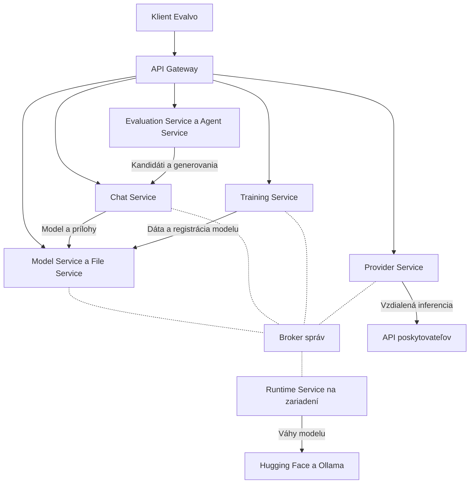

# Evalvo

Evalvo je návrh platformy na výber jazykového modelu pre konkrétnu úlohu. Umožňuje stiahnuť kompatibilný lokálny model, prispôsobiť ho vlastnými dátami alebo pripojiť API model. Používateľ môže modely vyskúšať v konverzácii a porovnať kvalitu odpovedí, spotrebu tokenov a dostupné náklady na vlastných vstupoch.

Repozitár obsahuje funkčné požiadavky, návrh kontraktov API a mikroservisnú architektúru rozdelenú do troch zadaní.

## Zadania

| Zadanie | Obsah |
| --- | --- |
| [Zadanie 1 – Modely, fine-tuning a používanie](Zadanie%201%20-%20Modely%2C%20FineTuning%2C%20Pou%C5%BE%C3%ADvanie/README.md) | Stiahnutie, správa knižnice, fine-tuning, pripojenie poskytovateľov a konverzácie. |
| [Zadanie 2 – Modely, používanie a evaluácia jednej úlohy](Zadanie%202%20-%20Modely%2C%20Pou%C5%BE%C3%ADvanie%2C%20Evalu%C3%A1cia%20%C3%BAlohy/README.md) | Stiahnuté základné modely, konverzácie a testovanie jednej úlohy proti očakávaným výstupom. |
| [Zadanie 3 – Modely, používanie a evaluácia agentov](Zadanie%203%20-%20Modely%2C%20Pou%C5%BE%C3%ADvanie%2C%20Evalu%C3%A1cia%20agentov/README.md) | Stiahnuté základné modely, konverzácie a porovnanie kombinácií modelov a agentov. |

Každé zadanie má vlastné README, funkčné požiadavky s akceptačnými kritériami, high-level diagram, prehľad endpointov a API kontrakty s príkladmi a sekvenčnými diagramami.

## Funkčné požiadavky

| Oblasť | ID | Rozsah |
| --- | --- | --- |
| Stiahnutie a správa LLM modelov | FR-001 až FR-004 | Výber zdroja a variantu, kontrola kompatibility, stiahnutie a odstránenie. |
| Fine-tuning LLM modelov | FR-005 až FR-012 | Parametre tréningu, textové a obrazové dáta, priebeh, zastavenie a uloženie výsledku. |
| Pripojenie API poskytovateľov | FR-013 až FR-016 | Pripojenie účtu, výber modelu a podporovaných nastavení, nástroje a cenník. |
| Používanie LLM modelov | FR-017 až FR-025 | Generovanie, konverzácie, história, obrázky, výsledky, chyby a spotreba. |
| Evaluácia podľa úlohy | FR-026 až FR-033 | Rovnaké testovacie vstupy, očakávané výsledky, CSV, behy a porovnanie. FR-032 pokrýva agentové zadanie. |
| Evaluácia agentových prístupov | FR-034 až FR-041 | Uložené inštrukcie, oddelené konverzácie kandidátov, preferencie a spotreba. |

## Oblasti API

Verejné API používa prefix `/api/v1` a má 64 unikátnych endpointov. Súbory sú spoločnou službou pre tréningové dáta, obrázky a CSV. Dlhšie operácie vracajú `202` a stav sa číta cez príslušné `GET`.

| Oblasť API | Hlavné zdroje | Vlastník | Endpointy |
| --- | --- | --- | --- |
| Stiahnutie a správa LLM modelov | `/hardware`, `/model-catalog`, `/model-downloads`, `/models` | Model Service | 10 |
| Fine-tuning LLM modelov | `/fine-tuning/jobs`; spoločné `/files` | Training Service, File Service | 10 |
| Pripojenie API poskytovateľov | `/providers`, `/provider-connections`, `/models/{model_id}/pricing` | Provider Service | 9 |
| Konverzácie a používanie modelov | `/conversations`, `/generations` | Chat Service | 8 |
| Evaluácia podľa úlohy | `/evaluations`, `/evaluation-runs` | Evaluation Service | 15 |
| Agenti a porovnávanie prístupov | `/agents`, `/comparisons` | Agent Service, Evaluation Service | 12 |

## High-level architektúra

API Gateway smeruje požiadavky do doménových služieb. Služby vlastnia svoje dáta a komunikujú cez HTTP rozhrania alebo broker správ. Runtime Service vykonáva sťahovanie, lokálnu inferenciu a podľa rozsahu aj tréning na zariadení s modelovými váhami. Provider Service zabezpečuje vzdialené volania a spravuje prihlasovacie údaje poskytovateľov. Druhé a tretie zadanie používajú základné lokálne modely bez tréningu.

Plné šípky zobrazujú priame volania. Prerušované spojenia označujú príkazy a udalosti cez broker. Diagramy v jednotlivých zadaniach uvádzajú konkrétnych volajúcich a vlastníkov úložísk.
