# API kontrakty – Zadanie 1

[Späť na zadanie](README.md) · [Zoznam endpointov](ENDPOINTY.md) · [Architektúra](ARCHITEKTURA.md)

Návrh 37 verejných kontraktov pre toto zadanie. Príklady používajú syntetické identifikátory, vstupy a ceny. Čísla endpointov zodpovedajú spoločnému návrhu Evalva.

## Spoločné konvencie

- Základ verejných trás je `/api/v1`. Hlavička `Authorization: Bearer EVALVO_ACCESS_TOKEN` používa zástupný token. Pri každom zdroji sa overujú oprávnenia.
- `GET` a `DELETE` používajú parametre cesty a query. Ich dokumentačný JSON slúži ako prehľad parametrov. `POST`, `PUT` a `PATCH` používajú `application/json`, okrem uploadu s `multipart/form-data`.
- `201` označuje vytvorený zdroj. `202` potvrdzuje prijatie dlhšej operácie a obsahuje identifikátor a `status_url`. Pri čítaní už prijatej úlohy vracia `200` aktuálny stav vrátane prípadnej doménovej chyby.
- Pre opakované čítanie kolekcií sa používa `cursor` z `next_cursor` a `limit` od 1 do 100, predvolene 20.
- Pri spustení asynchrónnej práce sa používa `Idempotency-Key`. Kľúč je viazaný na identitu a operáciu aspoň 24 hodín. Opakované rovnaké volanie vráti pôvodné ID. Iný obsah pod tým istým kľúčom vráti `409 IDEMPOTENCY_CONFLICT`.
- Časy sú v UTC, veľkosti v bajtoch a tokeny ako celé čísla. Cena je desatinný reťazec s menou. Pri neznámom náklade má `amount` hodnotu `null` a `status` je `unknown`.

Tento tok používa konverzácie bez agentového profilu. V zdieľanej schéme môžu zostať jeho nepovinné polia a spoločné chybové kódy.

### Spoločný formát chyby

Pri neplatnej identite sa vracia `401`, pri chýbajúcom oprávnení `403` alebo podľa viditeľnosti zdroja `404`. Doménové chyby sú uvedené pri jednotlivých endpointoch.

```json
{
  "error": {
    "code": "VALIDATION_ERROR",
    "message": "Požiadavka obsahuje neplatnú hodnotu.",
    "details": {
      "fields": [
        {
          "field": "parameters.epochs",
          "reason": "Hodnota musí byť kladné celé číslo."
        }
      ]
    },
    "request_id": "req_demo_01",
    "retryable": false
  }
}
```

## Stiahnutie a správa LLM modelov

### 01 Zistenie hardvéru

**GET `/api/v1/hardware`**

Zistiť výpočtové zdroje zariadenia, na ktorom sa majú lokálne modely spúšťať.

**Parametre cesty a query — nie HTTP body**

```json
{
  "query": {
    "device_id": "device_01"
  }
}
```

**Sekvenčný diagram**

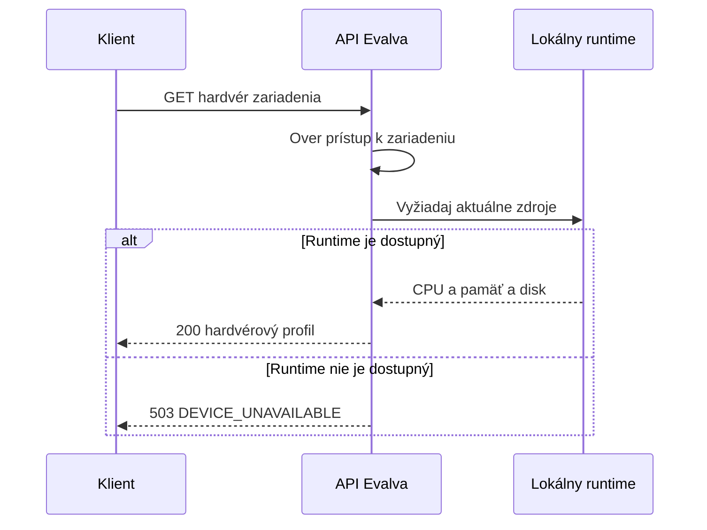

**JSON výstupu — HTTP 200**

```json
{
  "device_id": "device_01",
  "cpu": {
    "logical_cores": 8
  },
  "ram": {
    "total_bytes": 34359738368,
    "available_bytes": 25769803776
  },
  "gpus": [
    {
      "name": "Demo GPU",
      "vram_total_bytes": 17179869184,
      "vram_available_bytes": 12884901888
    }
  ],
  "disk_available_bytes": 128849018880,
  "captured_at": "2026-11-17T18:00:00Z"
}
```

**Chybové stavy:** `404 DEVICE_NOT_FOUND`; `503 DEVICE_UNAVAILABLE`.

### 02 Vyhľadanie modelov v katalógu

**GET `/api/v1/model-catalog`**

Vyhľadať modely z Hugging Face a Ollama a filtrovať ich podľa zdroja, kompresie a vhodnosti pre zariadenie.

**Parametre cesty a query — nie HTTP body**

```json
{
  "query": {
    "source": "huggingface",
    "search": "demo",
    "compatible_with": "device_01",
    "limit": 20
  }
}
```

**Sekvenčný diagram**

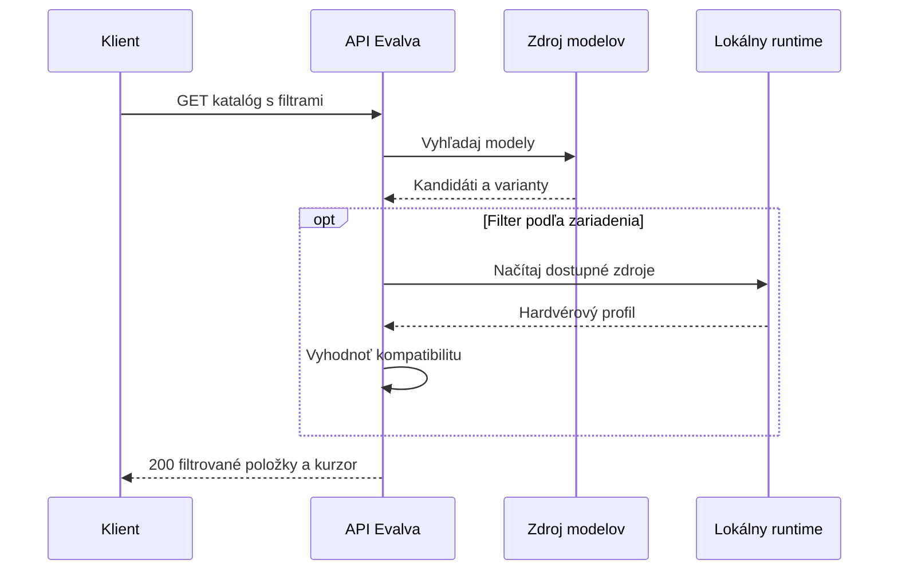

**JSON výstupu — HTTP 200**

```json
{
  "items": [
    {
      "catalog_model_id": "cat_demo_3b",
      "name": "Evalvo Demo 3B",
      "source": "huggingface",
      "source_model_id": "demo/evalvo-3b",
      "modalities": [
        "text"
      ],
      "compatibility": "compatible"
    }
  ],
  "next_cursor": null
}
```

**Chybové stavy:** `422 INVALID_QUERY`; `503 MODEL_SOURCE_UNAVAILABLE`.

Parameter source prijíma huggingface alebo ollama. Filter výkonu vychádza zo zvoleného lokálneho zariadenia.

### 03 Detail katalógového modelu

**GET `/api/v1/model-catalog/{catalog_model_id}`**

Zobraziť detail modelu dostupného na stiahnutie.

**Parametre cesty a query — nie HTTP body**

```json
{
  "path": {
    "catalog_model_id": "cat_demo_3b"
  }
}
```

**Sekvenčný diagram**

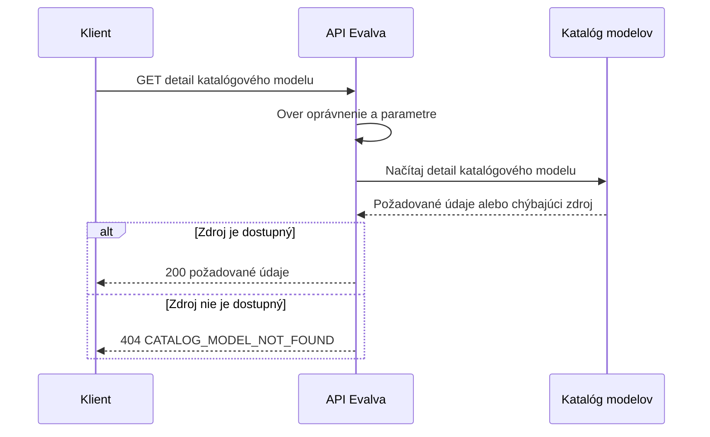

**JSON výstupu — HTTP 200**

```json
{
  "catalog_model_id": "cat_demo_3b",
  "name": "Evalvo Demo 3B",
  "source": "huggingface",
  "source_model_id": "demo/evalvo-3b",
  "modalities": [
    "text"
  ],
  "variant_ids": [
    "var_demo_q4",
    "var_demo_bf16"
  ]
}
```

**Chybové stavy:** `404 CATALOG_MODEL_NOT_FOUND`.

### 04 Varianty kompresie

**GET `/api/v1/model-catalog/{catalog_model_id}/variants`**

Zobraziť dostupné varianty kompresie vybraného modelu.

**Parametre cesty a query — nie HTTP body**

```json
{
  "path": {
    "catalog_model_id": "cat_demo_3b"
  }
}
```

**Sekvenčný diagram**

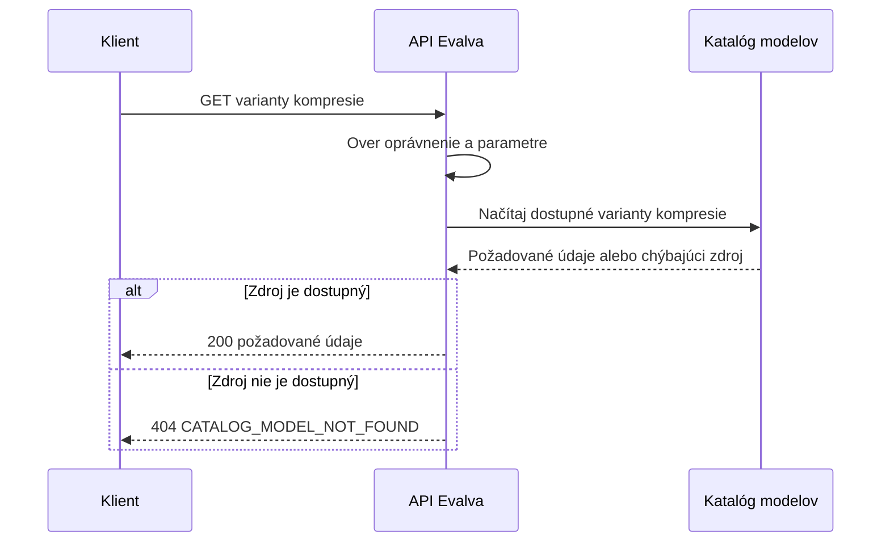

**JSON výstupu — HTTP 200**

```json
{
  "items": [
    {
      "variant_id": "var_demo_q4",
      "compression": "Q4_K_M",
      "format": "gguf",
      "size_bytes": 2147483648,
      "supports_fine_tuning": false
    },
    {
      "variant_id": "var_demo_bf16",
      "compression": "BF16",
      "format": "safetensors",
      "size_bytes": 6442450944,
      "supports_fine_tuning": true
    }
  ],
  "next_cursor": null
}
```

**Chybové stavy:** `404 CATALOG_MODEL_NOT_FOUND`.

### 05 Kompatibilita variantu

**GET `/api/v1/model-catalog/{catalog_model_id}/variants/{variant_id}/compatibility`**

Overiť vhodnosť variantu pre zariadenie a vrátiť dôvod prípadného blokovania.

**Parametre cesty a query — nie HTTP body**

```json
{
  "path": {
    "catalog_model_id": "cat_demo_3b",
    "variant_id": "var_demo_q4"
  },
  "query": {
    "device_id": "device_01",
    "context_length": 4096,
    "parallel_requests": 1
  }
}
```

**Sekvenčný diagram**

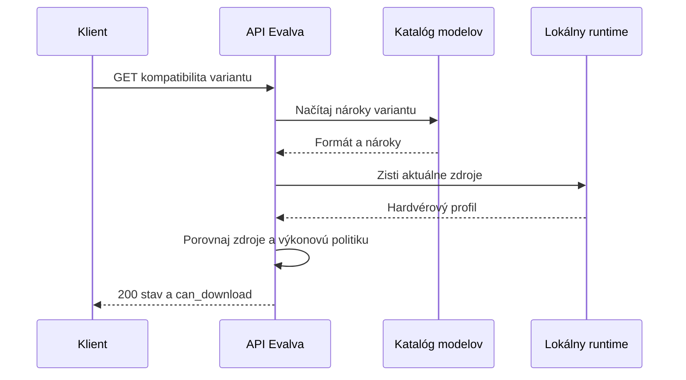

**JSON výstupu — HTTP 200**

```json
{
  "catalog_model_id": "cat_demo_3b",
  "variant_id": "var_demo_q4",
  "device_id": "device_01",
  "status": "compatible",
  "can_download": true,
  "checks": {
    "runtime": "passed",
    "memory": "passed",
    "disk": "passed",
    "performance": "passed"
  },
  "estimates": {
    "required_vram_bytes": 3221225472,
    "tokens_per_second": 25,
    "is_estimate": true
  },
  "reasons": []
}
```

**Chybové stavy:** `404 MODEL_VARIANT_NOT_FOUND`; `503 DEVICE_UNAVAILABLE`.

status má hodnoty compatible, incompatible alebo unknown. can_download je true iba pri compatible. Výkonové odhady a prah plynulosti vychádzajú z politiky konkrétneho runtime; uvedené čísla sú syntetický príklad. POST model-downloads kontrolu zopakuje.

### 06 Spustenie sťahovania

**POST `/api/v1/model-downloads`**

Spustiť sťahovanie zvoleného modelu a variantu. Pred začatím vynútiť kontrolu výkonu zariadenia a nevhodný model zablokovať.

**JSON vstupu — application/json**

```json
{
  "catalog_model_id": "cat_demo_3b",
  "variant_id": "var_demo_q4",
  "device_id": "device_01",
  "context_length": 4096,
  "parallel_requests": 1
}
```

**Sekvenčný diagram**

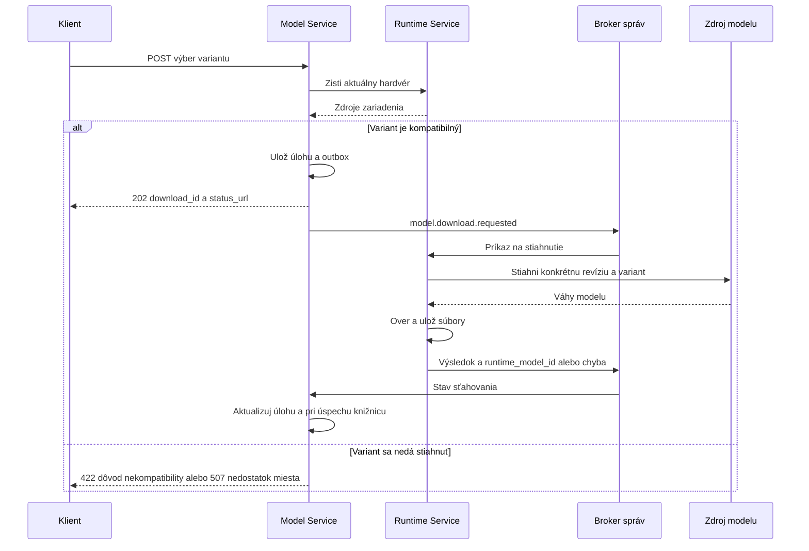

**JSON výstupu — HTTP 202**

```json
{
  "download_id": "dl_01",
  "status": "queued",
  "progress": {
    "downloaded_bytes": 0,
    "total_bytes": 2147483648
  },
  "model_id": null,
  "status_url": "/api/v1/model-downloads/dl_01"
}
```

**Chybové stavy:** `422 MODEL_INCOMPATIBLE`; `422 PERFORMANCE_NOT_VERIFIED`; `507 INSUFFICIENT_STORAGE`.

### 07 Stav sťahovania

**GET `/api/v1/model-downloads/{download_id}`**

Zobraziť stav a priebeh sťahovania; po dokončení vrátiť odkaz na model v knižnici alebo chybu.

**Parametre cesty a query — nie HTTP body**

```json
{
  "path": {
    "download_id": "dl_01"
  }
}
```

**Sekvenčný diagram**

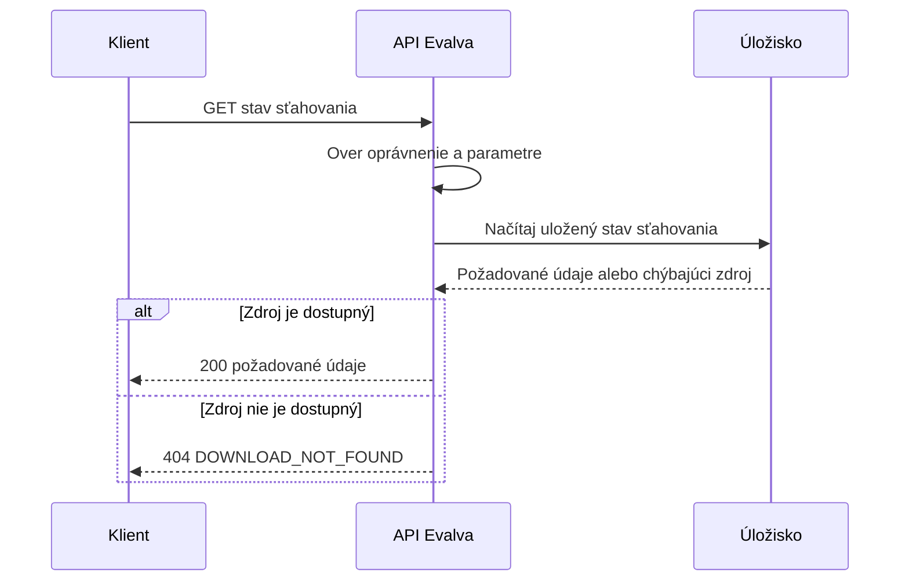

**JSON výstupu — HTTP 200**

```json
{
  "download_id": "dl_01",
  "status": "completed",
  "progress": {
    "downloaded_bytes": 2147483648,
    "total_bytes": 2147483648
  },
  "model_id": "mdl_local_01",
  "error": null
}
```

**Chybové stavy:** `404 DOWNLOAD_NOT_FOUND`.

Počas spracovania je model_id null. Pri failed obsahuje error konkrétny dôvod; čítanie stavu sťahovanie znovu nespustí.

### 08 Knižnica modelov

**GET `/api/v1/models`**

Zobraziť knižnicu modelov dostupných v Evalve vrátane stiahnutých, fine-tunovaných a pripojených API modelov.

**Parametre cesty a query — nie HTTP body**

```json
{
  "query": {
    "limit": 20
  }
}
```

**Sekvenčný diagram**

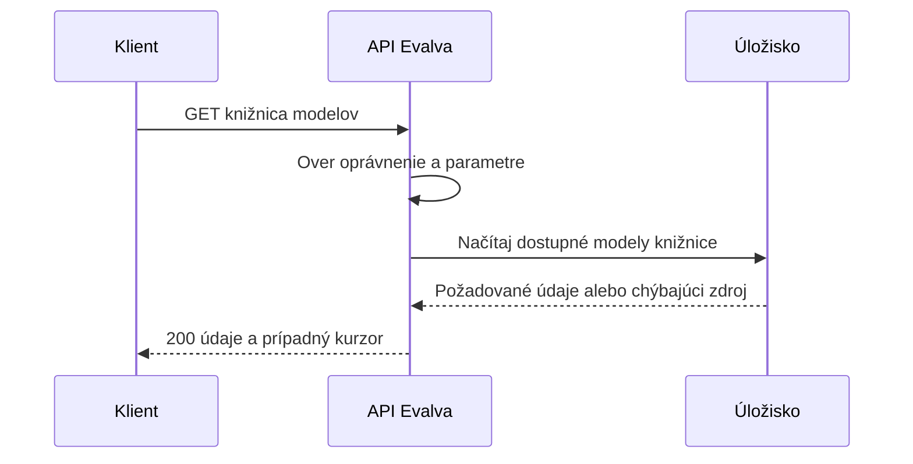

**JSON výstupu — HTTP 200**

```json
{
  "items": [
    {
      "model_id": "mdl_local_01",
      "name": "Evalvo Demo 3B Q4",
      "kind": "local",
      "status": "ready"
    },
    {
      "model_id": "mdl_train_base",
      "name": "Evalvo Demo 3B Train",
      "kind": "local",
      "status": "ready"
    },
    {
      "model_id": "mdl_api_demo",
      "name": "API Demo Model",
      "kind": "api",
      "connection_id": "conn_01",
      "status": "ready"
    },
    {
      "model_id": "mdl_ft_01",
      "name": "Evalvo Demo 3B FT",
      "kind": "fine_tuned",
      "base_model_id": "mdl_train_base",
      "status": "ready"
    },
    {
      "model_id": "mdl_vlm_train_base",
      "name": "Evalvo Demo Vision Train",
      "kind": "local",
      "status": "ready"
    }
  ],
  "next_cursor": null
}
```

**Chybové stavy:** `422 INVALID_QUERY`.

### 09 Detail modelu knižnice

**GET `/api/v1/models/{model_id}`**

Zobraziť detail modelu z knižnice a jeho podporované možnosti používania a fine-tuningu.

**Parametre cesty a query — nie HTTP body**

```json
{
  "path": {
    "model_id": "mdl_train_base"
  }
}
```

**Sekvenčný diagram**

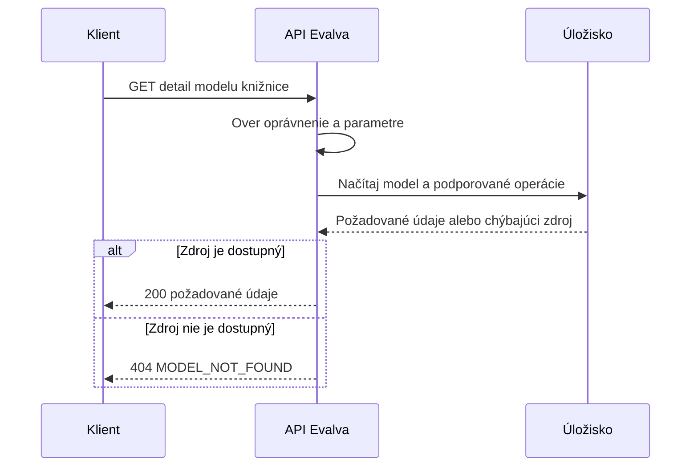

**JSON výstupu — HTTP 200**

```json
{
  "model_id": "mdl_train_base",
  "name": "Evalvo Demo 3B Train",
  "kind": "local",
  "status": "ready",
  "format": "safetensors",
  "device_id": "device_01",
  "capabilities": {
    "text": true,
    "images": false,
    "tools": false,
    "fine_tuning": true
  },
  "fine_tuning": {
    "methods": [
      "qlora"
    ],
    "parameters": [
      "epochs",
      "learning_rate",
      "batch_size",
      "max_sequence_length",
      "seed",
      "lora_rank"
    ]
  }
}
```

**Chybové stavy:** `404 MODEL_NOT_FOUND`.

### 10 Odstránenie lokálneho modelu

**DELETE `/api/v1/models/{model_id}`**

Odstrániť stiahnutý alebo fine-tunovaný lokálny model z knižnice a úložiska.

**Parametre cesty a query — nie HTTP body**

```json
{
  "path": {
    "model_id": "mdl_local_01"
  }
}
```

**Sekvenčný diagram**

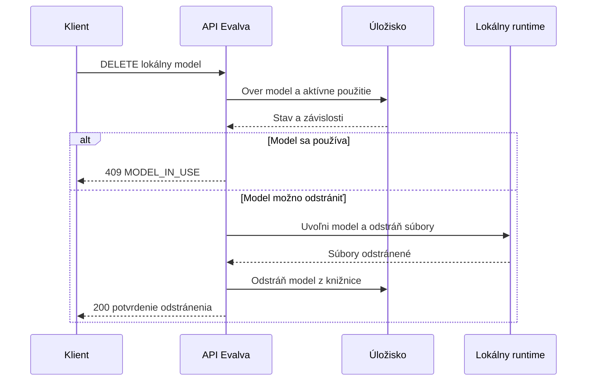

**JSON výstupu — HTTP 200**

```json
{
  "model_id": "mdl_local_01",
  "deleted": true,
  "released_bytes": 2147483648
}
```

**Chybové stavy:** `404 MODEL_NOT_FOUND`; `409 MODEL_IN_USE`; `422 MODEL_NOT_LOCAL`.

API model sa týmto endpointom neodstraňuje u poskytovateľa. Lokálny variant používaný aktívnym tréningom alebo generovaním sa odmietne.

## Súbory

### 11 Nahratie súboru

**POST `/api/v1/files`**

Nahrať tréningový JSON alebo obrázok a získať `file_id`.

**Formát vstupu: `multipart/form-data`.** Pole `file` obsahuje binárne dáta a pole `purpose` hodnotu `training` alebo `image`. Nasledujúce JSON ukážky predstavujú samotný obsah tréningových súborov.

**Obsah training.json pre textový tréning**

```json
{
  "examples": [
    {
      "messages": [
        {
          "role": "user",
          "content": [
            {
              "type": "text",
              "text": "Koľko je dva plus dva?"
            }
          ]
        },
        {
          "role": "assistant",
          "content": [
            {
              "type": "text",
              "text": "4"
            }
          ]
        }
      ]
    }
  ]
}
```

**Obsah vision-training.json pre multimodálny tréning**

```json
{
  "examples": [
    {
      "messages": [
        {
          "role": "user",
          "content": [
            {
              "type": "text",
              "text": "Opíš obsah obrázka."
            },
            {
              "type": "image",
              "file_id": "file_image_01"
            }
          ]
        },
        {
          "role": "assistant",
          "content": [
            {
              "type": "text",
              "text": "Na obrázku je červené auto."
            }
          ]
        }
      ]
    }
  ]
}
```

**Sekvenčný diagram**

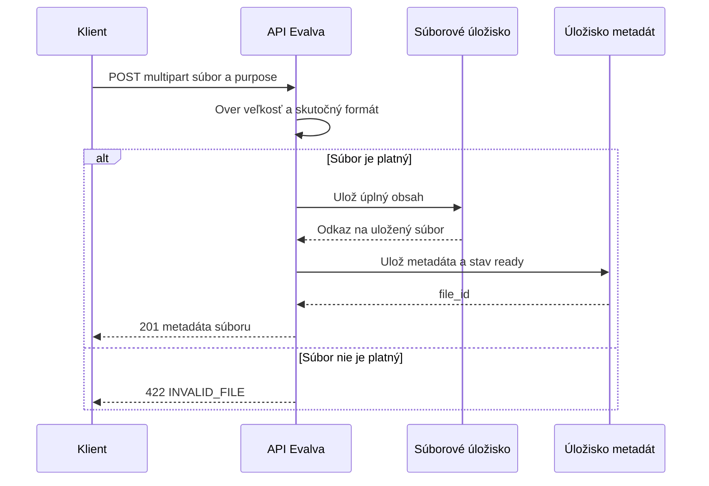

**JSON výstupu — HTTP 201**

```json
{
  "file_id": "file_train_json",
  "filename": "training.json",
  "purpose": "training",
  "media_type": "application/json",
  "size_bytes": 421,
  "status": "ready"
}
```

**Chybové stavy:** `413 FILE_TOO_LARGE`; `415 UNSUPPORTED_MEDIA_TYPE`; `422 INVALID_FILE`.

Obrázky sa najprv nahrajú s `purpose=image`. Tréningový JSON potom použije ich `file_id`. Obrázkové prílohy konverzácií využívajú rovnaký upload.

### 12 Načítanie obsahu súboru

**GET `/api/v1/files/{file_id}/content`**

Načítať obsah nahratého súboru alebo zobraziť uložený obrázok.

**Parametre cesty a query — nie HTTP body**

```json
{
  "path": {
    "file_id": "file_image_01"
  }
}
```

**Sekvenčný diagram**

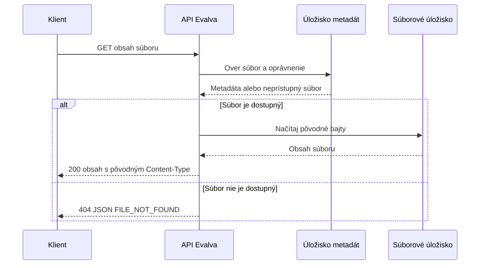

**Úspešný výstup — HTTP 200**

`Content-Type: image/jpeg`; `Content-Disposition: inline; filename="image.jpg"`. Úspešná odpoveď obsahuje pôvodné bajty súboru. Pri JPG ide o obrázok; pri tréningovom JSON ide o pôvodný JSON súbor. Nasledujúca ukážka JSON je chybová odpoveď pre neexistujúce file_id.

**JSON chyby — HTTP 404**

```json
{
  "error": {
    "code": "FILE_NOT_FOUND",
    "message": "Súbor neexistuje alebo k nemu nie je prístup.",
    "details": {
      "file_id": "file_image_01"
    },
    "request_id": "req_demo_12",
    "retryable": false
  }
}
```

**Chybové stavy:** `404 FILE_NOT_FOUND`.

## Fine-tuning LLM modelov

### 13 Príprava tréningu

**POST `/api/v1/fine-tuning/jobs`**

Vytvoriť pripravený tréning so zvoleným stiahnutým modelom, tréningovými súbormi a parametrami.

**JSON vstupu — application/json**

```json
{
  "model_id": "mdl_train_base",
  "device_id": "device_01",
  "training_file_id": "file_train_json",
  "method": "qlora",
  "parameters": {
    "epochs": 3,
    "learning_rate": 0.0002,
    "batch_size": 1,
    "max_sequence_length": 512,
    "seed": 42,
    "lora_rank": 8
  }
}
```

**Alternatívny vstup pre obrazový tréning**

```json
{
  "model_id": "mdl_vlm_train_base",
  "device_id": "device_01",
  "training_file_id": "file_train_vision",
  "method": "qlora",
  "parameters": {
    "epochs": 3,
    "learning_rate": 0.0002,
    "batch_size": 1,
    "max_sequence_length": 512,
    "seed": 42,
    "lora_rank": 8
  }
}
```

**Sekvenčný diagram**

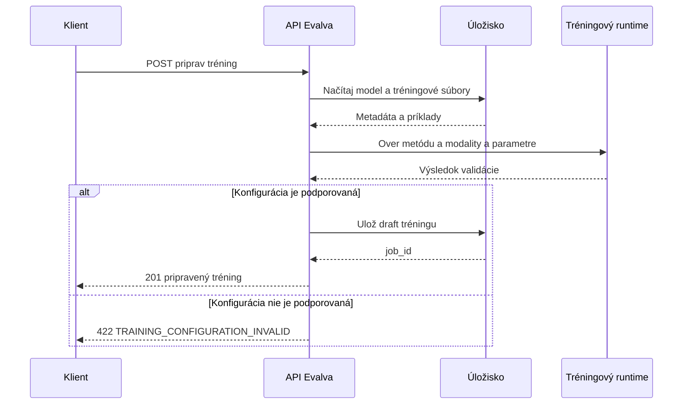

**JSON výstupu — HTTP 201**

```json
{
  "job_id": "ft_job_01",
  "status": "draft",
  "model_id": "mdl_train_base",
  "device_id": "device_01",
  "training_file_id": "file_train_json",
  "method": "qlora",
  "parameters": {
    "epochs": 3,
    "learning_rate": 0.0002,
    "batch_size": 1,
    "max_sequence_length": 512,
    "seed": 42,
    "lora_rank": 8
  },
  "result_model_id": null
}
```

**Chybové stavy:** `404 MODEL_OR_FILE_NOT_FOUND`; `422 TRAINING_CONFIGURATION_INVALID`; `422 TRAINING_DATA_INVALID`.

### 14 Zoznam tréningov

**GET `/api/v1/fine-tuning/jobs`**

Zobraziť zoznam pripravených, bežiacich a ukončených tréningov.

**Parametre cesty a query — nie HTTP body**

```json
{
  "query": {
    "limit": 20
  }
}
```

**Sekvenčný diagram**


**JSON výstupu — HTTP 200**

```json
{
  "items": [
    {
      "job_id": "ft_job_01",
      "model_id": "mdl_train_base",
      "status": "draft",
      "result_model_id": null
    }
  ],
  "next_cursor": null
}
```

**Chybové stavy:** `422 INVALID_QUERY`.

### 15 Stav tréningu

**GET `/api/v1/fine-tuning/jobs/{job_id}`**

Zobraziť konfiguráciu, aktuálny stav a priebeh konkrétneho tréningu.

**Parametre cesty a query — nie HTTP body**

```json
{
  "path": {
    "job_id": "ft_job_01"
  }
}
```

**Sekvenčný diagram**

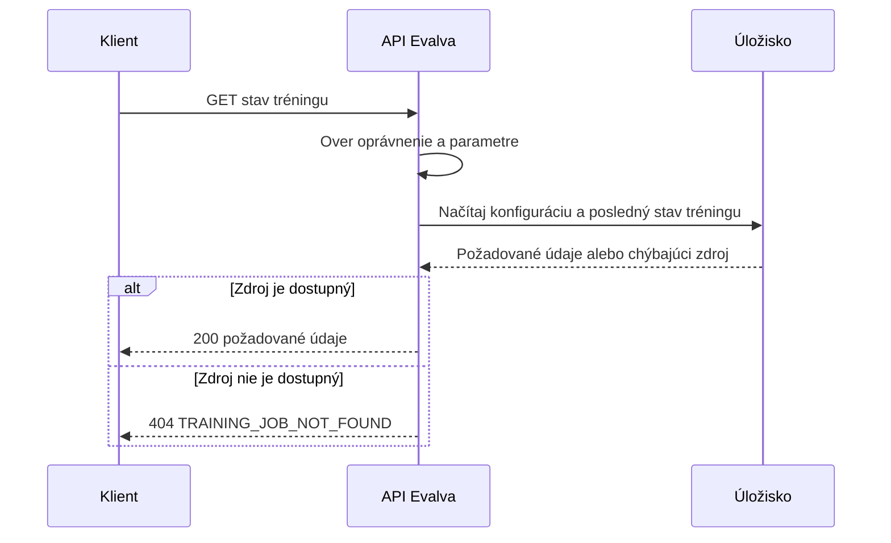

**JSON výstupu — HTTP 200**

```json
{
  "job_id": "ft_job_01",
  "status": "running",
  "model_id": "mdl_train_base",
  "device_id": "device_01",
  "training_file_id": "file_train_json",
  "method": "qlora",
  "parameters": {
    "epochs": 3,
    "learning_rate": 0.0001,
    "batch_size": 1,
    "max_sequence_length": 512,
    "seed": 42,
    "lora_rank": 8
  },
  "progress": {
    "completed_steps": 1,
    "total_steps": 3,
    "current_epoch": 1
  },
  "result_model_id": null,
  "error": null
}
```

**Chybové stavy:** `404 TRAINING_JOB_NOT_FOUND`.

GET iba číta uložený stav. Tréning neštartuje a nevyvoláva nový výpočet.

### 16 Úprava parametrov tréningu

**PATCH `/api/v1/fine-tuning/jobs/{job_id}`**

Upraviť podporované parametre tréningu pred jeho spustením.

**Parametre cesty a query — nie HTTP body**

```json
{
  "path": {
    "job_id": "ft_job_01"
  }
}
```

**JSON vstupu — application/json**

```json
{
  "parameters": {
    "learning_rate": 0.0001
  }
}
```

**Sekvenčný diagram**

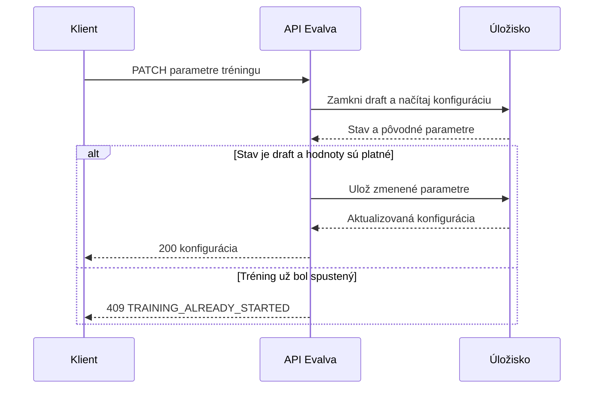

**JSON výstupu — HTTP 200**

```json
{
  "job_id": "ft_job_01",
  "status": "draft",
  "parameters": {
    "epochs": 3,
    "learning_rate": 0.0001,
    "batch_size": 1,
    "max_sequence_length": 512,
    "seed": 42,
    "lora_rank": 8
  }
}
```

**Chybové stavy:** `404 TRAINING_JOB_NOT_FOUND`; `409 TRAINING_ALREADY_STARTED`; `422 INVALID_TRAINING_PARAMETER`.

PATCH mení len uvedené parametre. Zmeny po spustení sa odmietnu; konfigurácia vykonávaného tréningu zostáva pevná.

### 17 Spustenie tréningu

**POST `/api/v1/fine-tuning/jobs/{job_id}/start`**

Spustiť pripravený tréning. Po úspešnom dokončení sa výsledný model automaticky zaradí do knižnice.

**Parametre cesty a query — nie HTTP body**

```json
{
  "path": {
    "job_id": "ft_job_01"
  }
}
```

**JSON vstupu — application/json**

```json
{}
```

**Sekvenčný diagram**

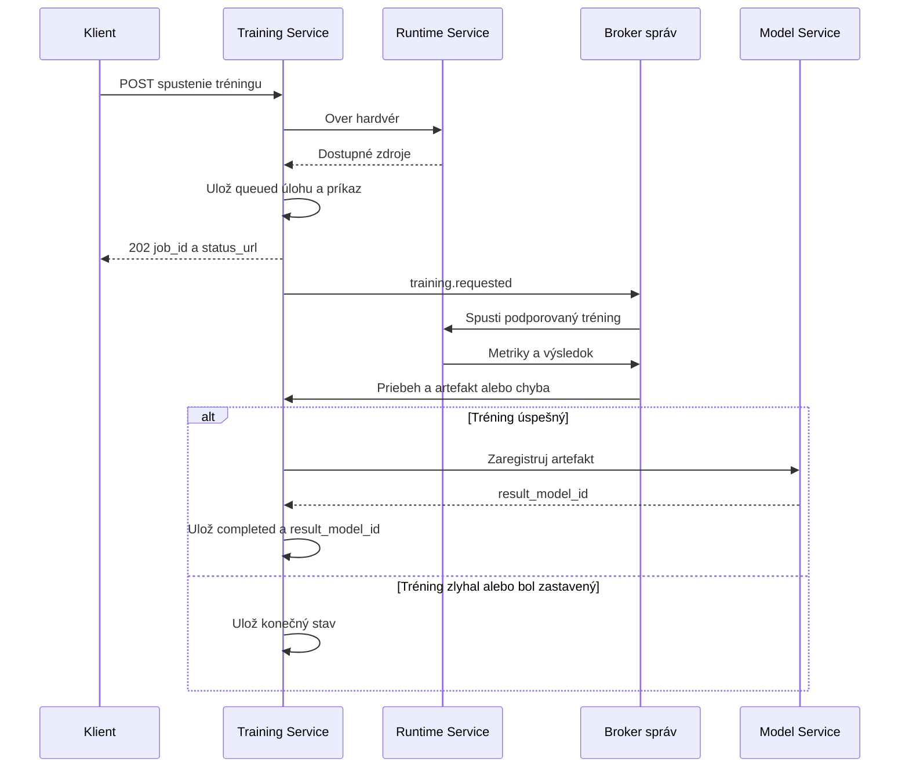

**JSON výstupu — HTTP 202**

```json
{
  "job_id": "ft_job_01",
  "status": "queued",
  "status_url": "/api/v1/fine-tuning/jobs/ft_job_01"
}
```

**Chybové stavy:** `404 TRAINING_JOB_NOT_FOUND`; `409 TRAINING_NOT_DRAFT`; `422 TRAINING_CONFIGURATION_INVALID`; `503 DEVICE_UNAVAILABLE`.

Start je povolený iba pre draft. Úspešný artefakt sa uloží automaticky; samostatné volanie na pridanie do knižnice nie je potrebné.

### 18 Zastavenie tréningu

**POST `/api/v1/fine-tuning/jobs/{job_id}/cancel`**

Zastaviť bežiaci tréning alebo zrušiť tréning čakajúci na spustenie.

**Parametre cesty a query — nie HTTP body**

```json
{
  "path": {
    "job_id": "ft_job_01"
  }
}
```

**JSON vstupu — application/json**

```json
{}
```

**Sekvenčný diagram**

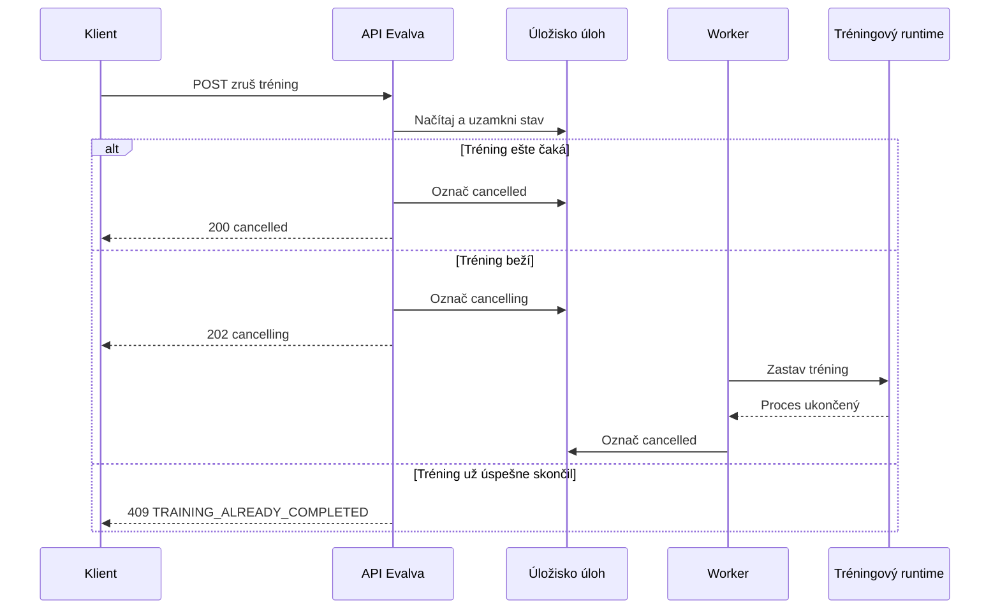

**JSON výstupu — HTTP 202**

```json
{
  "job_id": "ft_job_01",
  "status": "cancelling",
  "status_url": "/api/v1/fine-tuning/jobs/ft_job_01"
}
```

**Okamžite zrušený čakajúci tréning — HTTP 200**

```json
{
  "job_id": "ft_job_01",
  "status": "cancelled",
  "result_model_id": null
}
```

**Chybové stavy:** `404 TRAINING_JOB_NOT_FOUND`; `409 TRAINING_ALREADY_COMPLETED`.

202 nepotvrdzuje dokončené zastavenie. Klient sleduje stav cez GET úlohy; zrušený alebo neúplný artefakt sa nezaradí ako úspešný model.

### 19 Priebežné metriky tréningu

**GET `/api/v1/fine-tuning/jobs/{job_id}/metrics`**

Zobraziť priebežne zaznamenané výsledky a metriky tréningu.

**Parametre cesty a query — nie HTTP body**

```json
{
  "path": {
    "job_id": "ft_job_01"
  },
  "query": {
    "after_step": 0,
    "limit": 100
  }
}
```

**Sekvenčný diagram**

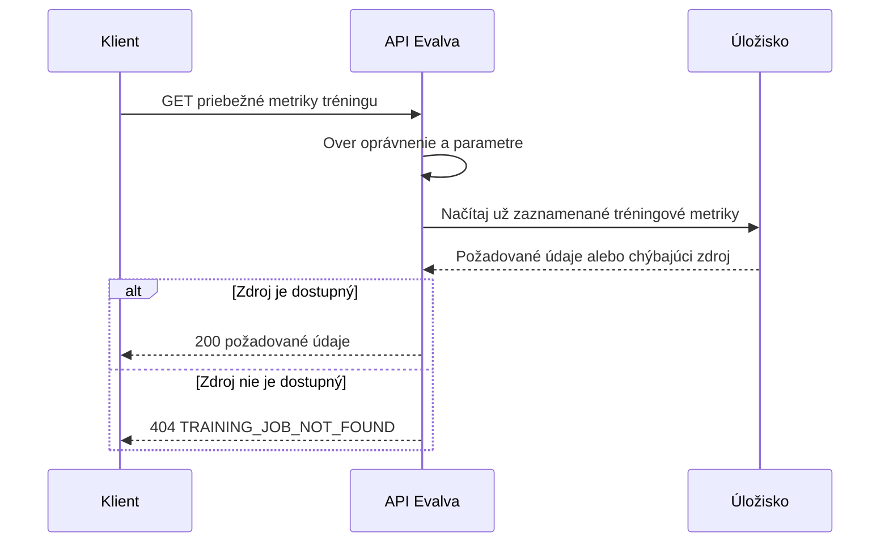

**JSON výstupu — HTTP 200**

```json
{
  "job_id": "ft_job_01",
  "items": [
    {
      "step": 1,
      "epoch": 1,
      "training_loss": 1.2,
      "validation_loss": null,
      "recorded_at": "2026-11-17T18:01:00Z"
    }
  ],
  "next_cursor": null
}
```

**Chybové stavy:** `404 TRAINING_JOB_NOT_FOUND`; `422 INVALID_QUERY`.

### 20 Výsledok tréningu

**GET `/api/v1/fine-tuning/jobs/{job_id}/result`**

Zobraziť záverečný výsledok tréningu a odkaz na vytvorený model v knižnici alebo chybu tréningu.

**Parametre cesty a query — nie HTTP body**

```json
{
  "path": {
    "job_id": "ft_job_01"
  }
}
```

**Sekvenčný diagram**

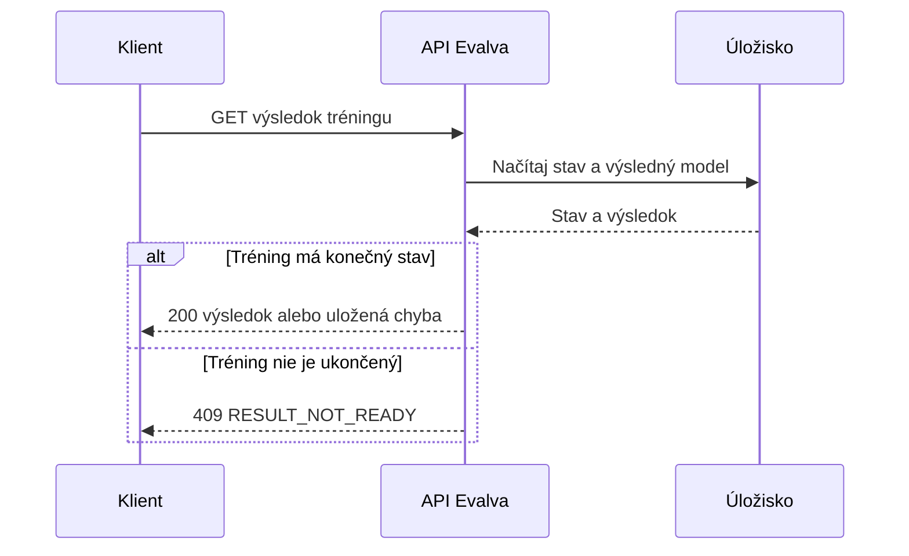

**JSON výstupu — HTTP 200**

```json
{
  "job_id": "ft_job_01",
  "status": "completed",
  "result": {
    "model_id": "mdl_ft_01",
    "base_model_id": "mdl_train_base",
    "format": "lora_adapter",
    "model_url": "/api/v1/models/mdl_ft_01"
  },
  "summary": {
    "completed_steps": 3,
    "epochs": 3,
    "final_training_loss": 0.9,
    "final_validation_loss": null
  },
  "error": null
}
```

**Chybové stavy:** `404 TRAINING_JOB_NOT_FOUND`; `409 RESULT_NOT_READY`.

Pri failed alebo cancelled endpoint vráti 200 so skutočným stavom, result=null a prípadnou uloženou chybou. Nedokončený tréning vracia 409.

## Pripojenie API poskytovateľov

### 21 Podporovaní poskytovatelia

**GET `/api/v1/providers`**

Zobraziť podporovaných poskytovateľov, najmä OpenAI a Anthropic pre modely Claude.

**Sekvenčný diagram**

```mermaid
sequenceDiagram
    participant C as Klient
    participant A as API Evalva
    participant D as Register konektorov
    C->>A: GET podporovaní poskytovatelia
    A->>A: Over oprávnenie a parametre
    A->>D: Načítaj podporované konektory
    D-->>A: Požadované údaje alebo chýbajúci zdroj
    A-->>C: 200 údaje a prípadný kurzor
```

**JSON výstupu — HTTP 200**

```json
{
  "items": [
    {
      "provider_id": "openai",
      "name": "OpenAI"
    },
    {
      "provider_id": "anthropic",
      "name": "Anthropic Claude"
    }
  ],
  "next_cursor": null
}
```

### 22 Vytvorenie pripojenia

**POST `/api/v1/provider-connections`**

Vytvoriť pripojenie k poskytovateľovi a uložiť jeho prístupové údaje.

**JSON vstupu — application/json**

```json
{
  "provider_id": "openai",
  "name": "OpenAI pracovné",
  "api_key": "PROVIDER_API_KEY_PLACEHOLDER"
}
```

**Sekvenčný diagram**

```mermaid
sequenceDiagram
    participant C as Klient
    participant A as API Evalva
    participant V as Úložisko tajomstiev
    participant D as Úložisko
    C->>A: POST pripojenie s poverením
    A->>A: Over poskytovateľa a vstup
    A->>V: Ulož zašifrované poverenie
    V-->>A: Interná referencia
    A->>D: Ulož pripojenie bez otvoreného kľúča
    D-->>A: connection_id
    A-->>C: 201 pripojenie bez kľúča
```

**JSON výstupu — HTTP 201**

```json
{
  "connection_id": "conn_01",
  "provider_id": "openai",
  "name": "OpenAI pracovné",
  "status": "unverified",
  "credentials_configured": true
}
```

**Chybové stavy:** `422 PROVIDER_NOT_SUPPORTED`; `422 INVALID_CREDENTIAL_FORMAT`.

api_key je vstupné tajomstvo a nikdy sa nevracia v odpovedi. Vytvorenie pripojenia ešte neznamená úspešný test poskytovateľa.

### 23 Zoznam pripojení

**GET `/api/v1/provider-connections`**

Zobraziť uložené pripojenia k poskytovateľom.

**Parametre cesty a query — nie HTTP body**

```json
{
  "query": {
    "limit": 20
  }
}
```

**Sekvenčný diagram**

```mermaid
sequenceDiagram
    participant C as Klient
    participant A as API Evalva
    participant D as Úložisko
    C->>A: GET zoznam pripojení
    A->>A: Over oprávnenie a parametre
    A->>D: Načítaj dostupné pripojenia bez tajomstiev
    D-->>A: Požadované údaje alebo chýbajúci zdroj
    A-->>C: 200 údaje a prípadný kurzor
```

**JSON výstupu — HTTP 200**

```json
{
  "items": [
    {
      "connection_id": "conn_01",
      "provider_id": "openai",
      "name": "OpenAI pracovné",
      "status": "valid",
      "credentials_configured": true
    }
  ],
  "next_cursor": null
}
```

**Chybové stavy:** `422 INVALID_QUERY`.

### 24 Detail pripojenia

**GET `/api/v1/provider-connections/{connection_id}`**

Zobraziť nastavenia a stav pripojenia s maskovanými prístupovými údajmi.

**Parametre cesty a query — nie HTTP body**

```json
{
  "path": {
    "connection_id": "conn_01"
  }
}
```

**Sekvenčný diagram**

```mermaid
sequenceDiagram
    participant C as Klient
    participant A as API Evalva
    participant D as Úložisko
    C->>A: GET detail pripojenia
    A->>A: Over oprávnenie a parametre
    A->>D: Načítaj nastavenia a posledný stav pripojenia
    D-->>A: Požadované údaje alebo chýbajúci zdroj
    alt Zdroj je dostupný
    A-->>C: 200 požadované údaje
    else Zdroj nie je dostupný
    A-->>C: 404 CONNECTION_NOT_FOUND
    end
```

**JSON výstupu — HTTP 200**

```json
{
  "connection_id": "conn_01",
  "provider_id": "openai",
  "name": "OpenAI pracovné",
  "status": "valid",
  "credentials_configured": true,
  "last_checked_at": "2026-11-17T18:00:00Z"
}
```

**Chybové stavy:** `404 CONNECTION_NOT_FOUND`.

Odpoveď neobsahuje api_key ani internú referenciu na tajomstvo.

### 25 Úprava pripojenia

**PATCH `/api/v1/provider-connections/{connection_id}`**

Aktualizovať nastavenia alebo prístupové údaje existujúceho pripojenia.

**Parametre cesty a query — nie HTTP body**

```json
{
  "path": {
    "connection_id": "conn_01"
  }
}
```

**JSON vstupu — application/json**

```json
{
  "name": "OpenAI nový kľúč",
  "api_key": "PROVIDER_API_KEY_PLACEHOLDER"
}
```

**Sekvenčný diagram**

```mermaid
sequenceDiagram
    participant C as Klient
    participant A as API Evalva
    participant V as Úložisko tajomstiev
    participant D as Úložisko
    C->>A: PATCH názov alebo poverenie
    A->>D: Over pripojenie a oprávnenie
    D-->>A: Existujúce pripojenie
    opt Zmena kľúča
    A->>V: Bezpečne vymeň poverenie
    V-->>A: Nová referencia
    end
    A->>D: Ulož zmeny a zneplatni test pri zmene kľúča
    A-->>C: 200 bezpečný detail
```

**JSON výstupu — HTTP 200**

```json
{
  "connection_id": "conn_01",
  "provider_id": "openai",
  "name": "OpenAI nový kľúč",
  "status": "unverified",
  "credentials_configured": true,
  "last_checked_at": null
}
```

**Chybové stavy:** `404 CONNECTION_NOT_FOUND`; `422 INVALID_CONNECTION_SETTINGS`.

Odosielajú sa iba menené polia. Po zmene kľúča je potrebné pripojenie znovu otestovať; samotná zmena názvu nemení platnosť posledného testu.

### 26 Odstránenie pripojenia

**DELETE `/api/v1/provider-connections/{connection_id}`**

Odstrániť uložené pripojenie poskytovateľa z Evalva.

**Parametre cesty a query — nie HTTP body**

```json
{
  "path": {
    "connection_id": "conn_01"
  }
}
```

**Sekvenčný diagram**

```mermaid
sequenceDiagram
    participant C as Klient
    participant A as API Evalva
    participant D as Úložisko
    participant V as Úložisko tajomstiev
    C->>A: DELETE pripojenie
    A->>D: Over aktívne použitie
    D-->>A: Stav a závislosti
    alt Pripojenie sa aktívne používa
    A-->>C: 409 CONNECTION_IN_USE
    else Pripojenie možno odstrániť
    A->>D: Zablokuj nové použitie pripojenia
    A->>V: Odstráň uložené poverenie
    V-->>A: Potvrdené odstránenie
    A->>D: Odstráň pripojenie
    A-->>C: 200 deleted true
    end
```

**JSON výstupu — HTTP 200**

```json
{
  "connection_id": "conn_01",
  "deleted": true,
  "stored_credentials_deleted": true
}
```

**Chybové stavy:** `404 CONNECTION_NOT_FOUND`; `409 CONNECTION_IN_USE`.

Zruší sa uložené pripojenie v Evalve. Kľúč vydaný poskytovateľom sa týmto volaním u poskytovateľa nerevokuje.

### 27 Test pripojenia

**POST `/api/v1/provider-connections/{connection_id}/test`**

Overiť pripojenie a platnosť prístupových údajov; vrátiť výsledok kontroly alebo chybu.

**Parametre cesty a query — nie HTTP body**

```json
{
  "path": {
    "connection_id": "conn_01"
  }
}
```

**JSON vstupu — application/json**

```json
{}
```

**Sekvenčný diagram**

```mermaid
sequenceDiagram
    participant C as Klient
    participant A as API Evalva
    participant D as Úložisko
    participant P as Poskytovateľ
    C->>A: POST test pripojenia
    A->>D: Načítaj pripojenie a poverenie
    D-->>A: Bezpečný prístup k povereniu
    A->>P: Over dostupnosť bez generovania odpovede
    P-->>A: Výsledok autentifikácie a prístupu
    A->>D: Ulož výsledok kontroly a čas
    A-->>C: 200 valid alebo invalid alebo unavailable
```

**JSON výstupu — HTTP 200**

```json
{
  "connection_id": "conn_01",
  "status": "valid",
  "checked_at": "2026-11-17T18:00:00Z",
  "models_accessible": true,
  "validation_error": null
}
```

**Kontrola dokončená s neplatným poverením — HTTP 200**

```json
{
  "connection_id": "conn_01",
  "status": "invalid",
  "checked_at": "2026-11-17T18:00:00Z",
  "models_accessible": false,
  "validation_error": {
    "code": "UPSTREAM_AUTH_FAILED",
    "message": "Poskytovateľ odmietol poverenie."
  }
}
```

**Chybové stavy:** `404 CONNECTION_NOT_FOUND`; `503 CONNECTOR_UNAVAILABLE`.

HTTP 200 znamená vykonanú kontrolu; úspech pripojenia určuje status. Kontrola nespúšťa platené generovanie. Ak konektor nevie bezpečne overiť prístup, vráti status=unverified a dôvod.

### 28 Modely poskytovateľa

**GET `/api/v1/provider-connections/{connection_id}/models`**

Zobraziť dostupné modely pripojeného poskytovateľa, podporované úrovne premýšľania, obrazové vstupy a nástroje.

**Parametre cesty a query — nie HTTP body**

```json
{
  "path": {
    "connection_id": "conn_01"
  },
  "query": {
    "limit": 20
  }
}
```

**Sekvenčný diagram**

```mermaid
sequenceDiagram
    participant C as Klient
    participant P as Provider Service
    participant V as API poskytovateľa
    participant M as Model Service
    C->>P: GET modely pripojenia
    P->>P: Over pripojenie a načítaj poverenie
    P->>V: Načítaj dostupné modely
    V-->>P: Modely a schopnosti alebo chyba
    P->>P: Normalizuj metadáta
    P->>M: Zaregistruj dostupné API modely
    M-->>P: Kanonické model_id
    P-->>C: 200 dostupné modely
```

**JSON výstupu — HTTP 200**

```json
{
  "items": [
    {
      "model_id": "mdl_api_demo",
      "provider_model_id": "demo-text-model",
      "name": "API Demo Model",
      "capabilities": {
        "text": true,
        "images": true,
        "reasoning_efforts": [
          "low",
          "medium",
          "high"
        ],
        "client_function_tools": true,
        "provider_tools": [
          "web_search"
        ]
      },
      "parameters": {
        "temperature": {
          "min": 0,
          "max": 2
        },
        "max_output_tokens": {
          "min": 1,
          "max": 4096
        }
      }
    }
  ],
  "next_cursor": null
}
```

**Chybové stavy:** `404 CONNECTION_NOT_FOUND`; `422 CONNECTION_NOT_VALID`; `502 PROVIDER_ERROR`.

provider_model_id, schopnosti a rozsahy v ukážke sú syntetické. Skutočný konektor ich overuje pre konkrétny model; nedokumentovaná schopnosť nie je automaticky považovaná za podporovanú.

### 29 Cenník modelu

**GET `/api/v1/models/{model_id}/pricing`**

Zobraziť cenník vybraného API modelu za 1 milión tokenov vrátane meny a príslušných vstupných a výstupných sadzieb.

**Parametre cesty a query — nie HTTP body**

```json
{
  "path": {
    "model_id": "mdl_api_demo"
  }
}
```

**Sekvenčný diagram**

```mermaid
sequenceDiagram
    participant C as Klient
    participant A as API Evalva
    participant D as Cenník Evalva
    C->>A: GET cenník modelu
    A->>A: Over oprávnenie a parametre
    A->>D: Načítaj cenový podklad vybraného modelu
    D-->>A: Požadované údaje alebo chýbajúci zdroj
    alt Zdroj je dostupný
    A-->>C: 200 požadované údaje
    else Zdroj nie je dostupný
    A-->>C: 404 MODEL_NOT_FOUND
    end
```

**JSON výstupu — HTTP 200**

```json
{
  "model_id": "mdl_api_demo",
  "pricing_id": "price_demo_01",
  "currency": "USD",
  "unit_tokens": 1000000,
  "input_price": "2.00000000",
  "output_price": "10.00000000",
  "cached_input_price": null,
  "effective_from": "2026-11-01T00:00:00Z",
  "source": "synthetic_example"
}
```

**Chybové stavy:** `404 MODEL_NOT_FOUND`; `422 MODEL_PRICING_UNAVAILABLE`.

Ceny v ukážke sú testovacie. Endpoint vracia cenový podklad Evalva; nespolieha sa na existenciu osobitného cenového endpointu poskytovateľa. Chýbajúca cena nie je nula.

## Konverzácie a používanie modelov

### 30 Vytvorenie konverzácie

**POST `/api/v1/conversations`**

Vytvoriť konverzáciu s modelom z knižnice.

**JSON vstupu — application/json**

```json
{
  "model_id": "mdl_api_demo",
  "title": "Test matematickej úlohy"
}
```

**Sekvenčný diagram**

```mermaid
sequenceDiagram
    participant C as Klient
    participant A as Chat Service
    participant D as Úložisko
    C->>A: POST vytvor konverzáciu
    A->>D: Over model a priprav konverzáciu
    D-->>A: Dostupné konfigurácie
    A->>D: Ulož prázdnu konverzáciu
    D-->>A: conversation_id
    A-->>C: 201 konverzácia
```

**JSON výstupu — HTTP 201**

```json
{
  "conversation_id": "conv_01",
  "model_id": "mdl_api_demo",
  "agent_id": null,
  "title": "Test matematickej úlohy",
  "message_count": 0,
  "status": "idle",
  "created_at": "2026-11-17T18:00:00Z"
}
```

**Chybové stavy:** `404 MODEL_OR_AGENT_NOT_FOUND`; `422 MODEL_NOT_READY`.

Vytvorenie konverzácie negeneruje odpoveď. Vstup sa odosiela cez POST /api/v1/generations.

### 31 Zoznam konverzácií

**GET `/api/v1/conversations`**

Zobraziť uložené konverzácie.

**Parametre cesty a query — nie HTTP body**

```json
{
  "query": {
    "limit": 20
  }
}
```

**Sekvenčný diagram**

```mermaid
sequenceDiagram
    participant C as Klient
    participant A as API Evalva
    participant D as Úložisko
    C->>A: GET zoznam konverzácií
    A->>A: Over oprávnenie a parametre
    A->>D: Načítaj zoznam konverzácií
    D-->>A: Požadované údaje alebo chýbajúci zdroj
    A-->>C: 200 údaje a prípadný kurzor
```

**JSON výstupu — HTTP 200**

```json
{
  "items": [
    {
      "conversation_id": "conv_01",
      "model_id": "mdl_api_demo",
      "agent_id": null,
      "title": "Test matematickej úlohy",
      "message_count": 2,
      "status": "idle",
      "updated_at": "2026-11-17T18:00:05Z"
    }
  ],
  "next_cursor": null
}
```

**Chybové stavy:** `422 INVALID_QUERY`.

### 32 Detail konverzácie

**GET `/api/v1/conversations/{conversation_id}`**

Načítať detail konverzácie a priradený model.

**Parametre cesty a query — nie HTTP body**

```json
{
  "path": {
    "conversation_id": "conv_01"
  }
}
```

**Sekvenčný diagram**

```mermaid
sequenceDiagram
    participant C as Klient
    participant A as API Evalva
    participant D as Úložisko
    C->>A: GET detail konverzácie
    A->>A: Over oprávnenie a parametre
    A->>D: Načítaj konverzáciu a jej priradenia
    D-->>A: Požadované údaje alebo chýbajúci zdroj
    alt Zdroj je dostupný
    A-->>C: 200 požadované údaje
    else Zdroj nie je dostupný
    A-->>C: 404 CONVERSATION_NOT_FOUND
    end
```

**JSON výstupu — HTTP 200**

```json
{
  "conversation_id": "conv_01",
  "model_id": "mdl_api_demo",
  "agent_id": null,
  "title": "Test matematickej úlohy",
  "message_count": 2,
  "last_message_id": "msg_a01",
  "active_generation_id": null,
  "status": "idle"
}
```

**Chybové stavy:** `404 CONVERSATION_NOT_FOUND`.

### 33 História správ

**GET `/api/v1/conversations/{conversation_id}/messages`**

Načítať celú uloženú históriu správ a odpovedí v správnom poradí.

**Parametre cesty a query — nie HTTP body**

```json
{
  "path": {
    "conversation_id": "conv_01"
  },
  "query": {
    "limit": 50
  }
}
```

**Sekvenčný diagram**

```mermaid
sequenceDiagram
    participant C as Klient
    participant A as API Evalva
    participant D as Úložisko
    C->>A: GET história správ
    A->>A: Over oprávnenie a parametre
    A->>D: Načítaj správy chronologicky s kurzorom
    D-->>A: Požadované údaje alebo chýbajúci zdroj
    alt Zdroj je dostupný
    A-->>C: 200 požadované údaje
    else Zdroj nie je dostupný
    A-->>C: 404 CONVERSATION_NOT_FOUND
    end
```

**JSON výstupu — HTTP 200**

```json
{
  "items": [
    {
      "message_id": "msg_u01",
      "role": "user",
      "content": [
        {
          "type": "text",
          "text": "Koľko je dva plus dva?"
        }
      ],
      "generation_id": "gen_01",
      "created_at": "2026-11-17T18:00:00Z"
    },
    {
      "message_id": "msg_a01",
      "role": "assistant",
      "content": [
        {
          "type": "text",
          "text": "4"
        }
      ],
      "generation_id": "gen_01",
      "created_at": "2026-11-17T18:00:05Z"
    }
  ],
  "next_cursor": null
}
```

**Chybové stavy:** `404 CONVERSATION_NOT_FOUND`; `422 INVALID_QUERY`.

Stránkovanie nemení poradie histórie. Odkaz na obrázok sa vracia ako file_id a obsah možno načítať cez GET /api/v1/files/{file_id}/content.

### 34 Spustenie generovania

**POST `/api/v1/generations`**

Spustiť generovanie vybraného lokálneho, API alebo fine-tunovaného modelu. Pri konverzácii načítať jej kontext a uložiť nové správy.

**JSON vstupu — application/json**

```json
{
  "conversation_id": "conv_01",
  "model_id": "mdl_api_demo",
  "input": {
    "text": "Koľko je dva plus dva?",
    "image_file_ids": []
  },
  "parameters": {
    "temperature": 0.2,
    "max_output_tokens": 512,
    "reasoning_effort": "medium"
  },
  "tools": []
}
```

**Alternatívny vstup s obrázkom**

```json
{
  "conversation_id": "conv_image_01",
  "model_id": "mdl_api_demo",
  "input": {
    "text": "Čo je na obrázku?",
    "image_file_ids": [
      "file_image_01"
    ]
  },
  "parameters": {
    "max_output_tokens": 128
  },
  "tools": []
}
```

**Alternatívny vstup s nástrojom vykonávaným klientom**

```json
{
  "conversation_id": "conv_tool_01",
  "model_id": "mdl_api_demo",
  "input": {
    "text": "Zisti stav objednávky ORD-42.",
    "image_file_ids": []
  },
  "parameters": {
    "max_output_tokens": 512
  },
  "tools": [
    {
      "type": "function",
      "execution": "client",
      "name": "lookup_order",
      "description": "Načíta stav objednávky.",
      "input_schema": {
        "type": "object",
        "properties": {
          "order_id": {
            "type": "string"
          }
        },
        "required": [
          "order_id"
        ],
        "additionalProperties": false
      }
    }
  ]
}
```

**Sekvenčný diagram**

```mermaid
sequenceDiagram
    participant C as Klient
    participant A as Chat Service
    participant D as Úložisko úloh
    participant W as Worker
    participant R as Runtime alebo Provider Service
    C->>A: POST vstup a konfigurácia
    A->>D: Over model a konverzáciu
    D-->>A: Konfigurácia a história
    A->>A: Over modality a kontext a parametre
    A->>D: Atómovo ulož správu a queued generovanie
    D-->>A: generation_id
    A-->>C: 202 ID a status_url
    W->>D: Načítaj pevný kontext
    D-->>W: Vstup pre daný pokus
    W->>R: Generuj s podporovanými nástrojmi
    R-->>W: Odpoveď alebo požiadavky na nástroje
    alt Treba klientský nástroj
    W->>D: Ulož requires_tool_results a tool_calls
    else Odpoveď je dokončená
    W->>D: Ulož odpoveď a použitie a completed
    end
```

**JSON výstupu — HTTP 202**

```json
{
  "generation_id": "gen_01",
  "conversation_id": "conv_01",
  "status": "queued",
  "user_message_id": "msg_u01",
  "status_url": "/api/v1/generations/gen_01"
}
```

**Chybové stavy:** `404 MODEL_CONVERSATION_OR_AGENT_NOT_FOUND`; `409 CONVERSATION_BUSY`; `409 CONVERSATION_MODEL_MISMATCH`; `422 CONTEXT_LIMIT_EXCEEDED`; `422 UNSUPPORTED_INPUT_OR_PARAMETER`.

Samostatné generovanie môže vynechať `conversation_id`. Pri konverzácii sa explicitný `model_id` musí zhodovať s jej modelom. Konverzácia má najviac jedno aktívne generovanie. Prekročenie kontextu vráti `422 CONTEXT_LIMIT_EXCEEDED`.

Príklady s obrazovým vstupom a nástrojom používajú model s podporou príslušnej schopnosti.

### 35 Stav a výsledok generovania

**GET `/api/v1/generations/{generation_id}`**

Načítať stav generovania, požiadavky na nástroje a po ukončení úplnú odpoveď alebo chybu.

**Parametre cesty a query — nie HTTP body**

```json
{
  "path": {
    "generation_id": "gen_01"
  }
}
```

**Sekvenčný diagram**

```mermaid
sequenceDiagram
    participant C as Klient
    participant A as API Evalva
    participant D as Úložisko
    C->>A: GET stav generovania
    A->>D: Načítaj posledný potvrdený stav
    D-->>A: Stav a dostupné výstupy
    alt Odpoveď je hotová
    A-->>C: 200 completed s výstupom
    else Treba klientský nástroj
    A-->>C: 200 requires_tool_results
    else Spracovanie pokračuje
    A-->>C: 200 queued alebo running
    else Vykonanie zlyhalo
    A-->>C: 200 failed alebo outcome_unknown s chybou
    end
```

**JSON výstupu — HTTP 200**

```json
{
  "generation_id": "gen_01",
  "conversation_id": "conv_01",
  "model_id": "mdl_api_demo",
  "agent_id": null,
  "status": "completed",
  "output": {
    "message_id": "msg_a01",
    "text": "4",
    "image_file_ids": []
  },
  "tool_calls": [],
  "usage": {
    "input_tokens": 100,
    "output_tokens": 1,
    "total_tokens": 101,
    "cost": {
      "amount": "0.00021000",
      "currency": "USD",
      "status": "estimated",
      "pricing_id": "price_demo_01"
    }
  },
  "error": null
}
```

**Generovanie čakajúce na klientský nástroj — HTTP 200**

```json
{
  "generation_id": "gen_tool_01",
  "conversation_id": "conv_tool_01",
  "model_id": "mdl_api_demo",
  "status": "requires_tool_results",
  "output": null,
  "tool_calls": [
    {
      "tool_call_id": "tc_01",
      "type": "function",
      "name": "lookup_order",
      "arguments": {
        "order_id": "ORD-42"
      }
    }
  ],
  "usage": null,
  "error": null
}
```

**Chybové stavy:** `404 GENERATION_NOT_FOUND`.

Chyba už prijatej úlohy je súčasťou zdroja pri HTTP 200. HTTP 404 označuje nenájdené ID. outcome_unknown po neoveriteľnom vzdialenom volaní neznamená bezpečné automatické opakovanie ani nulový náklad.

### 36 Odovzdanie výsledkov nástrojov

**POST `/api/v1/generations/{generation_id}/tool-results`**

Doplniť výsledky nástrojov vykonaných klientom a umožniť pokračovanie generovania čakajúceho na tieto výsledky.

**Parametre cesty a query — nie HTTP body**

```json
{
  "path": {
    "generation_id": "gen_tool_01"
  }
}
```

**JSON vstupu — application/json**

```json
{
  "tool_results": [
    {
      "tool_call_id": "tc_01",
      "output": {
        "order_id": "ORD-42",
        "status": "shipped"
      }
    }
  ]
}
```

**Sekvenčný diagram**

```mermaid
sequenceDiagram
    participant C as Klient
    participant A as Chat Service
    participant D as Úložisko úloh
    participant W as Worker
    participant R as Runtime alebo Provider Service
    C->>A: POST výsledok nástroja
    A->>D: Over čakajúci tool_call_id a prijaté výsledky
    D-->>A: Čakajúce volania
    A->>A: Over schému a duplicity
    A->>D: Ulož výsledok a queued pokračovanie
    A-->>C: 202 pokračovanie prijaté
    W->>D: Načítaj pôvodný kontext a výsledok nástroja
    D-->>W: Kontext pre pokračovanie
    W->>R: Pokračuj v tom istom generovaní
    R-->>W: Odpoveď alebo ďalší nástroj
    W->>D: Ulož nový stav a spotrebu
```

**JSON výstupu — HTTP 202**

```json
{
  "generation_id": "gen_tool_01",
  "status": "queued",
  "accepted_tool_call_ids": [
    "tc_01"
  ],
  "status_url": "/api/v1/generations/gen_tool_01"
}
```

**Chybové stavy:** `404 GENERATION_NOT_FOUND`; `409 GENERATION_NOT_WAITING_FOR_TOOLS`; `409 TOOL_RESULT_CONFLICT`; `422 TOOL_RESULT_INVALID`.

Nevytvára sa nové generation_id. Rovnaký tool_call_id s rovnakým výsledkom sa započíta iba raz; iný výsledok pre už prijaté volanie spôsobí konflikt.

### 37 Spotreba konverzácie

**GET `/api/v1/conversations/{conversation_id}/usage`**

Zobraziť priebežné použitie tokenov, cenu a prepočet na 1 milión tokenov pre danú konverzáciu.

**Parametre cesty a query — nie HTTP body**

```json
{
  "path": {
    "conversation_id": "conv_01"
  }
}
```

**Sekvenčný diagram**

```mermaid
sequenceDiagram
    participant C as Klient
    participant A as API Evalva
    participant D as Úložisko použitia
    C->>A: GET spotreba konverzácie
    A->>D: Načítaj použitie všetkých jej pokusov
    D-->>A: Tokeny a cenové položky
    A->>A: Sčítaj bez duplicít a vypočítaj prepočet
    A-->>C: 200 tokeny a náklady
```

**JSON výstupu — HTTP 200**

```json
{
  "conversation_id": "conv_01",
  "model_id": "mdl_api_demo",
  "input_tokens": 100,
  "output_tokens": 1,
  "total_tokens": 101,
  "cost": {
    "amount": "0.00021000",
    "currency": "USD",
    "status": "estimated",
    "pricing_id": "price_demo_01"
  },
  "effective_price_per_1m_tokens": "2.07920792",
  "cost_complete": true
}
```

**Chybové stavy:** `404 CONVERSATION_NOT_FOUND`.

Efektívna cena za milión je celkový náklad × 1 000 000 / total_tokens. Pri nule tokenov alebo neúplnej cene je null. Nie je to náhrada samostatných vstupných a výstupných sadzieb z cenníka.

## Interná komunikácia

Interné HTTP trasy a vlastníkov uvádza [prehľad endpointov](ENDPOINTY.md#navrhnut%C3%A9-intern%C3%A9-endpointy). Výmenné schémy týchto návrhov sa dodefinujú pri implementácii. Training Service používa internú registráciu pri publikovaní hotového modelu. Provider Service ju používa pri pridaní API modelu. Údaje o pripojení ostávajú vo vlastníctve Provider Service.

Význam stavov a metód upravujú [RFC 9110](https://www.rfc-editor.org/rfc/rfc9110.html) a pri stave `507` [RFC 4918](https://www.rfc-editor.org/rfc/rfc4918.html#section-11.5).
