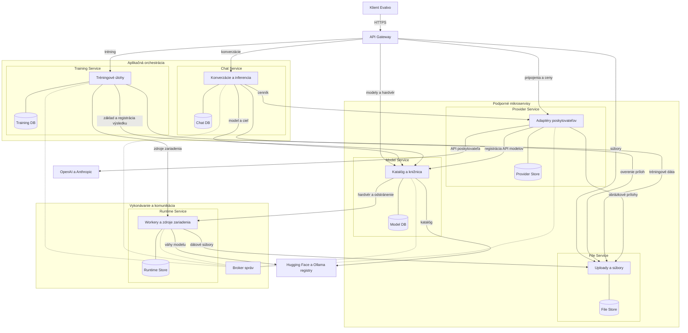

# Mikroservisná architektúra – Zadanie 1

[Späť na zadanie](README.md) · [Endpointy](ENDPOINTY.md)

Návrh toku od výberu variantu modelu po jeho používanie. Model vybraný z katalógu sa najprv overí pre cieľové zariadenie. Podporovaný lokálny základ možno fine-tunovať a výsledok uložiť do tej istej knižnice. Chat pracuje so základným modelom, výsledkom tréningu aj s API modelom z pripojeného účtu.

Plná šípka zobrazuje priame volanie a plná čiara k úložisku vlastníctvo dát. Prerušované spojenia zobrazujú komunikáciu cez broker. Presný smer príkazov a udalostí je uvedený v tabuľke nižšie.

## Služby a vlastníctvo dát

| Mikroservis | Čo má robiť | Vlastné dáta |
| --- | --- | --- |
| Model Service | Katalóg, varianty, kompatibilita, sťahovacie úlohy a kanonická knižnica modelov. Verejný hardvérový endpoint deleguje na Runtime Service. | Model DB: metadáta modelov, device_id, runtime_model_id a stav download_id. |
| File Service | Príjem JSON, JPG a CSV, kontrola formátu, oprávnení a poskytovanie nemenných file_id. Dávkovo overuje prístup k prílohám cez interný resolver. | File DB a súkromný File Store: metadáta a používateľské prílohy. |
| Training Service | Konfigurácia a riadenie tréningu, metriky, zrušenie a publikovanie výsledku do knižnice. Riadi proces; samotný GPU výpočet vykoná Runtime Service. | Training DB: job_id, parametre, stav, metriky a result_model_id. |
| Provider Service | Pripojenia poskytovateľov, modelové adaptéry, prístupové kľúče a cenové podklady. Spotrebúva požiadavky na vzdialenú inferenciu a normalizuje odpovede, nástroje a použitie tokenov. | Provider DB: pripojenia a cenníky; Vault: samostatne chránené tajomstvá. |
| Chat Service | Konverzácie, zostavenie kontextu, prijatie generovania, pokračovanie po nástrojoch a spotreba tokenov. Vyberá lokálny alebo poskytovateľský vykonávací kanál; výsledok zapisuje do vlastnej histórie. | Chat DB: história, generation_id, snapshot vstupu, tool_calls a cenové položky. |
| Runtime Service | Sťahuje váhy, vykonáva lokálnu inferenciu aj podporovaný tréning a riadi prístup k GPU. Inferenčné a tréningové workery majú oddelené fronty a zdrojové limity. | Runtime DB a Runtime Store na device_id: rezervácie zdrojov, modelové súbory, adaptéry a pracovné checkpointy. |

## Volania medzi službami

| Volajúca služba | Cieľ | Endpointy | Úloha volania |
| --- | --- | --- | --- |
| Model Service | Runtime Service | `GET /internal/v1/devices/{device_id}/hardware`; `DELETE /internal/v1/runtime-models/{runtime_model_id}` | Získať skutočné zdroje zariadenia a bezpečne odstrániť lokálne súbory modelu. |
| Chat Service | Model Service | `GET /api/v1/models/{model_id}` | Zistiť dostupnosť, schopnosti a cieľ modelu vrátane device_id alebo connection_id. |
| Chat Service | File Service | `POST /internal/v1/files/resolve` | Overiť file_id a modality príloh pred prijatím generovania. |
| Chat Service | Provider Service | `GET /api/v1/models/{model_id}/pricing` | Pri API modeli zachytiť cenový podklad pre výpočet spotreby. |
| Training Service | Model Service | `GET /api/v1/models/{model_id}`; `POST /internal/v1/models/registrations` | Overiť trénovateľný základ a po tréningu zaregistrovať artefakt; získať nové model_id. |
| Training Service | File Service | `POST /internal/v1/files/resolve`; `GET /api/v1/files/{file_id}/content` | Overiť schému tréningového JSON, obrazové väzby a dostupnosť dát. |
| Training Service | Runtime Service | `GET /internal/v1/devices/{device_id}/hardware` | Overiť dostupné zdroje; runtime ich pri prevzatí práce znovu skontroluje a rezervuje. |
| Provider Service | Model Service | `POST /internal/v1/models/registrations` | Zaradiť objavené API modely do jednotnej knižnice a dostať ich kanonické ID. |
| Runtime Service a Provider Service | File Service | `GET /api/v1/files/{file_id}/content` | Načítať len povolené tréningové alebo obrazové prílohy potrebné na konkrétnu prácu. |
| Runtime Service | Lokálny inferenčný adaptér | `POST /api/chat` | Pri použití Ollama vykonať chat. Sťahovanie a tréning používajú vlastné podporované adaptéry. |
| Provider Service | OpenAI alebo Anthropic | `POST /v1/responses`; `POST /v1/messages` | Adaptér mapuje interný vstup na API konkrétneho poskytovateľa; kľúč zostáva v Provider Service. |

Verejné trasy `/api/v1` volajú interné služby priamo na vlastníka kontraktu. `GET /api/v1/hardware` vlastní Model Service a načítava skutočné zdroje zariadenia z Runtime Service. Navrhnuté trasy `/internal/v1` a externé adaptéry majú samostatné rozhrania.

## Príkazy a udalosti

| Producent | Konzument | Správa | Úloha |
| --- | --- | --- | --- |
| Model Service | Runtime Service | `model.download.requested` | Stiahnuť presnú revíziu a variant na device_id. |
| Runtime Service | Model Service | `model.download.progress`, `model.download.completed`, `model.download.failed` | Priebeh a výsledok so záznamom runtime_model_id. Knižnicu aktualizuje Model Service. |
| Training Service | Runtime Service | `training.requested`, `training.cancel.requested` | Spustiť alebo zastaviť tréningový worker. |
| Runtime Service | Training Service | `training.progress`, `training.completed`, `training.failed`, `training.cancelled` | Vrátiť metriky a stav artefaktu. Dokončenie workeru ešte neznamená publikovanie modelu v knižnici. |
| Chat Service | Runtime Service | `runtime.inference.requested` | Vykonať pripravené lokálne generovanie. |
| Chat Service | Provider Service | `provider.inference.requested` | Vykonať vzdialené generovanie pomocou vybraného pripojenia. |
| Runtime Service alebo Provider Service | Chat Service | `inference.completed`, `inference.requires_tool_results`, `inference.failed` | Vrátiť odpoveď, volania nástrojov, použitie tokenov alebo chybu. Chat Service uloží stav a históriu. |

## Hlavný tok

1. Overiť zariadenie cez `GET /api/v1/hardware`, vybrať variant a spustiť `POST /api/v1/model-downloads`.
2. Pri tréningu nahrať JSON alebo JPG cez `POST /api/v1/files`, pripraviť úlohu v `POST /api/v1/fine-tuning/jobs` a spustiť ju cez `POST /api/v1/fine-tuning/jobs/{job_id}/start`.
3. Pri vzdialenom modeli vytvoriť pripojenie cez `POST /api/v1/provider-connections` a otestovať ho.
4. Vytvoriť konverzáciu a spustiť generovanie. Stav, odpovede a spotrebu načítať cez príslušné `GET`.

Po úspešnom tréningu Training Service registruje artefakt cez Model Service a uloží `result_model_id`. Pri dočasnej chybe registrácie sa opakuje uloženie do knižnice. Tréningový worker používa podporovaný tréningový backend a runtime overuje použiteľnosť výsledku pred stavom `ready`.

Provider Service pri objavení vzdialených modelov registruje ich metadáta v Model Service. Prístupový kľúč zostáva v úložisku tajomstiev poskytovateľa. Pri neoveriteľnom výsledku vzdialeného generovania Chat Service označí stav `outcome_unknown` a zosúladí stav pred ďalším pokusom.

## Spoločné pravidlá

Každá doménová služba vlastní svoje údaje a má vlastné prístupové oprávnenia. Brána overí vstupnú identitu a smeruje požiadavku. Pri čítaní a zápise doménové služby overujú prístup k vlastným zdrojom.

Runtime Service reportuje zdroje konkrétneho zariadenia podľa `device_id`. Na prenášanie príkazov a výsledkov sa používa broker. Veľké súbory zostávajú v úložiskách a správy prenášajú ich identifikátory. Producent trvalo zapisuje prácu a udalosť pomocou outboxu. Konzument opakovanú správu rozpozná podľa `message_id` a ID vykonania.

Pre katalóg Hugging Face môže Model Service používať Hub SDK `list_models`; Runtime Service sťahuje zvolenú revíziu cez `snapshot_download`. Pri Ollama používa runtime príslušný download adaptér a na chat `POST /api/chat`. Tieto volania patria adaptérom externých nástrojov, kým verejný klient používa API Evalva.
