# API kontrakty – Zadanie 2

[Späť na zadanie](README.md) · [Zoznam endpointov](ENDPOINTY.md) · [Architektúra](ARCHITEKTURA.md)

Návrh 35 verejných kontraktov pre toto zadanie. Príklady používajú syntetické identifikátory, vstupy a ceny. Čísla endpointov zodpovedajú spoločnému návrhu Evalva.

## Spoločné konvencie

- Základ verejných trás je `/api/v1`. Hlavička `Authorization: Bearer EVALVO_ACCESS_TOKEN` používa zástupný token. Pri každom zdroji sa overujú oprávnenia.
- `GET` a `DELETE` používajú parametre cesty a query. Ich dokumentačný JSON slúži ako prehľad parametrov. `POST`, `PUT` a `PATCH` používajú `application/json`, okrem uploadu s `multipart/form-data`.
- `201` označuje vytvorený zdroj. `202` potvrdzuje prijatie dlhšej operácie a obsahuje identifikátor a `status_url`. Pri čítaní už prijatej úlohy vracia `200` aktuálny stav vrátane prípadnej doménovej chyby.
- Pre opakované čítanie kolekcií sa používa `cursor` z `next_cursor` a `limit` od 1 do 100, predvolene 20.
- Pri spustení asynchrónnej práce sa používa `Idempotency-Key`. Kľúč je viazaný na identitu a operáciu aspoň 24 hodín. Opakované rovnaké volanie vráti pôvodné ID. Iný obsah pod tým istým kľúčom vráti `409 IDEMPOTENCY_CONFLICT`.
- Časy sú v UTC, veľkosti v bajtoch a tokeny ako celé čísla. Cena je desatinný reťazec s menou. Pri neznámom náklade má `amount` hodnotu `null` a `status` je `unknown`.

Tento tok používa konverzácie bez agentového profilu. V zdieľanej schéme môžu zostať jeho nepovinné polia a spoločné chybové kódy.

### Spoločný formát chyby

Pri neplatnej identite sa vracia `401`, pri chýbajúcom oprávnení `403` alebo podľa viditeľnosti zdroja `404`. Doménové chyby sú uvedené pri jednotlivých endpointoch.

```json
{
  "error": {
    "code": "VALIDATION_ERROR",
    "message": "Požiadavka obsahuje neplatnú hodnotu.",
    "details": {
      "fields": [
        {
          "field": "parameters.epochs",
          "reason": "Hodnota musí byť kladné celé číslo."
        }
      ]
    },
    "request_id": "req_demo_01",
    "retryable": false
  }
}
```

## Stiahnutie a správa LLM modelov

### 01 Zistenie hardvéru

**GET `/api/v1/hardware`**

Zistiť výpočtové zdroje zariadenia, na ktorom sa majú lokálne modely spúšťať.

**Parametre cesty a query — nie HTTP body**

```json
{
  "query": {
    "device_id": "device_01"
  }
}
```

**Sekvenčný diagram**

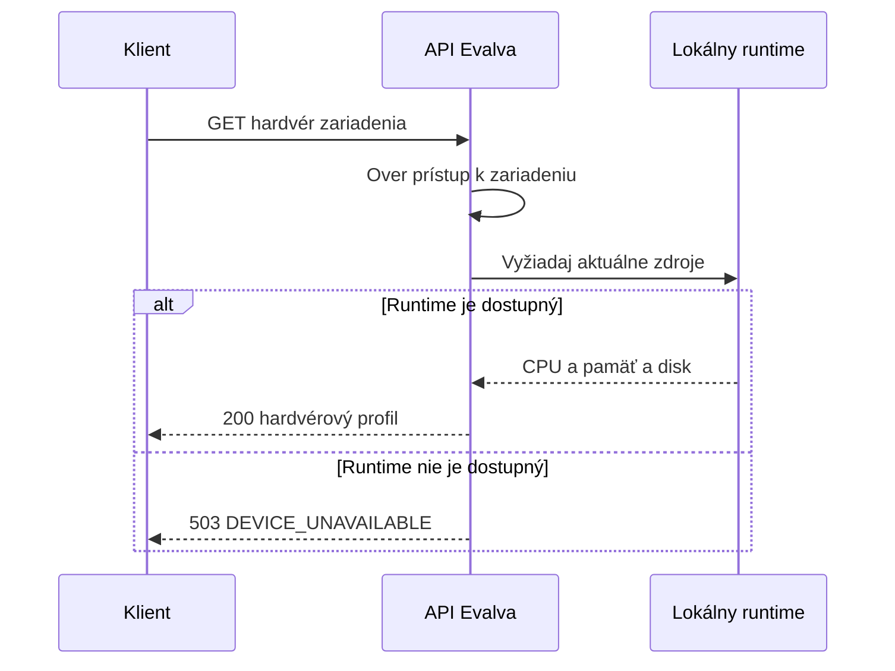

**JSON výstupu — HTTP 200**

```json
{
  "device_id": "device_01",
  "cpu": {
    "logical_cores": 8
  },
  "ram": {
    "total_bytes": 34359738368,
    "available_bytes": 25769803776
  },
  "gpus": [
    {
      "name": "Demo GPU",
      "vram_total_bytes": 17179869184,
      "vram_available_bytes": 12884901888
    }
  ],
  "disk_available_bytes": 128849018880,
  "captured_at": "2026-11-17T18:00:00Z"
}
```

**Chybové stavy:** `404 DEVICE_NOT_FOUND`; `503 DEVICE_UNAVAILABLE`.

### 02 Vyhľadanie modelov v katalógu

**GET `/api/v1/model-catalog`**

Vyhľadať modely z Hugging Face a Ollama a filtrovať ich podľa zdroja, kompresie a vhodnosti pre zariadenie.

**Parametre cesty a query — nie HTTP body**

```json
{
  "query": {
    "source": "huggingface",
    "search": "demo",
    "compatible_with": "device_01",
    "limit": 20
  }
}
```

**Sekvenčný diagram**

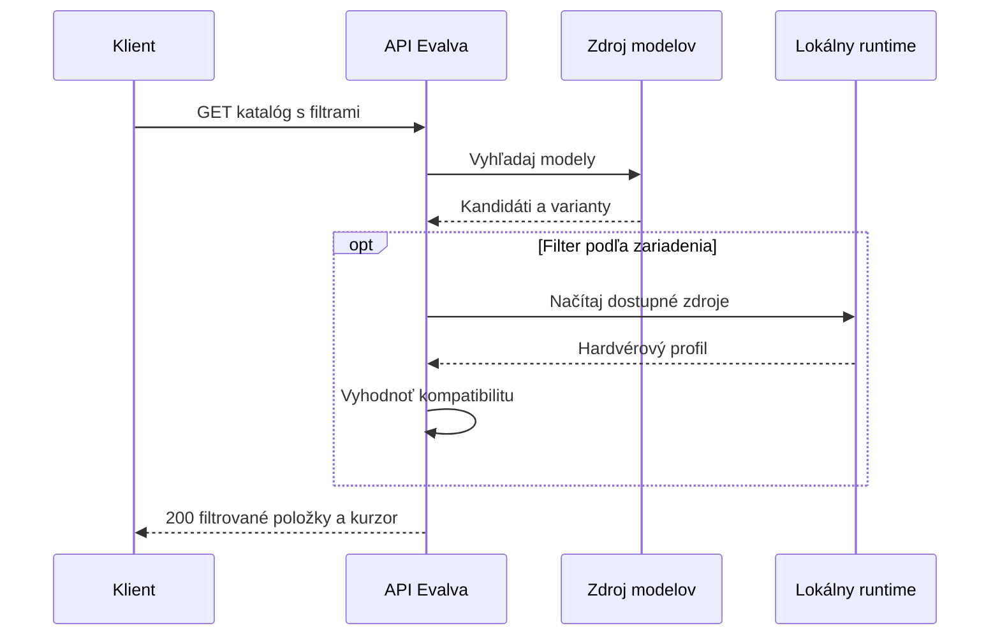

**JSON výstupu — HTTP 200**

```json
{
  "items": [
    {
      "catalog_model_id": "cat_demo_3b",
      "name": "Evalvo Demo 3B",
      "source": "huggingface",
      "source_model_id": "demo/evalvo-3b",
      "modalities": [
        "text"
      ],
      "compatibility": "compatible"
    }
  ],
  "next_cursor": null
}
```

**Chybové stavy:** `422 INVALID_QUERY`; `503 MODEL_SOURCE_UNAVAILABLE`.

Parameter source prijíma huggingface alebo ollama. Filter výkonu vychádza zo zvoleného lokálneho zariadenia.

### 03 Detail katalógového modelu

**GET `/api/v1/model-catalog/{catalog_model_id}`**

Zobraziť detail modelu dostupného na stiahnutie.

**Parametre cesty a query — nie HTTP body**

```json
{
  "path": {
    "catalog_model_id": "cat_demo_3b"
  }
}
```

**Sekvenčný diagram**

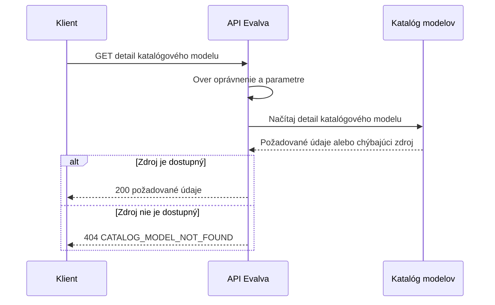

**JSON výstupu — HTTP 200**

```json
{
  "catalog_model_id": "cat_demo_3b",
  "name": "Evalvo Demo 3B",
  "source": "huggingface",
  "source_model_id": "demo/evalvo-3b",
  "modalities": [
    "text"
  ],
  "variant_ids": [
    "var_demo_q4",
    "var_demo_bf16"
  ]
}
```

**Chybové stavy:** `404 CATALOG_MODEL_NOT_FOUND`.

### 04 Varianty kompresie

**GET `/api/v1/model-catalog/{catalog_model_id}/variants`**

Zobraziť dostupné varianty kompresie vybraného modelu.

**Parametre cesty a query — nie HTTP body**

```json
{
  "path": {
    "catalog_model_id": "cat_demo_3b"
  }
}
```

**Sekvenčný diagram**

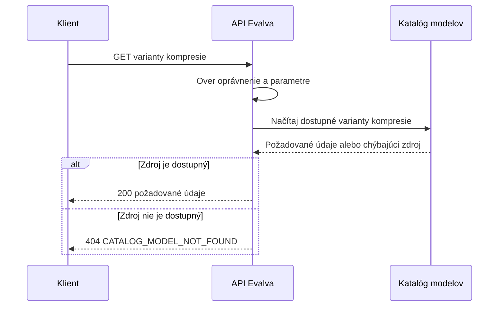

**JSON výstupu — HTTP 200**

```json
{
  "items": [
    {
      "variant_id": "var_demo_q4",
      "compression": "Q4_K_M",
      "format": "gguf",
      "size_bytes": 2147483648,
      "supports_fine_tuning": false
    },
    {
      "variant_id": "var_demo_bf16",
      "compression": "BF16",
      "format": "safetensors",
      "size_bytes": 6442450944,
      "supports_fine_tuning": true
    }
  ],
  "next_cursor": null
}
```

**Chybové stavy:** `404 CATALOG_MODEL_NOT_FOUND`.

### 05 Kompatibilita variantu

**GET `/api/v1/model-catalog/{catalog_model_id}/variants/{variant_id}/compatibility`**

Overiť vhodnosť variantu pre zariadenie a vrátiť dôvod prípadného blokovania.

**Parametre cesty a query — nie HTTP body**

```json
{
  "path": {
    "catalog_model_id": "cat_demo_3b",
    "variant_id": "var_demo_q4"
  },
  "query": {
    "device_id": "device_01",
    "context_length": 4096,
    "parallel_requests": 1
  }
}
```

**Sekvenčný diagram**

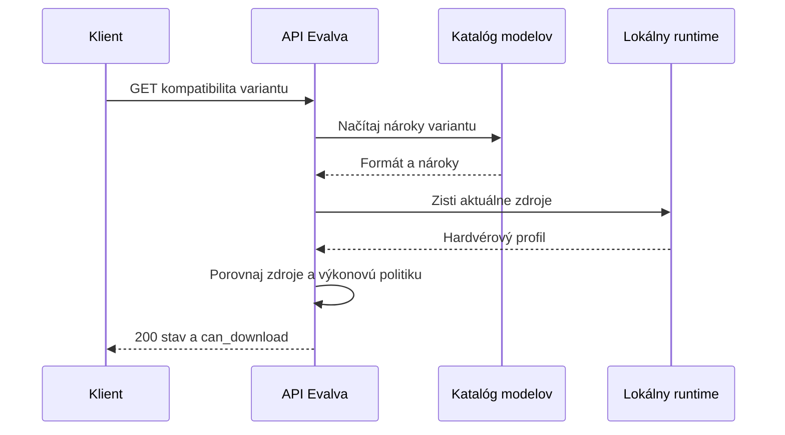

**JSON výstupu — HTTP 200**

```json
{
  "catalog_model_id": "cat_demo_3b",
  "variant_id": "var_demo_q4",
  "device_id": "device_01",
  "status": "compatible",
  "can_download": true,
  "checks": {
    "runtime": "passed",
    "memory": "passed",
    "disk": "passed",
    "performance": "passed"
  },
  "estimates": {
    "required_vram_bytes": 3221225472,
    "tokens_per_second": 25,
    "is_estimate": true
  },
  "reasons": []
}
```

**Chybové stavy:** `404 MODEL_VARIANT_NOT_FOUND`; `503 DEVICE_UNAVAILABLE`.

status má hodnoty compatible, incompatible alebo unknown. can_download je true iba pri compatible. Výkonové odhady a prah plynulosti vychádzajú z politiky konkrétneho runtime; uvedené čísla sú syntetický príklad. POST model-downloads kontrolu zopakuje.

### 06 Spustenie sťahovania

**POST `/api/v1/model-downloads`**

Spustiť sťahovanie zvoleného modelu a variantu. Pred začatím vynútiť kontrolu výkonu zariadenia a nevhodný model zablokovať.

**JSON vstupu — application/json**

```json
{
  "catalog_model_id": "cat_demo_3b",
  "variant_id": "var_demo_q4",
  "device_id": "device_01",
  "context_length": 4096,
  "parallel_requests": 1
}
```

**Sekvenčný diagram**

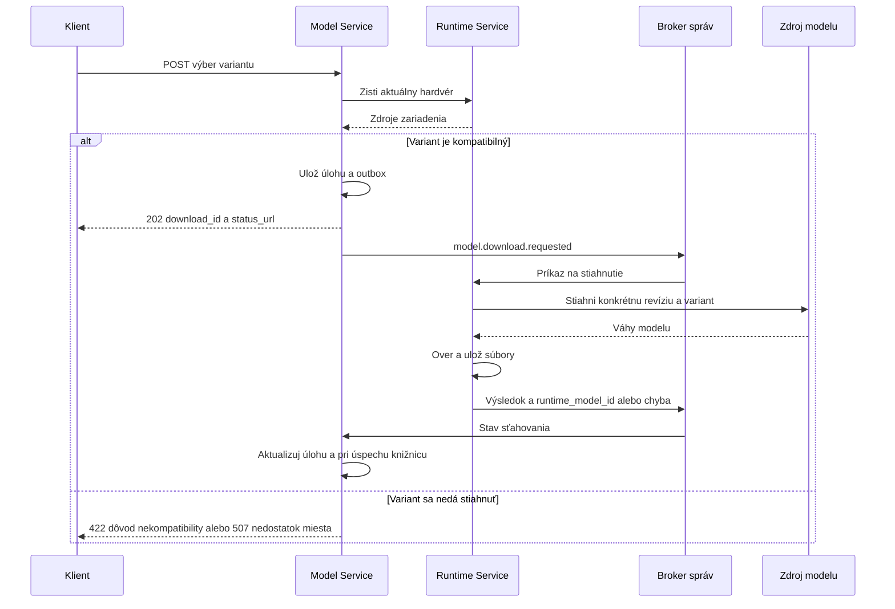

**JSON výstupu — HTTP 202**

```json
{
  "download_id": "dl_01",
  "status": "queued",
  "progress": {
    "downloaded_bytes": 0,
    "total_bytes": 2147483648
  },
  "model_id": null,
  "status_url": "/api/v1/model-downloads/dl_01"
}
```

**Chybové stavy:** `422 MODEL_INCOMPATIBLE`; `422 PERFORMANCE_NOT_VERIFIED`; `507 INSUFFICIENT_STORAGE`.

### 07 Stav sťahovania

**GET `/api/v1/model-downloads/{download_id}`**

Zobraziť stav a priebeh sťahovania; po dokončení vrátiť odkaz na model v knižnici alebo chybu.

**Parametre cesty a query — nie HTTP body**

```json
{
  "path": {
    "download_id": "dl_01"
  }
}
```

**Sekvenčný diagram**

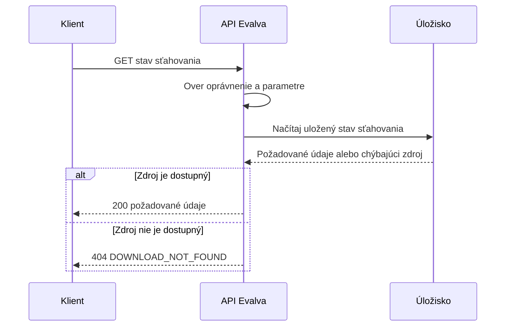

**JSON výstupu — HTTP 200**

```json
{
  "download_id": "dl_01",
  "status": "completed",
  "progress": {
    "downloaded_bytes": 2147483648,
    "total_bytes": 2147483648
  },
  "model_id": "mdl_local_01",
  "error": null
}
```

**Chybové stavy:** `404 DOWNLOAD_NOT_FOUND`.

Počas spracovania je model_id null. Pri failed obsahuje error konkrétny dôvod; čítanie stavu sťahovanie znovu nespustí.

### 08 Knižnica modelov

**GET `/api/v1/models`**

Zobraziť základné stiahnuté modely v knižnici.

**Parametre cesty a query — nie HTTP body**

```json
{
  "query": {
    "limit": 20
  }
}
```

**Sekvenčný diagram**

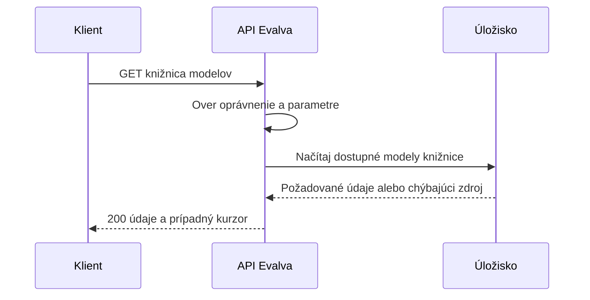

**JSON výstupu — HTTP 200**

```json
{
  "items": [
    {
      "model_id": "mdl_local_01",
      "name": "Evalvo Demo 3B Q4",
      "kind": "local",
      "status": "ready"
    },
    {
      "model_id": "mdl_local_02",
      "name": "Evalvo Demo 7B Q4",
      "kind": "local",
      "status": "ready"
    },
    {
      "model_id": "mdl_local_vision_01",
      "name": "Evalvo Demo Vision",
      "kind": "local",
      "status": "ready"
    }
  ],
  "next_cursor": null
}
```

**Chybové stavy:** `422 INVALID_QUERY`.

### 09 Detail modelu knižnice

**GET `/api/v1/models/{model_id}`**

Načítať detail stiahnutého modelu a jeho podporované vstupy a možnosti.

**Parametre cesty a query — nie HTTP body**

```json
{
  "path": {
    "model_id": "mdl_local_02"
  }
}
```

**Sekvenčný diagram**

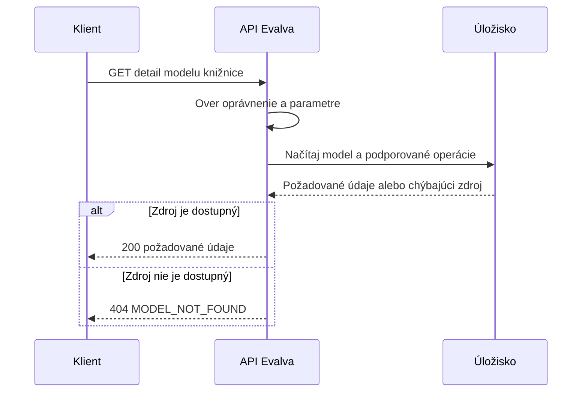

**JSON výstupu — HTTP 200**

```json
{
  "model_id": "mdl_local_02",
  "name": "Evalvo Demo 7B Q4",
  "kind": "local",
  "status": "ready",
  "format": "gguf",
  "device_id": "device_01",
  "capabilities": {
    "text": true,
    "images": false,
    "tools": false,
    "fine_tuning": false
  },
  "fine_tuning": {
    "methods": [],
    "parameters": []
  }
}
```

**Chybové stavy:** `404 MODEL_NOT_FOUND`.

### 10 Odstránenie lokálneho modelu

**DELETE `/api/v1/models/{model_id}`**

Odstrániť stiahnutý model z knižnice a zo zariadenia.

**Parametre cesty a query — nie HTTP body**

```json
{
  "path": {
    "model_id": "mdl_local_01"
  }
}
```

**Sekvenčný diagram**

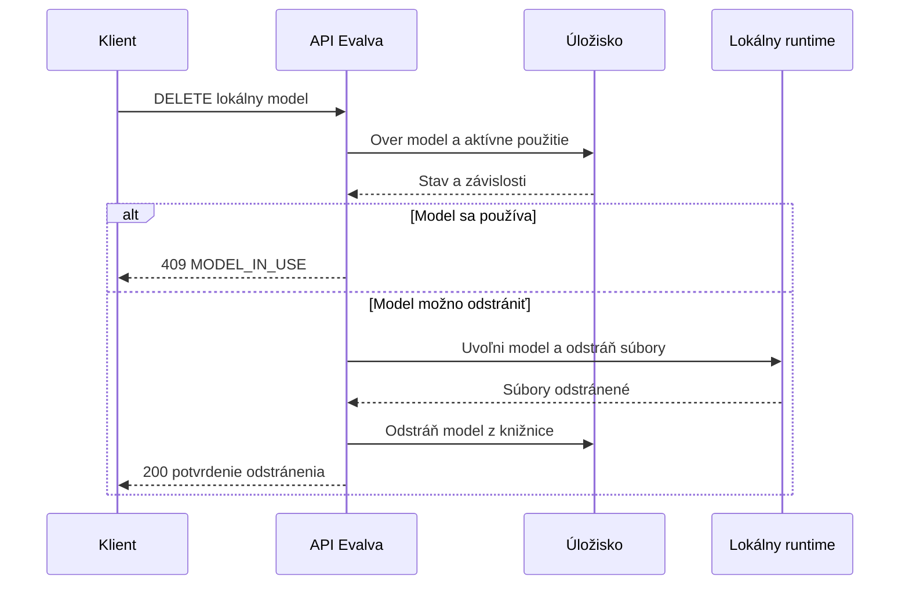

**JSON výstupu — HTTP 200**

```json
{
  "model_id": "mdl_local_01",
  "deleted": true,
  "released_bytes": 2147483648
}
```

**Chybové stavy:** `404 MODEL_NOT_FOUND`; `409 MODEL_IN_USE`; `422 MODEL_NOT_LOCAL`.

Runtime overí, či lokálny model nemá aktívne použitie. Pri používanom modeli vráti `409 MODEL_IN_USE`.

## Súbory

### 11 Nahratie súboru

**POST `/api/v1/files`**

Nahrať obrázok do konverzácie alebo CSV s testovacími prípadmi a získať `file_id`.

**Vstup — `multipart/form-data`**

| Pole | Typ | Hodnota |
| --- | --- | --- |
| `file` | súbor | Obrázok JPG alebo testovacie CSV. |
| `purpose` | text | `image` pre obrázok, `evaluation` pre CSV. |

CSV pre evaluáciu má stĺpce `input` a `výsledok`. Vlastný import sa spúšťa cez `POST /api/v1/evaluations/{evaluation_id}/imports` s vráteným `file_id`.

**Sekvenčný diagram**

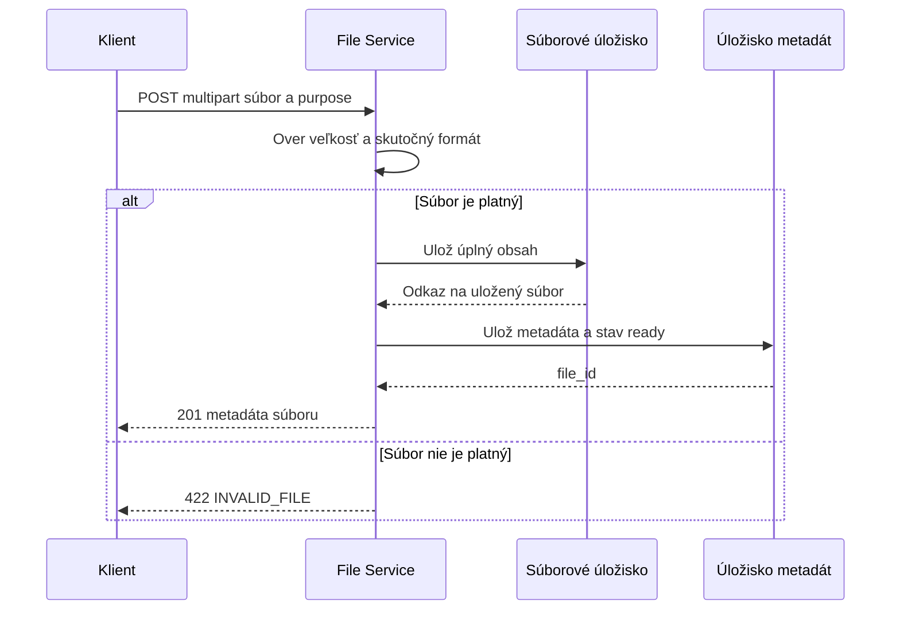

**JSON výstupu — HTTP 201**

```json
{
  "file_id": "file_eval_csv",
  "filename": "evaluation.csv",
  "purpose": "evaluation",
  "media_type": "text/csv",
  "size_bytes": 84,
  "status": "ready"
}
```

**Chybové stavy:** `413 FILE_TOO_LARGE`; `415 UNSUPPORTED_MEDIA_TYPE`; `422 INVALID_FILE`.

### 12 Načítanie obsahu súboru

**GET `/api/v1/files/{file_id}/content`**

Načítať obsah nahratého súboru alebo zobraziť uložený obrázok.

**Parametre cesty a query — nie HTTP body**

```json
{
  "path": {
    "file_id": "file_image_01"
  }
}
```

**Sekvenčný diagram**

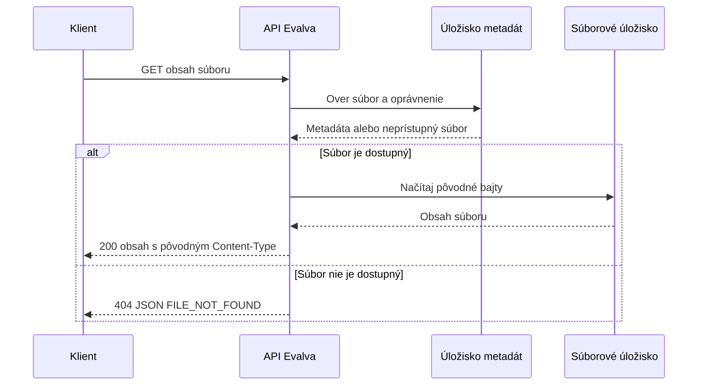

**Úspešný výstup — HTTP 200**

`Content-Type: image/jpeg` a `Content-Disposition: inline; filename="image.jpg"`. Úspešná odpoveď obsahuje pôvodné bajty súboru. Nasledujúca JSON ukážka ukazuje chybovú odpoveď pre neexistujúce `file_id`.

**JSON chyby — HTTP 404**

```json
{
  "error": {
    "code": "FILE_NOT_FOUND",
    "message": "Súbor neexistuje alebo k nemu nie je prístup.",
    "details": {
      "file_id": "file_image_01"
    },
    "request_id": "req_demo_12",
    "retryable": false
  }
}
```

**Chybové stavy:** `404 FILE_NOT_FOUND`.

## Konverzácie a používanie modelov

### 30 Vytvorenie konverzácie

**POST `/api/v1/conversations`**

Vytvoriť konverzáciu so stiahnutým modelom.

**JSON vstupu — application/json**

```json
{
  "model_id": "mdl_local_01",
  "title": "Test matematickej úlohy"
}
```

**Sekvenčný diagram**

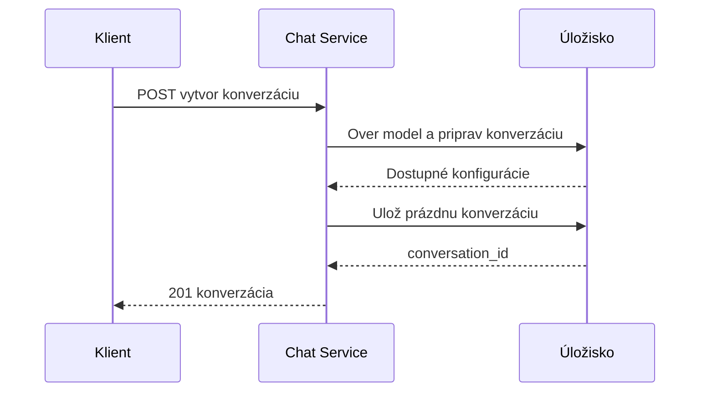

**JSON výstupu — HTTP 201**

```json
{
  "conversation_id": "conv_01",
  "model_id": "mdl_local_01",
  "agent_id": null,
  "title": "Test matematickej úlohy",
  "message_count": 0,
  "status": "idle",
  "created_at": "2026-11-17T18:00:00Z"
}
```

**Chybové stavy:** `404 MODEL_OR_AGENT_NOT_FOUND`; `422 MODEL_NOT_READY`.

Vytvorenie konverzácie negeneruje odpoveď. Vstup sa odosiela cez POST /api/v1/generations.

### 31 Zoznam konverzácií

**GET `/api/v1/conversations`**

Zobraziť uložené konverzácie.

**Parametre cesty a query — nie HTTP body**

```json
{
  "query": {
    "limit": 20
  }
}
```

**Sekvenčný diagram**


**JSON výstupu — HTTP 200**

```json
{
  "items": [
    {
      "conversation_id": "conv_01",
      "model_id": "mdl_local_01",
      "agent_id": null,
      "title": "Test matematickej úlohy",
      "message_count": 2,
      "status": "idle",
      "updated_at": "2026-11-17T18:00:05Z"
    }
  ],
  "next_cursor": null
}
```

**Chybové stavy:** `422 INVALID_QUERY`.

### 32 Detail konverzácie

**GET `/api/v1/conversations/{conversation_id}`**

Načítať detail konverzácie a priradený model.

**Parametre cesty a query — nie HTTP body**

```json
{
  "path": {
    "conversation_id": "conv_01"
  }
}
```

**Sekvenčný diagram**

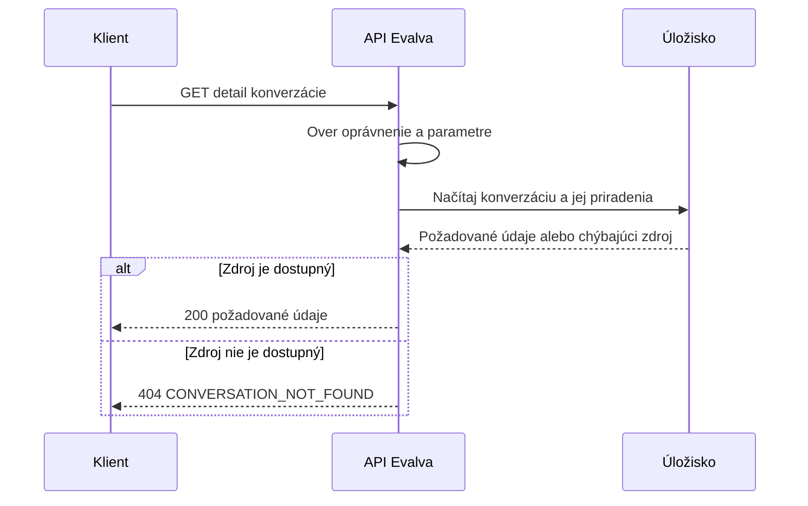

**JSON výstupu — HTTP 200**

```json
{
  "conversation_id": "conv_01",
  "model_id": "mdl_local_01",
  "agent_id": null,
  "title": "Test matematickej úlohy",
  "message_count": 2,
  "last_message_id": "msg_a01",
  "active_generation_id": null,
  "status": "idle"
}
```

**Chybové stavy:** `404 CONVERSATION_NOT_FOUND`.

### 33 História správ

**GET `/api/v1/conversations/{conversation_id}/messages`**

Načítať celú uloženú históriu správ a odpovedí v správnom poradí.

**Parametre cesty a query — nie HTTP body**

```json
{
  "path": {
    "conversation_id": "conv_01"
  },
  "query": {
    "limit": 50
  }
}
```

**Sekvenčný diagram**

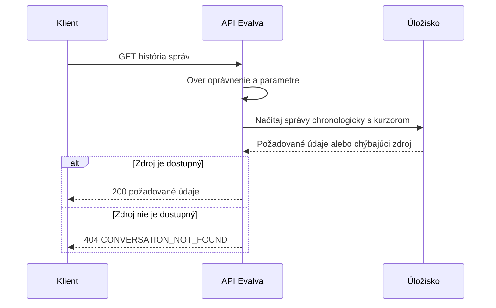

**JSON výstupu — HTTP 200**

```json
{
  "items": [
    {
      "message_id": "msg_u01",
      "role": "user",
      "content": [
        {
          "type": "text",
          "text": "Koľko je dva plus dva?"
        }
      ],
      "generation_id": "gen_01",
      "created_at": "2026-11-17T18:00:00Z"
    },
    {
      "message_id": "msg_a01",
      "role": "assistant",
      "content": [
        {
          "type": "text",
          "text": "4"
        }
      ],
      "generation_id": "gen_01",
      "created_at": "2026-11-17T18:00:05Z"
    }
  ],
  "next_cursor": null
}
```

**Chybové stavy:** `404 CONVERSATION_NOT_FOUND`; `422 INVALID_QUERY`.

Stránkovanie nemení poradie histórie. Odkaz na obrázok sa vracia ako file_id a obsah možno načítať cez GET /api/v1/files/{file_id}/content.

### 34 Spustenie generovania

**POST `/api/v1/generations`**

Spustiť generovanie základného lokálneho modelu a podľa konverzácie použiť jej kontext.

**JSON vstupu — application/json**

```json
{
  "conversation_id": "conv_01",
  "model_id": "mdl_local_01",
  "input": {
    "text": "Koľko je dva plus dva?",
    "image_file_ids": []
  },
  "parameters": {
    "temperature": 0.2,
    "max_output_tokens": 512
  },
  "tools": []
}
```

**Alternatívny vstup s obrázkom**

```json
{
  "conversation_id": "conv_image_01",
  "model_id": "mdl_local_vision_01",
  "input": {
    "text": "Čo je na obrázku?",
    "image_file_ids": [
      "file_image_01"
    ]
  },
  "parameters": {
    "max_output_tokens": 128
  },
  "tools": []
}
```

**Alternatívny vstup s nástrojom vykonávaným klientom**

```json
{
  "conversation_id": "conv_tool_01",
  "model_id": "mdl_local_tools_01",
  "input": {
    "text": "Zisti stav objednávky ORD-42.",
    "image_file_ids": []
  },
  "parameters": {
    "max_output_tokens": 512
  },
  "tools": [
    {
      "type": "function",
      "execution": "client",
      "name": "lookup_order",
      "description": "Načíta stav objednávky.",
      "input_schema": {
        "type": "object",
        "properties": {
          "order_id": {
            "type": "string"
          }
        },
        "required": [
          "order_id"
        ],
        "additionalProperties": false
      }
    }
  ]
}
```

**Sekvenčný diagram**

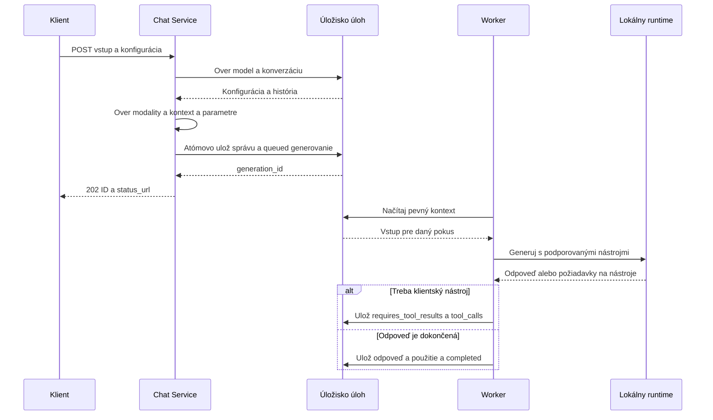

**JSON výstupu — HTTP 202**

```json
{
  "generation_id": "gen_01",
  "conversation_id": "conv_01",
  "status": "queued",
  "user_message_id": "msg_u01",
  "status_url": "/api/v1/generations/gen_01"
}
```

**Chybové stavy:** `404 MODEL_CONVERSATION_OR_AGENT_NOT_FOUND`; `409 CONVERSATION_BUSY`; `409 CONVERSATION_MODEL_MISMATCH`; `422 CONTEXT_LIMIT_EXCEEDED`; `422 UNSUPPORTED_INPUT_OR_PARAMETER`.

Samostatné generovanie môže vynechať `conversation_id`. Pri konverzácii sa explicitný `model_id` musí zhodovať s jej modelom. Konverzácia má najviac jedno aktívne generovanie. Prekročenie kontextu vráti `422 CONTEXT_LIMIT_EXCEEDED`.

Obrazová a nástrojová ukážka predpokladajú, že uvedené modely podporujú príslušnú modalitu alebo nástroje.

### 35 Stav a výsledok generovania

**GET `/api/v1/generations/{generation_id}`**

Načítať stav generovania, požiadavky na nástroje a po ukončení úplnú odpoveď alebo chybu.

**Parametre cesty a query — nie HTTP body**

```json
{
  "path": {
    "generation_id": "gen_01"
  }
}
```

**Sekvenčný diagram**

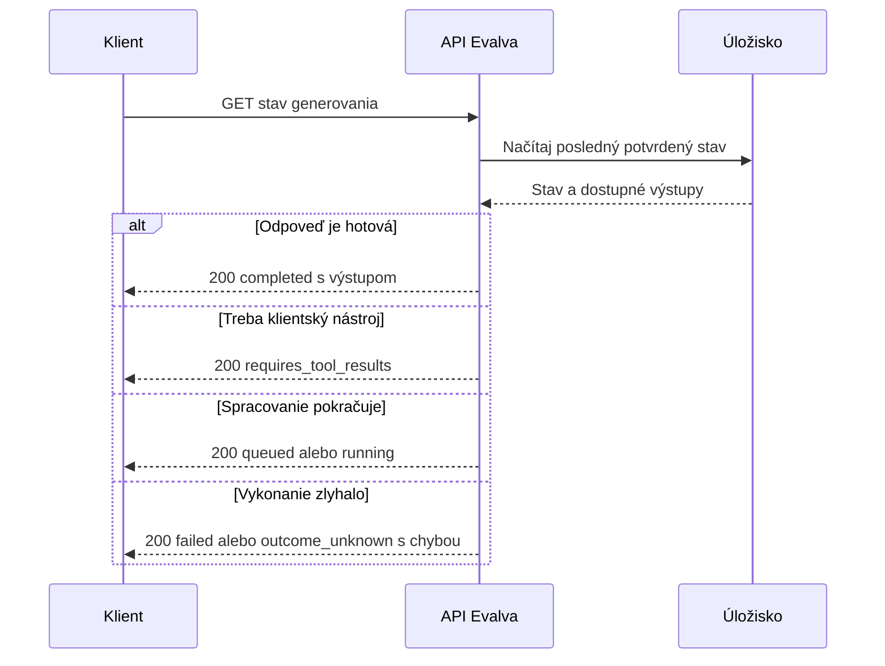

**JSON výstupu — HTTP 200**

```json
{
  "generation_id": "gen_01",
  "conversation_id": "conv_01",
  "model_id": "mdl_local_01",
  "agent_id": null,
  "status": "completed",
  "output": {
    "message_id": "msg_a01",
    "text": "4",
    "image_file_ids": []
  },
  "tool_calls": [],
  "usage": {
    "input_tokens": 100,
    "output_tokens": 1,
    "total_tokens": 101,
    "cost": {
      "amount": null,
      "currency": null,
      "status": "unknown",
      "reason": "LOCAL_COST_NOT_CONFIGURED"
    }
  },
  "error": null
}
```

**Generovanie čakajúce na klientský nástroj — HTTP 200**

```json
{
  "generation_id": "gen_tool_01",
  "conversation_id": "conv_tool_01",
  "model_id": "mdl_local_tools_01",
  "status": "requires_tool_results",
  "output": null,
  "tool_calls": [
    {
      "tool_call_id": "tc_01",
      "type": "function",
      "name": "lookup_order",
      "arguments": {
        "order_id": "ORD-42"
      }
    }
  ],
  "usage": null,
  "error": null
}
```

**Chybové stavy:** `404 GENERATION_NOT_FOUND`.

Chyba prijatej úlohy je súčasťou zdroja generovania pri HTTP `200`. HTTP `404` označuje nenájdené ID.

### 36 Odovzdanie výsledkov nástrojov

**POST `/api/v1/generations/{generation_id}/tool-results`**

Doplniť výsledky nástrojov vykonaných klientom a umožniť pokračovanie generovania čakajúceho na tieto výsledky.

**Parametre cesty a query — nie HTTP body**

```json
{
  "path": {
    "generation_id": "gen_tool_01"
  }
}
```

**JSON vstupu — application/json**

```json
{
  "tool_results": [
    {
      "tool_call_id": "tc_01",
      "output": {
        "order_id": "ORD-42",
        "status": "shipped"
      }
    }
  ]
}
```

**Sekvenčný diagram**

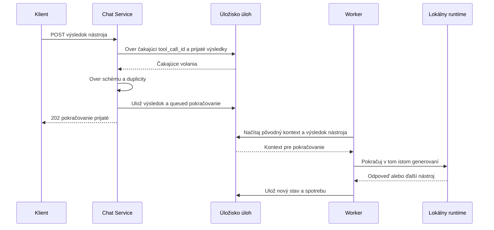

**JSON výstupu — HTTP 202**

```json
{
  "generation_id": "gen_tool_01",
  "status": "queued",
  "accepted_tool_call_ids": [
    "tc_01"
  ],
  "status_url": "/api/v1/generations/gen_tool_01"
}
```

**Chybové stavy:** `404 GENERATION_NOT_FOUND`; `409 GENERATION_NOT_WAITING_FOR_TOOLS`; `409 TOOL_RESULT_CONFLICT`; `422 TOOL_RESULT_INVALID`.

Nevytvára sa nové generation_id. Rovnaký tool_call_id s rovnakým výsledkom sa započíta iba raz; iný výsledok pre už prijaté volanie spôsobí konflikt.

### 37 Spotreba konverzácie

**GET `/api/v1/conversations/{conversation_id}/usage`**

Zobraziť priebežné použitie tokenov, cenu a prepočet na 1 milión tokenov pre danú konverzáciu.

**Parametre cesty a query — nie HTTP body**

```json
{
  "path": {
    "conversation_id": "conv_01"
  }
}
```

**Sekvenčný diagram**

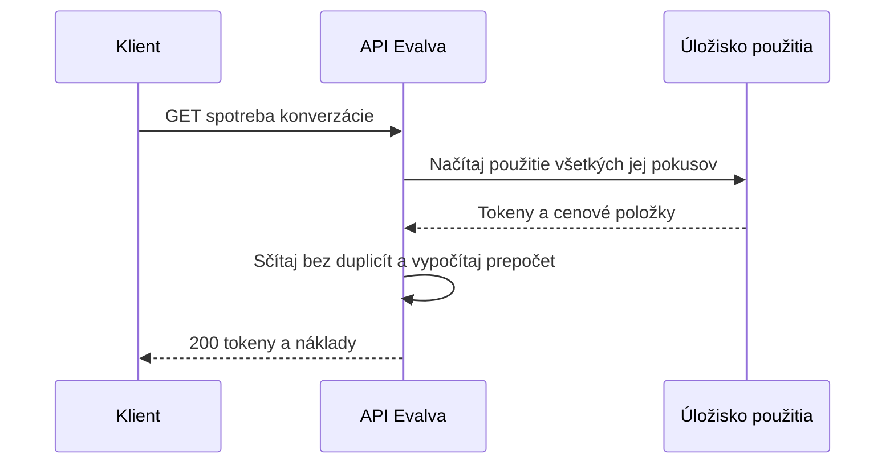

**JSON výstupu — HTTP 200**

```json
{
  "conversation_id": "conv_01",
  "model_id": "mdl_local_01",
  "input_tokens": 100,
  "output_tokens": 1,
  "total_tokens": 101,
  "cost": {
    "amount": null,
    "currency": null,
    "status": "unknown",
    "reason": "LOCAL_COST_NOT_CONFIGURED"
  },
  "effective_price_per_1m_tokens": null,
  "cost_complete": false
}
```

**Chybové stavy:** `404 CONVERSATION_NOT_FOUND`.

Efektívna cena za milión je celkový náklad × 1 000 000 / `total_tokens`. Pri nulovom počte alebo neúplnom cenovom podklade má hodnotu `null`.

## Evaluácia podľa úlohy

### 38 Vytvorenie evaluácie

**POST `/api/v1/evaluations`**

Vytvoriť evaluáciu konkrétnej úlohy s vybranými lokálnymi modelmi.

**JSON vstupu — application/json**

```json
{
  "name": "Porovnanie sčítania",
  "task": "Vráť iba výsledné číslo.",
  "candidates": [
    {
      "candidate_id": "candidate_local_a",
      "model_id": "mdl_local_01",
      "parameters": {
        "max_output_tokens": 512
      }
    },
    {
      "candidate_id": "candidate_local_b",
      "model_id": "mdl_local_02",
      "parameters": {
        "max_output_tokens": 512
      }
    }
  ],
  "comparison_rule": {
    "method": "exact_match",
    "trim": true,
    "case_sensitive": true
  }
}
```

**Sekvenčný diagram**

```mermaid
sequenceDiagram
    participant C as Klient
    participant A as API Evalva
    participant D as Úložisko
    C->>A: POST definícia evaluácie
    A->>D: Over kandidátne modely
    D-->>A: Dostupní kandidáti
    A->>A: Over pravidlo porovnania
    A->>D: Ulož definíciu bez spustenia modelov
    D-->>A: evaluation_id
    A-->>C: 201 definícia evaluácie
```

**JSON výstupu — HTTP 201**

```json
{
  "evaluation_id": "eval_01",
  "name": "Porovnanie sčítania",
  "task": "Vráť iba výsledné číslo.",
  "candidates": [
    {
      "candidate_id": "candidate_local_a",
      "model_id": "mdl_local_01",
      "agent_id": null,
      "parameters": {
        "max_output_tokens": 512
      }
    },
    {
      "candidate_id": "candidate_local_b",
      "model_id": "mdl_local_02",
      "agent_id": null,
      "parameters": {
        "max_output_tokens": 512
      }
    }
  ],
  "comparison_rule": {
    "method": "exact_match",
    "trim": true,
    "case_sensitive": true
  },
  "test_case_count": 0,
  "conversation_bindings": []
}
```

**Chybové stavy:** `404 MODEL_OR_AGENT_NOT_FOUND`; `422 INVALID_EVALUATION_CONFIGURATION`.

Ukážka používa doslovnú zhodu po orezaní okrajových medzier. Referenčný výstup používa Evaluation Service pri vyhodnotení.

### 39 Zoznam evaluácií

**GET `/api/v1/evaluations`**

Zobraziť uložené evaluácie.

**Parametre cesty a query — nie HTTP body**

```json
{
  "query": {
    "limit": 20
  }
}
```

**Sekvenčný diagram**

```mermaid
sequenceDiagram
    participant C as Klient
    participant A as API Evalva
    participant D as Úložisko
    C->>A: GET zoznam evaluácií
    A->>A: Over oprávnenie a parametre
    A->>D: Načítaj uložené definície evaluácií
    D-->>A: Požadované údaje alebo chýbajúci zdroj
    A-->>C: 200 údaje a prípadný kurzor
```

**JSON výstupu — HTTP 200**

```json
{
  "items": [
    {
      "evaluation_id": "eval_01",
      "name": "Porovnanie sčítania",
      "test_case_count": 2,
      "candidate_count": 2
    }
  ],
  "next_cursor": null
}
```

**Chybové stavy:** `422 INVALID_QUERY`.

### 40 Detail evaluácie

**GET `/api/v1/evaluations/{evaluation_id}`**

Zobraziť nastavenia evaluácie, vybrané modely a priradené konverzácie.

**Parametre cesty a query — nie HTTP body**

```json
{
  "path": {
    "evaluation_id": "eval_01"
  }
}
```

**Sekvenčný diagram**

```mermaid
sequenceDiagram
    participant C as Klient
    participant A as API Evalva
    participant D as Úložisko
    C->>A: GET detail evaluácie
    A->>A: Over oprávnenie a parametre
    A->>D: Načítaj definíciu a väzby konverzácií
    D-->>A: Požadované údaje alebo chýbajúci zdroj
    alt Zdroj je dostupný
    A-->>C: 200 požadované údaje
    else Zdroj nie je dostupný
    A-->>C: 404 EVALUATION_NOT_FOUND
    end
```

**JSON výstupu — HTTP 200**

```json
{
  "evaluation_id": "eval_01",
  "name": "Porovnanie sčítania",
  "task": "Vráť iba výsledné číslo.",
  "candidates": [
    {
      "candidate_id": "candidate_local_a",
      "model_id": "mdl_local_01",
      "agent_id": null,
      "parameters": {
        "max_output_tokens": 512
      }
    },
    {
      "candidate_id": "candidate_local_b",
      "model_id": "mdl_local_02",
      "agent_id": null,
      "parameters": {
        "max_output_tokens": 512
      }
    }
  ],
  "comparison_rule": {
    "method": "exact_match",
    "trim": true,
    "case_sensitive": true
  },
  "test_case_count": 2,
  "conversation_bindings": [
    {
      "conversation_id": "conv_01",
      "candidate_id": "candidate_local_a",
      "mappings": [
        {
          "test_case_id": "case_01",
          "generation_id": "gen_01"
        }
      ]
    }
  ]
}
```

**Chybové stavy:** `404 EVALUATION_NOT_FOUND`.

### 41 Úprava evaluácie

**PATCH `/api/v1/evaluations/{evaluation_id}`**

Upraviť zadanie a výber modelov pre ďalší beh evaluácie.

**Parametre cesty a query — nie HTTP body**

```json
{
  "path": {
    "evaluation_id": "eval_01"
  }
}
```

**JSON vstupu — application/json**

```json
{
  "name": "Kontrola sčítania",
  "candidates": [
    {
      "candidate_id": "candidate_local_a",
      "model_id": "mdl_local_01",
      "parameters": {
        "max_output_tokens": 256
      }
    },
    {
      "candidate_id": "candidate_local_b",
      "model_id": "mdl_local_02",
      "parameters": {
        "max_output_tokens": 512
      }
    }
  ]
}
```

**Sekvenčný diagram**

```mermaid
sequenceDiagram
    participant C as Klient
    participant A as API Evalva
    participant D as Úložisko
    C->>A: PATCH definícia evaluácie
    A->>D: Načítaj definíciu a závislosti
    D-->>A: Aktuálna konfigurácia
    A->>A: Over upravené polia
    A->>D: Ulož definíciu pre budúce behy
    D-->>A: Aktualizovaná definícia
    A-->>C: 200 evaluácia
```

**JSON výstupu — HTTP 200**

```json
{
  "evaluation_id": "eval_01",
  "name": "Kontrola sčítania",
  "candidates": [
    {
      "candidate_id": "candidate_local_a",
      "model_id": "mdl_local_01",
      "agent_id": null,
      "parameters": {
        "max_output_tokens": 256
      }
    },
    {
      "candidate_id": "candidate_local_b",
      "model_id": "mdl_local_02",
      "agent_id": null,
      "parameters": {
        "max_output_tokens": 512
      }
    }
  ],
  "comparison_rule": {
    "method": "exact_match",
    "trim": true,
    "case_sensitive": true
  }
}
```

**Chybové stavy:** `404 EVALUATION_NOT_FOUND`; `422 INVALID_EVALUATION_CONFIGURATION`.

PATCH mení iba uvedené polia. Už spustené behy a ich konfigurácie sa nemenia.

### 42 Pridanie testovacieho prípadu

**POST `/api/v1/evaluations/{evaluation_id}/test-cases`**

Pridať testovací vstup a jeho očakávaný výstup.

**Parametre cesty a query — nie HTTP body**

```json
{
  "path": {
    "evaluation_id": "eval_01"
  }
}
```

**JSON vstupu — application/json**

```json
{
  "input": {
    "text": "Koľko je dva plus dva?",
    "image_file_ids": []
  },
  "expected_output": "4"
}
```

**Sekvenčný diagram**

```mermaid
sequenceDiagram
    participant C as Klient
    participant A as API Evalva
    participant D as Úložisko
    C->>A: POST vstup a očakávaný výstup
    A->>D: Over existenciu evaluácie
    D-->>A: Definícia a pravidlo porovnania
    A->>A: Validuj prípad a prílohy
    A->>D: Ulož spárovaný testovací prípad
    D-->>A: test_case_id
    A-->>C: 201 prípad
```

**JSON výstupu — HTTP 201**

```json
{
  "test_case_id": "case_01",
  "evaluation_id": "eval_01",
  "input": {
    "text": "Koľko je dva plus dva?",
    "image_file_ids": []
  },
  "expected_output": "4"
}
```

**Chybové stavy:** `404 EVALUATION_OR_FILE_NOT_FOUND`; `422 INVALID_TEST_CASE`.

### 43 Zoznam testovacích prípadov

**GET `/api/v1/evaluations/{evaluation_id}/test-cases`**

Zobraziť uložené testovacie vstupy a očakávané výstupy.

**Parametre cesty a query — nie HTTP body**

```json
{
  "path": {
    "evaluation_id": "eval_01"
  },
  "query": {
    "limit": 50
  }
}
```

**Sekvenčný diagram**

```mermaid
sequenceDiagram
    participant C as Klient
    participant A as API Evalva
    participant D as Úložisko
    C->>A: GET zoznam testovacích prípadov
    A->>A: Over oprávnenie a parametre
    A->>D: Načítaj prípady vrátane referenčných výstupov
    D-->>A: Požadované údaje alebo chýbajúci zdroj
    alt Zdroj je dostupný
    A-->>C: 200 požadované údaje
    else Zdroj nie je dostupný
    A-->>C: 404 EVALUATION_NOT_FOUND
    end
```

**JSON výstupu — HTTP 200**

```json
{
  "items": [
    {
      "test_case_id": "case_01",
      "input": {
        "text": "Koľko je dva plus dva?",
        "image_file_ids": []
      },
      "expected_output": "4"
    },
    {
      "test_case_id": "case_02",
      "input": {
        "text": "Koľko je tri plus tri?",
        "image_file_ids": []
      },
      "expected_output": "6"
    }
  ],
  "next_cursor": null
}
```

**Chybové stavy:** `404 EVALUATION_NOT_FOUND`; `422 INVALID_QUERY`.

### 44 Úprava testovacieho prípadu

**PATCH `/api/v1/evaluations/{evaluation_id}/test-cases/{test_case_id}`**

Upraviť vstup alebo očakávaný výstup testovacieho prípadu pre ďalší beh.

**Parametre cesty a query — nie HTTP body**

```json
{
  "path": {
    "evaluation_id": "eval_01",
    "test_case_id": "case_01"
  }
}
```

**JSON vstupu — application/json**

```json
{
  "input": {
    "text": "Odpovedz iba číslom: koľko je dva plus dva?",
    "image_file_ids": []
  },
  "expected_output": "4"
}
```

**Sekvenčný diagram**

```mermaid
sequenceDiagram
    participant C as Klient
    participant A as API Evalva
    participant D as Úložisko
    C->>A: PATCH testovací prípad
    A->>D: Over prípad v danej evaluácii
    D-->>A: Pôvodný prípad a pravidlá
    A->>A: Validuj zmenené údaje
    A->>D: Ulož prípad pre ďalší beh
    A-->>C: 200 aktualizovaný prípad
```

**JSON výstupu — HTTP 200**

```json
{
  "test_case_id": "case_01",
  "evaluation_id": "eval_01",
  "input": {
    "text": "Odpovedz iba číslom: koľko je dva plus dva?",
    "image_file_ids": []
  },
  "expected_output": "4"
}
```

**Chybové stavy:** `404 TEST_CASE_NOT_FOUND`; `422 INVALID_TEST_CASE`.

Výsledky existujúcich behov naďalej obsahujú pôvodný vstup a pôvodný očakávaný výstup.

### 45 Spustenie importu CSV

**POST `/api/v1/evaluations/{evaluation_id}/imports`**

Načítať prípady z nahratého CSV s poľami input a výsledok do evaluácie; každý dátový riadok vytvorí testovací prípad.

**Parametre cesty a query — nie HTTP body**

```json
{
  "path": {
    "evaluation_id": "eval_01"
  }
}
```

**JSON vstupu — application/json**

```json
{
  "file_id": "file_eval_csv",
  "column_mapping": {
    "input": "input",
    "expected_output": "výsledok"
  },
  "delimiter": ",",
  "has_header": true
}
```

**Príklad obsahu nahratého súboru**

```csv
input,výsledok
"Koľko je dva plus dva?",4
"Koľko je tri plus tri?",6
```

**Sekvenčný diagram**

```mermaid
sequenceDiagram
    participant C as Klient
    participant A as API Evalva
    participant D as Úložisko úloh
    participant W as Worker
    participant S as Súborové úložisko
    C->>A: POST import súboru
    A->>D: Over evaluáciu a file_id
    D-->>A: Metadáta súboru
    A->>D: Ulož queued import
    A-->>C: 202 import_id a status_url
    W->>S: Načítaj CSV
    S-->>W: Pôvodný obsah
    W->>W: Over všetky riadky a mapovanie stĺpcov
    alt Všetky riadky sú platné
    W->>D: Atómovo vlož prípady a dokonči import
    else CSV obsahuje chyby
    W->>D: Ulož failed a chyby bez čiastočných prípadov
    end
```

**JSON výstupu — HTTP 202**

```json
{
  "import_id": "import_01",
  "evaluation_id": "eval_01",
  "status": "queued",
  "status_url": "/api/v1/evaluations/eval_01/imports/import_01"
}
```

**Chybové stavy:** `404 EVALUATION_OR_FILE_NOT_FOUND`; `422 INVALID_IMPORT_CONFIGURATION`.

CSV musí byť UTF-8. Hodnoty vstupu a referencie sa pri tejto schéme načítajú ako text. V ukážke ide o alternatívu ručného vytvorenia prípadov do prázdnej evaluácie.

### 46 Stav importu CSV

**GET `/api/v1/evaluations/{evaluation_id}/imports/{import_id}`**

Zobraziť stav importu, počet načítaných prípadov a prípadné chyby CSV.

**Parametre cesty a query — nie HTTP body**

```json
{
  "path": {
    "evaluation_id": "eval_01",
    "import_id": "import_01"
  }
}
```

**Sekvenčný diagram**

```mermaid
sequenceDiagram
    participant C as Klient
    participant A as API Evalva
    participant D as Úložisko
    C->>A: GET stav importu csv
    A->>A: Over oprávnenie a parametre
    A->>D: Načítaj stav importu a validačné chyby
    D-->>A: Požadované údaje alebo chýbajúci zdroj
    alt Zdroj je dostupný
    A-->>C: 200 požadované údaje
    else Zdroj nie je dostupný
    A-->>C: 404 IMPORT_NOT_FOUND
    end
```

**JSON výstupu — HTTP 200**

```json
{
  "import_id": "import_01",
  "evaluation_id": "eval_01",
  "status": "completed",
  "parsed_rows": 2,
  "created_cases": 2,
  "test_case_ids": [
    "case_01",
    "case_02"
  ],
  "errors": []
}
```

**Neplatné CSV bez čiastočného importu — HTTP 200**

```json
{
  "import_id": "import_bad_01",
  "evaluation_id": "eval_01",
  "status": "failed",
  "parsed_rows": 2,
  "created_cases": 0,
  "test_case_ids": [],
  "errors": [
    {
      "row": 3,
      "column": "výsledok",
      "code": "REQUIRED_VALUE_MISSING",
      "message": "Chýba očakávaný výstup."
    }
  ]
}
```

**Chybové stavy:** `404 IMPORT_NOT_FOUND`.

Chyba CSV po prijatí importu je uložený výsledok úlohy s HTTP 200 a status=failed; nenájdené import_id je HTTP 404.

### 47 Priradenie konverzácie

**PUT `/api/v1/evaluations/{evaluation_id}/conversations/{conversation_id}`**

Priradiť existujúcu konverzáciu k evaluácii; rovnakú evaluáciu možno priradiť viacerým konverzáciám.

**Parametre cesty a query — nie HTTP body**

```json
{
  "path": {
    "evaluation_id": "eval_01",
    "conversation_id": "conv_01"
  }
}
```

**JSON vstupu — application/json**

```json
{
  "candidate_id": "candidate_local_a",
  "mappings": [
    {
      "test_case_id": "case_01",
      "generation_id": "gen_01"
    }
  ]
}
```

**Sekvenčný diagram**

```mermaid
sequenceDiagram
    participant C as Klient
    participant A as API Evalva
    participant D as Úložisko
    C->>A: PUT priraď konverzáciu
    A->>D: Over evaluáciu a prípady a generovania
    D-->>A: Vstupy a vlastníctvo zdrojov
    A->>A: Over zhodu kandidáta a vstupov
    A->>D: Vytvor alebo nahraď jednu väzbu
    D-->>A: Uložená väzba
    A-->>C: 201 nová väzba alebo 200 aktualizácia
```

**JSON výstupu — HTTP 201**

```json
{
  "evaluation_id": "eval_01",
  "conversation_id": "conv_01",
  "candidate_id": "candidate_local_a",
  "mappings": [
    {
      "test_case_id": "case_01",
      "generation_id": "gen_01"
    }
  ]
}
```

**Chybové stavy:** `404 EVALUATION_CONVERSATION_OR_GENERATION_NOT_FOUND`; `422 GENERATION_INPUT_MISMATCH`; `422 CANDIDATE_MISMATCH`.

mappings určuje, ktorú odpoveď generovania porovnať s ktorou referenciou. Generovanie musí patriť danej konverzácii. PUT nahrádza mapovanie tejto väzby a nevytvára duplicitu; už existujúca väzba vracia 200.

### 48 Spustenie evaluačného behu

**POST `/api/v1/evaluations/{evaluation_id}/runs`**

Spustiť beh s rovnakým vstupom pre všetky zvolené modely alebo nad uloženými konverzáciami. Výstupy sa porovnajú s referenciami.

**Parametre cesty a query — nie HTTP body**

```json
{
  "path": {
    "evaluation_id": "eval_01"
  }
}
```

**JSON vstupu — application/json**

```json
{
  "mode": "generate",
  "test_case_ids": [
    "case_01",
    "case_02"
  ],
  "candidate_ids": [
    "candidate_local_a",
    "candidate_local_b"
  ]
}
```

**Alternatíva pre existujúce konverzácie**

```json
{
  "mode": "existing_conversations",
  "conversation_ids": [
    "conv_01"
  ],
  "test_case_ids": [
    "case_01"
  ],
  "wait_timeout_ms": 120000
}
```

**Sekvenčný diagram**

```mermaid
sequenceDiagram
    participant C as Klient
    participant E as Evaluation Service
    participant H as Chat Service
    participant B as Broker správ
    C->>E: POST spustenie behu
    E->>E: Ulož plán, vstupy a referencie
    E-->>C: 202 run_id a status_url
    alt Režim generate
    E->>H: Prijmi dávku vstupov pre kandidátov
    H-->>E: ID generovaní
    H->>B: Príkazy pre runtime
    B-->>H: Odpovede runtime alebo chyby
    H->>B: Výsledky dokončených generovaní
    B-->>E: Výsledky alebo chyby
    else Režim existing_conversations
    E->>H: Čítaj mapované generovania do limitu
    H-->>E: Uložené výstupy alebo stav
    end
    E->>E: Vyhodnoť výstupy voči referenciám
    E->>E: Ulož výsledky a stav behu
```

**JSON výstupu — HTTP 202**

```json
{
  "run_id": "run_01",
  "evaluation_id": "eval_01",
  "mode": "generate",
  "status": "queued",
  "progress": {
    "planned_executions": 4,
    "finished_executions": 0
  },
  "status_url": "/api/v1/evaluation-runs/run_01"
}
```

**Chybové stavy:** `404 EVALUATION_NOT_FOUND`; `422 EMPTY_EVALUATION`; `422 INVALID_RUN_SELECTION`; `422 CONVERSATION_MAPPING_MISSING`.

Pri spustení sa zachytia vstupy, referencie, kandidáti a parametre. Režim `generate` používa novú konverzáciu pre každé vykonanie. Režim `existing_conversations` číta mapované generovania a po `wait_timeout_ms` uloží neukončené položky ako chybu čakania. Referencie zostávajú v Evaluation Service.

### 49 História evaluačných behov

**GET `/api/v1/evaluations/{evaluation_id}/runs`**

Zobraziť históriu behov konkrétnej evaluácie.

**Parametre cesty a query — nie HTTP body**

```json
{
  "path": {
    "evaluation_id": "eval_01"
  },
  "query": {
    "limit": 20
  }
}
```

**Sekvenčný diagram**

```mermaid
sequenceDiagram
    participant C as Klient
    participant A as API Evalva
    participant D as Úložisko
    C->>A: GET história evaluačných behov
    A->>A: Over oprávnenie a parametre
    A->>D: Načítaj históriu behov danej evaluácie
    D-->>A: Požadované údaje alebo chýbajúci zdroj
    alt Zdroj je dostupný
    A-->>C: 200 požadované údaje
    else Zdroj nie je dostupný
    A-->>C: 404 EVALUATION_NOT_FOUND
    end
```

**JSON výstupu — HTTP 200**

```json
{
  "items": [
    {
      "run_id": "run_01",
      "evaluation_id": "eval_01",
      "mode": "generate",
      "status": "completed",
      "planned_executions": 4,
      "finished_executions": 4
    }
  ],
  "next_cursor": null
}
```

**Chybové stavy:** `404 EVALUATION_NOT_FOUND`; `422 INVALID_QUERY`.

### 50 Stav evaluačného behu

**GET `/api/v1/evaluation-runs/{run_id}`**

Zobraziť aktuálny stav a priebeh vyhodnocovania jednotlivých konverzácií a prípadov.

**Parametre cesty a query — nie HTTP body**

```json
{
  "path": {
    "run_id": "run_01"
  }
}
```

**Sekvenčný diagram**

```mermaid
sequenceDiagram
    participant C as Klient
    participant A as API Evalva
    participant D as Úložisko
    C->>A: GET stav evaluačného behu
    A->>A: Over oprávnenie a parametre
    A->>D: Načítaj stav behu a počty vykonaní
    D-->>A: Požadované údaje alebo chýbajúci zdroj
    alt Zdroj je dostupný
    A-->>C: 200 požadované údaje
    else Zdroj nie je dostupný
    A-->>C: 404 EVALUATION_RUN_NOT_FOUND
    end
```

**JSON výstupu — HTTP 200**

```json
{
  "run_id": "run_01",
  "evaluation_id": "eval_01",
  "mode": "generate",
  "status": "completed",
  "progress": {
    "planned_executions": 4,
    "finished_executions": 4,
    "technical_failures": 0,
    "quality_pass": 3,
    "quality_fail": 1
  },
  "started_at": "2026-11-17T18:02:00Z",
  "completed_at": "2026-11-17T18:02:05Z",
  "error": null
}
```

**Chybové stavy:** `404 EVALUATION_RUN_NOT_FOUND`.

completed označuje ukončené technické spracovanie a hodnotenie, nie kvalitatívny úspech všetkých odpovedí. Technické chyby spôsobia completed_with_errors alebo failed podľa dostupnosti výsledkov.

### 51 Výsledky testovacích prípadov

**GET `/api/v1/evaluation-runs/{run_id}/results`**

Zobraziť vstup, skutočný a očakávaný výstup, výsledok porovnania a chyby pre jednotlivé prípady a modely.

**Parametre cesty a query — nie HTTP body**

```json
{
  "path": {
    "run_id": "run_01"
  },
  "query": {
    "limit": 50
  }
}
```

**Sekvenčný diagram**

```mermaid
sequenceDiagram
    participant C as Klient
    participant A as API Evalva
    participant D as Úložisko
    C->>A: GET výsledky testovacích prípadov
    A->>A: Over oprávnenie a parametre
    A->>D: Načítaj pôvodné vstupy a skutočné aj očakávané výstupy
    D-->>A: Požadované údaje alebo chýbajúci zdroj
    alt Zdroj je dostupný
    A-->>C: 200 požadované údaje
    else Zdroj nie je dostupný
    A-->>C: 404 EVALUATION_RUN_NOT_FOUND
    end
```

**JSON výstupu — HTTP 200**

```json
{
  "run_id": "run_01",
  "comparison_rule": {
    "method": "exact_match",
    "trim": true,
    "case_sensitive": true
  },
  "items": [
    {
      "test_case_id": "case_01",
      "candidate_id": "candidate_local_a",
      "model_id": "mdl_local_01",
      "conversation_id": "conv_run_local_a_01",
      "generation_id": "gen_run_local_a_01",
      "input": {
        "text": "Koľko je dva plus dva?",
        "image_file_ids": []
      },
      "actual_output": "4",
      "expected_output": "4",
      "execution_status": "completed",
      "quality": {
        "matched": true,
        "score": 1
      },
      "usage": {
        "input_tokens": 100,
        "output_tokens": 1,
        "total_tokens": 101,
        "cost": {
          "amount": null,
          "currency": null,
          "status": "unknown",
          "reason": "LOCAL_COST_NOT_CONFIGURED"
        }
      },
      "error": null
    },
    {
      "test_case_id": "case_02",
      "candidate_id": "candidate_local_a",
      "model_id": "mdl_local_01",
      "conversation_id": "conv_run_local_a_02",
      "generation_id": "gen_run_local_a_02",
      "input": {
        "text": "Koľko je tri plus tri?",
        "image_file_ids": []
      },
      "actual_output": "6",
      "expected_output": "6",
      "execution_status": "completed",
      "quality": {
        "matched": true,
        "score": 1
      },
      "usage": {
        "input_tokens": 100,
        "output_tokens": 1,
        "total_tokens": 101,
        "cost": {
          "amount": null,
          "currency": null,
          "status": "unknown",
          "reason": "LOCAL_COST_NOT_CONFIGURED"
        }
      },
      "error": null
    },
    {
      "test_case_id": "case_01",
      "candidate_id": "candidate_local_b",
      "model_id": "mdl_local_02",
      "conversation_id": "conv_run_local_b_01",
      "generation_id": "gen_run_local_b_01",
      "input": {
        "text": "Koľko je dva plus dva?",
        "image_file_ids": []
      },
      "actual_output": "4",
      "expected_output": "4",
      "execution_status": "completed",
      "quality": {
        "matched": true,
        "score": 1
      },
      "usage": {
        "input_tokens": 90,
        "output_tokens": 1,
        "total_tokens": 91,
        "cost": {
          "amount": null,
          "currency": null,
          "status": "unknown",
          "reason": "LOCAL_COST_NOT_CONFIGURED"
        }
      },
      "error": null
    },
    {
      "test_case_id": "case_02",
      "candidate_id": "candidate_local_b",
      "model_id": "mdl_local_02",
      "conversation_id": "conv_run_local_b_02",
      "generation_id": "gen_run_local_b_02",
      "input": {
        "text": "Koľko je tri plus tri?",
        "image_file_ids": []
      },
      "actual_output": "5",
      "expected_output": "6",
      "execution_status": "completed",
      "quality": {
        "matched": false,
        "score": 0
      },
      "usage": {
        "input_tokens": 90,
        "output_tokens": 1,
        "total_tokens": 91,
        "cost": {
          "amount": null,
          "currency": null,
          "status": "unknown",
          "reason": "LOCAL_COST_NOT_CONFIGURED"
        }
      },
      "error": null
    }
  ],
  "next_cursor": null
}
```

**Chybové stavy:** `404 EVALUATION_RUN_NOT_FOUND`; `422 INVALID_QUERY`.

Počas behu sa vracia dostupná časť výsledkov spolu s aktuálnym stavom. Technicky zlyhaný prípad má quality=null a vyplnené error; neoznačuje sa ako správna odpoveď.

### 52 Porovnanie výsledkov kandidátov

**GET `/api/v1/evaluation-runs/{run_id}/comparison`**

Porovnať úspešnosť modelov, spotrebu tokenov a dostupné náklady.

**Parametre cesty a query — nie HTTP body**

```json
{
  "path": {
    "run_id": "run_01"
  }
}
```

**Sekvenčný diagram**

```mermaid
sequenceDiagram
    participant C as Klient
    participant A as API Evalva
    participant D as Úložisko výsledkov
    C->>A: GET porovnanie kandidátov
    A->>D: Načítaj výsledky a cenové položky behu
    D-->>A: Dáta podľa prípadov a kandidátov
    A->>A: Spočítaj skóre a tokeny a úplnosť cien
    A-->>C: 200 porovnanie s označenými neznámymi cenami
```

**JSON výstupu — HTTP 200**

```json
{
  "run_id": "run_01",
  "status": "completed",
  "candidates": [
    {
      "candidate_id": "candidate_local_a",
      "model_id": "mdl_local_01",
      "agent_id": null,
      "agent_instructions": null,
      "planned_executions": 2,
      "technical_failures": 0,
      "quality_pass": 2,
      "quality_fail": 0,
      "success_rate": 1,
      "input_tokens": 200,
      "output_tokens": 2,
      "total_tokens": 202,
      "cost": {
        "amount": null,
        "currency": null,
        "status": "unknown",
        "reason": "LOCAL_COST_NOT_CONFIGURED"
      },
      "effective_price_per_1m_tokens": null
    },
    {
      "candidate_id": "candidate_local_b",
      "model_id": "mdl_local_02",
      "agent_id": null,
      "agent_instructions": null,
      "planned_executions": 2,
      "technical_failures": 0,
      "quality_pass": 1,
      "quality_fail": 1,
      "success_rate": 0.5,
      "input_tokens": 180,
      "output_tokens": 2,
      "total_tokens": 182,
      "cost": {
        "amount": null,
        "currency": null,
        "status": "unknown",
        "reason": "LOCAL_COST_NOT_CONFIGURED"
      },
      "effective_price_per_1m_tokens": null
    }
  ],
  "cost_comparison_complete": false
}
```

**Chybové stavy:** `404 EVALUATION_RUN_NOT_FOUND`.

`success_rate` je podiel `quality_pass` na plánovaných vykonaniach kandidáta. Technicky zlyhané prípady sú uvedené samostatne. Náklady bez cenového podkladu majú stav `unknown`.

## Interná komunikácia

Interné HTTP trasy a vlastníkov uvádza [prehľad endpointov](ENDPOINTY.md#navrhnut%C3%A9-intern%C3%A9-endpointy). Výmenné schémy týchto návrhov sa dodefinujú pri implementácii. Interná dávka generovaní prenáša model, vstup a ID kandidáta pre každú položku. Výsledok sa mapuje cez `generation_id`. Očakávané odpovede drží Evaluation Service.

Význam stavov a metód upravujú [RFC 9110](https://www.rfc-editor.org/rfc/rfc9110.html) a pri stave `507` [RFC 4918](https://www.rfc-editor.org/rfc/rfc4918.html#section-11.5).
