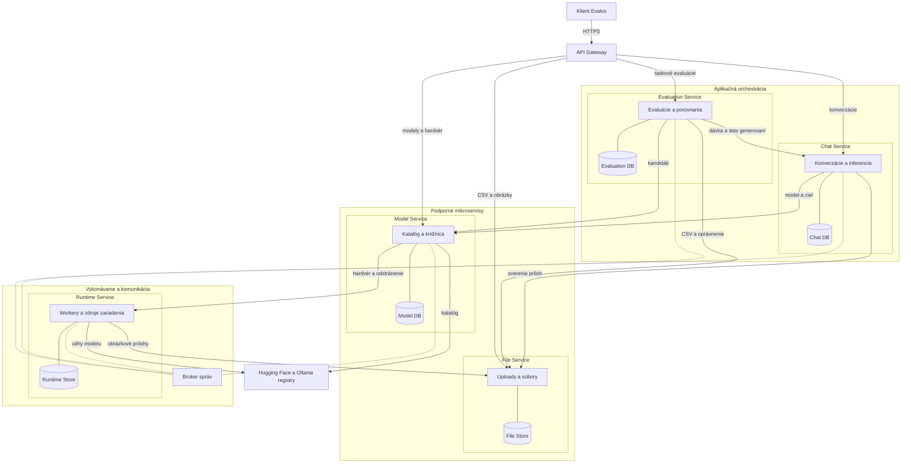

# Mikroservisná architektúra – Zadanie 2

[Späť na zadanie](README.md) · [Endpointy](ENDPOINTY.md)

Používateľ stiahne kompatibilné základné modely a vyskúša ich v bežných konverzáciách. Pri evaluácii jednej úlohy pripraví testovacie vstupy a referenčné výstupy ručne alebo z CSV. Systém odošle rovnaké vstupy vybraným modelom, vyhodnotí odpovede a porovná počet tokenov a dostupné náklady. Používajú sa stiahnuté váhy bez fine-tuningu.

Plná šípka zobrazuje priame volanie a plná čiara k úložisku vlastníctvo dát. Prerušované spojenia zobrazujú komunikáciu cez broker. Presný smer príkazov a udalostí je uvedený v tabuľke nižšie.

## Služby a vlastníctvo dát

| Mikroservis | Čo má robiť v tomto pohľade | Vlastné dáta |
| --- | --- | --- |
| Model Service | Ponúka modely a varianty, overuje zariadenie a riadi download. Udržiava knižnicu základných modelov pripravených na použitie. | Model DB: metadáta modelov, device_id, runtime_model_id a stav download_id. |
| File Service | Prijíma CSV testovacích prípadov a voliteľné obrazové prílohy. Poskytuje obsah a metadáta cez vlastné rozhranie. | File DB a súkromný File Store: metadáta a používateľské prílohy. |
| Chat Service | Vedie bežné aj evaluačné konverzácie, prijíma dávky generovaní a normalizuje ich výsledky a spotrebu. Každý testovací prípad má izolovaný kontext. | Chat DB: história, generation_id, snapshot vstupu, tool_calls a cenové položky. |
| Evaluation Service | Vlastní task, očakávané odpovede a pravidlo porovnania. Riadi beh nad kandidátmi, čaká na výsledky Chat Service a vytvára report podľa prípadov a modelov. | Evaluation DB: prípady, referencie, run_id, comparison_id, výsledkové projekcie a voľby používateľov. |
| Runtime Service | Sťahuje a načítava modely, vykonáva lokálnu inferenciu a rezervuje potrebné GPU a pamäťové zdroje. | Runtime DB a Runtime Store: lokálne váhy, dostupnosť a aktívne inferenčné vykonania. |

## Volania medzi službami

| Volajúca služba | Cieľ | Endpointy | Úloha volania |
| --- | --- | --- | --- |
| Model Service | Runtime Service | `GET /internal/v1/devices/{device_id}/hardware`; `DELETE /internal/v1/runtime-models/{runtime_model_id}` | Overiť zariadenie a vykonať správu lokálnych váh. |
| Evaluation Service | Model Service | `GET /api/v1/models/{model_id}` | Overiť kandidátov, modality a dostupnosť modelov vybraných pre beh. |
| Evaluation Service | File Service | `POST /internal/v1/files/resolve`; `GET /api/v1/files/{file_id}/content` | Overiť a načítať CSV; prípady a referencie uložiť do vlastnej Evaluation DB. |
| Evaluation Service | Chat Service | `POST /internal/v1/generation-batches` | V režime generate prijať kombinácie vstupu a kandidáta ako samostatné generovania. Očakávané odpovede sa neposielajú. |
| Evaluation Service | Chat Service | `GET /api/v1/generations/{generation_id}`; `GET /api/v1/conversations/{conversation_id}/messages` | Zosúladiť dokončenie a stav; v režime existing_conversations overiť mapované vstupy a vyhodnotiť uložené odpovede bez nového spustenia. |
| Chat Service | Model Service | `GET /api/v1/models/{model_id}` | Vybrať správny runtime a overiť schopnosti kandidáta. |
| Chat Service | File Service | `POST /internal/v1/files/resolve` | Overiť prílohy vstupu pred prijatím práce. |
| Runtime Service | File Service | `GET /api/v1/files/{file_id}/content` | Načítať povolené obrazové dáta pre lokálny model. |

Verejné trasy `/api/v1` volajú interné služby priamo na vlastníka kontraktu. `GET /api/v1/hardware` vlastní Model Service a načítava skutočné zdroje zariadenia z Runtime Service. Navrhnuté trasy `/internal/v1` a externé adaptéry majú samostatné rozhrania.

## Príkazy a udalosti

| Producent | Konzument | Správa | Úloha |
| --- | --- | --- | --- |
| Model Service | Runtime Service | `model.download.requested` | Stiahnuť presnú revíziu a variant na device_id. |
| Runtime Service | Model Service | `model.download.progress`, `model.download.completed`, `model.download.failed` | Priebeh a výsledok so záznamom runtime_model_id. Knižnicu aktualizuje Model Service. |
| Chat Service | Runtime Service | `runtime.inference.requested` | Vykonať pripravené lokálne generovanie. |
| Runtime Service | Chat Service | `inference.completed`, `inference.requires_tool_results`, `inference.failed` | Vrátiť odpoveď, volania nástrojov, použitie tokenov alebo chybu. Chat Service uloží stav a históriu. |
| Chat Service | Evaluation Service | `generation.completed`, `generation.failed` | Priradiť výsledok ku kandidátovi, testu alebo porovnávaciemu kolu. |

## Hlavný tok

1. Vybrať a stiahnuť kompatibilné modely, potom ich podľa potreby vyskúšať v konverzácii.
2. Vytvoriť evaluáciu cez `POST /api/v1/evaluations`. Pridať testovacie prípady ručne alebo importovať CSV so stĺpcami `input` a `výsledok`.
3. Spustiť `POST /api/v1/evaluations/{evaluation_id}/runs`. Režim `generate` vykoná rovnaké vstupy pre kandidátov. Režim `existing_conversations` vyhodnotí mapované odpovede z uložených konverzácií.
4. Načítať vyhodnotené prípady a porovnanie kvality, tokenov a dostupných cien cez `/api/v1/evaluation-runs/{run_id}` a jeho podzdroje.

Evaluation Service ukladá plán prípadu a kandidáta a koreluje výsledky cez `generation_id`. Každé testovacie vykonanie v režime `generate` má vlastný kontext. Režim `existing_conversations` číta existujúce správy a stavy. Očakávané výstupy sa používajú až pri hodnotení.

## Spoločné pravidlá

Každá doménová služba vlastní svoje údaje a má vlastné prístupové oprávnenia. Brána overí vstupnú identitu a smeruje požiadavku. Pri čítaní a zápise doménové služby overujú prístup k vlastným zdrojom.

Runtime Service reportuje zdroje konkrétneho zariadenia podľa `device_id`. Na prenášanie príkazov a výsledkov sa používa broker. Veľké súbory zostávajú v úložiskách a správy prenášajú ich identifikátory. Producent trvalo zapisuje prácu a udalosť pomocou outboxu. Konzument opakovanú správu rozpozná podľa `message_id` a ID vykonania.
