# API kontrakty – Zadanie 3

[Späť na zadanie](README.md) · [Zoznam endpointov](ENDPOINTY.md) · [Architektúra](ARCHITEKTURA.md)

Návrh 32 verejných kontraktov pre toto zadanie. Príklady používajú syntetické identifikátory, vstupy a ceny. Čísla endpointov zodpovedajú spoločnému návrhu Evalva.

## Spoločné konvencie

- Základ verejných trás je `/api/v1`. Hlavička `Authorization: Bearer EVALVO_ACCESS_TOKEN` používa zástupný token. Pri každom zdroji sa overujú oprávnenia.
- `GET` a `DELETE` používajú parametre cesty a query. Ich dokumentačný JSON slúži ako prehľad parametrov. `POST`, `PUT` a `PATCH` používajú `application/json`, okrem uploadu s `multipart/form-data`.
- `201` označuje vytvorený zdroj. `202` potvrdzuje prijatie dlhšej operácie a obsahuje identifikátor a `status_url`. Pri čítaní už prijatej úlohy vracia `200` aktuálny stav vrátane prípadnej doménovej chyby.
- Pre opakované čítanie kolekcií sa používa `cursor` z `next_cursor` a `limit` od 1 do 100, predvolene 20.
- Pri spustení asynchrónnej práce sa používa `Idempotency-Key`. Kľúč je viazaný na identitu a operáciu aspoň 24 hodín. Opakované rovnaké volanie vráti pôvodné ID. Iný obsah pod tým istým kľúčom vráti `409 IDEMPOTENCY_CONFLICT`.
- Časy sú v UTC, veľkosti v bajtoch a tokeny ako celé čísla. Cena je desatinný reťazec s menou. Pri neznámom náklade má `amount` hodnotu `null` a `status` je `unknown`.

Pri použití agenta má explicitne zvolený model prednosť pred predvoleným modelom jeho profilu. Služby pri prijatí generovania alebo kola zachytia použité inštrukcie a parametre.

### Spoločný formát chyby

Pri neplatnej identite sa vracia `401`, pri chýbajúcom oprávnení `403` alebo podľa viditeľnosti zdroja `404`. Doménové chyby sú uvedené pri jednotlivých endpointoch.

```json
{
  "error": {
    "code": "VALIDATION_ERROR",
    "message": "Požiadavka obsahuje neplatnú hodnotu.",
    "details": {
      "fields": [
        {
          "field": "parameters.epochs",
          "reason": "Hodnota musí byť kladné celé číslo."
        }
      ]
    },
    "request_id": "req_demo_01",
    "retryable": false
  }
}
```

## Stiahnutie a správa LLM modelov

### 01 Zistenie hardvéru

**GET `/api/v1/hardware`**

Zistiť výpočtové zdroje zariadenia, na ktorom sa majú lokálne modely spúšťať.

**Parametre cesty a query — nie HTTP body**

```json
{
  "query": {
    "device_id": "device_01"
  }
}
```

**Sekvenčný diagram**

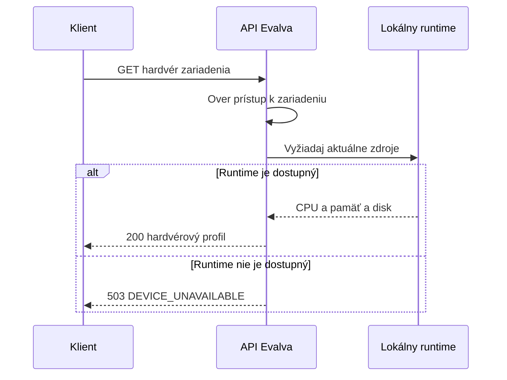

**JSON výstupu — HTTP 200**

```json
{
  "device_id": "device_01",
  "cpu": {
    "logical_cores": 8
  },
  "ram": {
    "total_bytes": 34359738368,
    "available_bytes": 25769803776
  },
  "gpus": [
    {
      "name": "Demo GPU",
      "vram_total_bytes": 17179869184,
      "vram_available_bytes": 12884901888
    }
  ],
  "disk_available_bytes": 128849018880,
  "captured_at": "2026-11-17T18:00:00Z"
}
```

**Chybové stavy:** `404 DEVICE_NOT_FOUND`; `503 DEVICE_UNAVAILABLE`.

### 02 Vyhľadanie modelov v katalógu

**GET `/api/v1/model-catalog`**

Vyhľadať modely z Hugging Face a Ollama a filtrovať ich podľa zdroja, kompresie a vhodnosti pre zariadenie.

**Parametre cesty a query — nie HTTP body**

```json
{
  "query": {
    "source": "huggingface",
    "search": "demo",
    "compatible_with": "device_01",
    "limit": 20
  }
}
```

**Sekvenčný diagram**

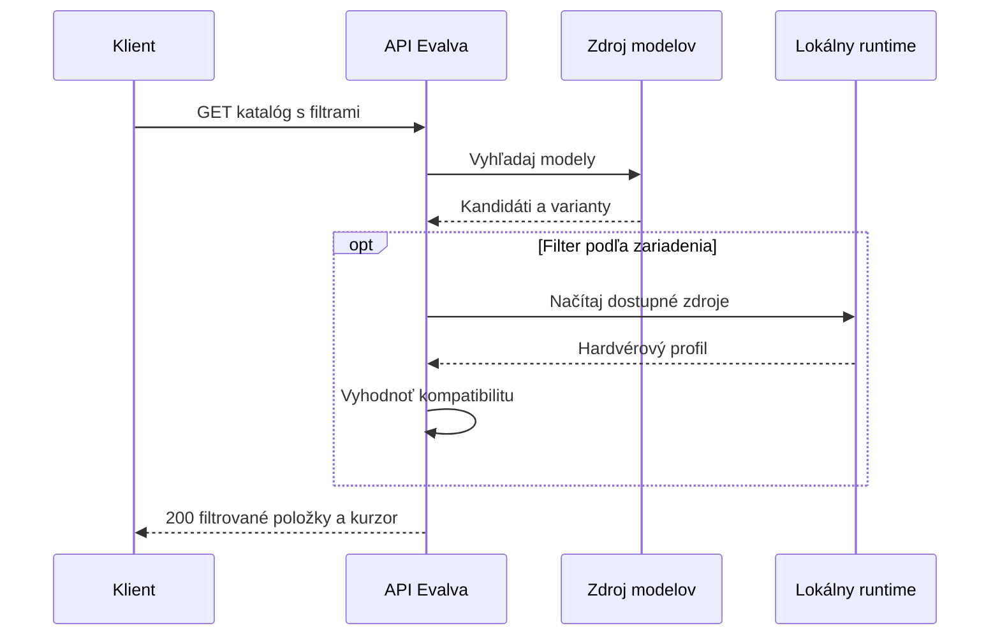

**JSON výstupu — HTTP 200**

```json
{
  "items": [
    {
      "catalog_model_id": "cat_demo_3b",
      "name": "Evalvo Demo 3B",
      "source": "huggingface",
      "source_model_id": "demo/evalvo-3b",
      "modalities": [
        "text"
      ],
      "compatibility": "compatible"
    }
  ],
  "next_cursor": null
}
```

**Chybové stavy:** `422 INVALID_QUERY`; `503 MODEL_SOURCE_UNAVAILABLE`.

Parameter source prijíma huggingface alebo ollama. Filter výkonu vychádza zo zvoleného lokálneho zariadenia.

### 03 Detail katalógového modelu

**GET `/api/v1/model-catalog/{catalog_model_id}`**

Zobraziť detail modelu dostupného na stiahnutie.

**Parametre cesty a query — nie HTTP body**

```json
{
  "path": {
    "catalog_model_id": "cat_demo_3b"
  }
}
```

**Sekvenčný diagram**

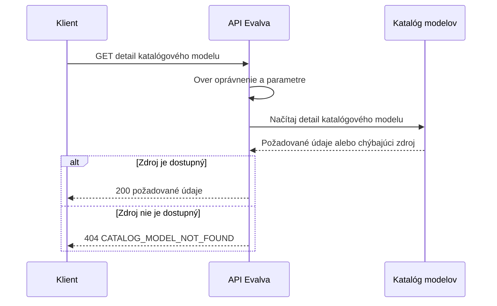

**JSON výstupu — HTTP 200**

```json
{
  "catalog_model_id": "cat_demo_3b",
  "name": "Evalvo Demo 3B",
  "source": "huggingface",
  "source_model_id": "demo/evalvo-3b",
  "modalities": [
    "text"
  ],
  "variant_ids": [
    "var_demo_q4",
    "var_demo_bf16"
  ]
}
```

**Chybové stavy:** `404 CATALOG_MODEL_NOT_FOUND`.

### 04 Varianty kompresie

**GET `/api/v1/model-catalog/{catalog_model_id}/variants`**

Zobraziť dostupné varianty kompresie vybraného modelu.

**Parametre cesty a query — nie HTTP body**

```json
{
  "path": {
    "catalog_model_id": "cat_demo_3b"
  }
}
```

**Sekvenčný diagram**

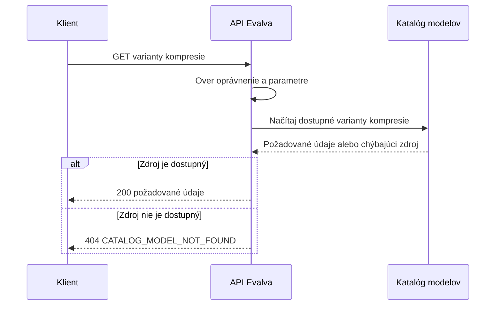

**JSON výstupu — HTTP 200**

```json
{
  "items": [
    {
      "variant_id": "var_demo_q4",
      "compression": "Q4_K_M",
      "format": "gguf",
      "size_bytes": 2147483648,
      "supports_fine_tuning": false
    },
    {
      "variant_id": "var_demo_bf16",
      "compression": "BF16",
      "format": "safetensors",
      "size_bytes": 6442450944,
      "supports_fine_tuning": true
    }
  ],
  "next_cursor": null
}
```

**Chybové stavy:** `404 CATALOG_MODEL_NOT_FOUND`.

### 05 Kompatibilita variantu

**GET `/api/v1/model-catalog/{catalog_model_id}/variants/{variant_id}/compatibility`**

Overiť vhodnosť variantu pre zariadenie a vrátiť dôvod prípadného blokovania.

**Parametre cesty a query — nie HTTP body**

```json
{
  "path": {
    "catalog_model_id": "cat_demo_3b",
    "variant_id": "var_demo_q4"
  },
  "query": {
    "device_id": "device_01",
    "context_length": 4096,
    "parallel_requests": 1
  }
}
```

**Sekvenčný diagram**

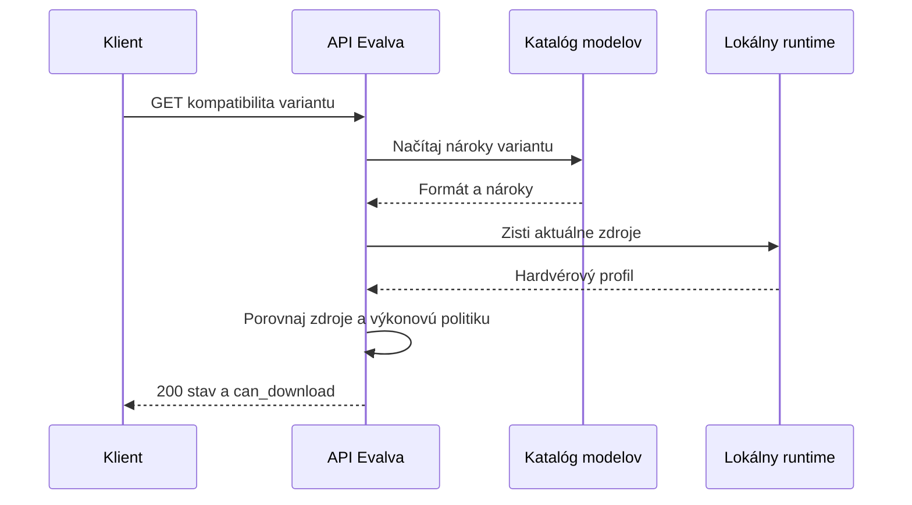

**JSON výstupu — HTTP 200**

```json
{
  "catalog_model_id": "cat_demo_3b",
  "variant_id": "var_demo_q4",
  "device_id": "device_01",
  "status": "compatible",
  "can_download": true,
  "checks": {
    "runtime": "passed",
    "memory": "passed",
    "disk": "passed",
    "performance": "passed"
  },
  "estimates": {
    "required_vram_bytes": 3221225472,
    "tokens_per_second": 25,
    "is_estimate": true
  },
  "reasons": []
}
```

**Chybové stavy:** `404 MODEL_VARIANT_NOT_FOUND`; `503 DEVICE_UNAVAILABLE`.

status má hodnoty compatible, incompatible alebo unknown. can_download je true iba pri compatible. Výkonové odhady a prah plynulosti vychádzajú z politiky konkrétneho runtime; uvedené čísla sú syntetický príklad. POST model-downloads kontrolu zopakuje.

### 06 Spustenie sťahovania

**POST `/api/v1/model-downloads`**

Spustiť sťahovanie zvoleného modelu a variantu. Pred začatím vynútiť kontrolu výkonu zariadenia a nevhodný model zablokovať.

**JSON vstupu — application/json**

```json
{
  "catalog_model_id": "cat_demo_3b",
  "variant_id": "var_demo_q4",
  "device_id": "device_01",
  "context_length": 4096,
  "parallel_requests": 1
}
```

**Sekvenčný diagram**

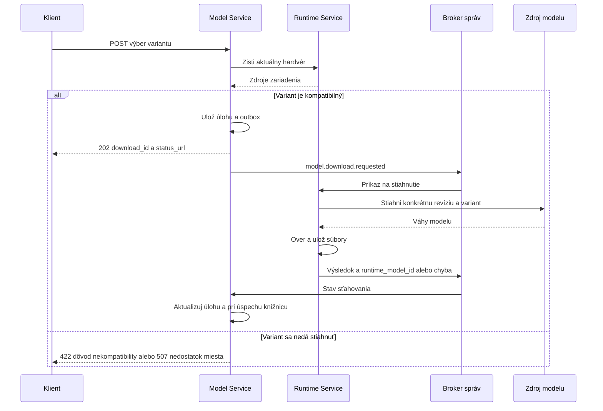

**JSON výstupu — HTTP 202**

```json
{
  "download_id": "dl_01",
  "status": "queued",
  "progress": {
    "downloaded_bytes": 0,
    "total_bytes": 2147483648
  },
  "model_id": null,
  "status_url": "/api/v1/model-downloads/dl_01"
}
```

**Chybové stavy:** `422 MODEL_INCOMPATIBLE`; `422 PERFORMANCE_NOT_VERIFIED`; `507 INSUFFICIENT_STORAGE`.

### 07 Stav sťahovania

**GET `/api/v1/model-downloads/{download_id}`**

Zobraziť stav a priebeh sťahovania; po dokončení vrátiť odkaz na model v knižnici alebo chybu.

**Parametre cesty a query — nie HTTP body**

```json
{
  "path": {
    "download_id": "dl_01"
  }
}
```

**Sekvenčný diagram**

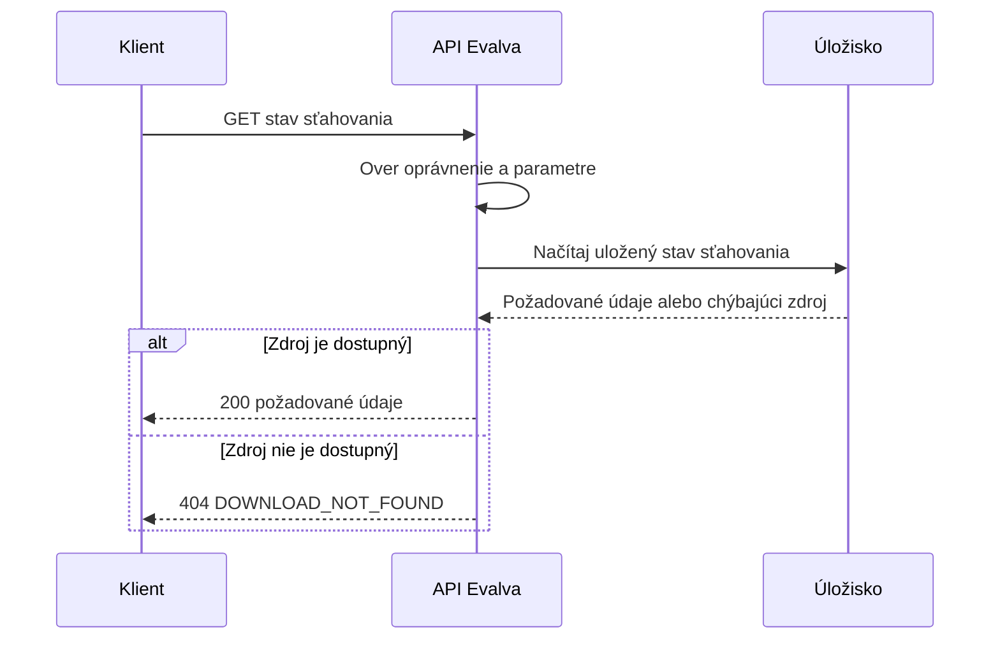

**JSON výstupu — HTTP 200**

```json
{
  "download_id": "dl_01",
  "status": "completed",
  "progress": {
    "downloaded_bytes": 2147483648,
    "total_bytes": 2147483648
  },
  "model_id": "mdl_local_01",
  "error": null
}
```

**Chybové stavy:** `404 DOWNLOAD_NOT_FOUND`.

Počas spracovania je model_id null. Pri failed obsahuje error konkrétny dôvod; čítanie stavu sťahovanie znovu nespustí.

### 08 Knižnica modelov

**GET `/api/v1/models`**

Zobraziť základné stiahnuté modely v knižnici.

**Parametre cesty a query — nie HTTP body**

```json
{
  "query": {
    "limit": 20
  }
}
```

**Sekvenčný diagram**

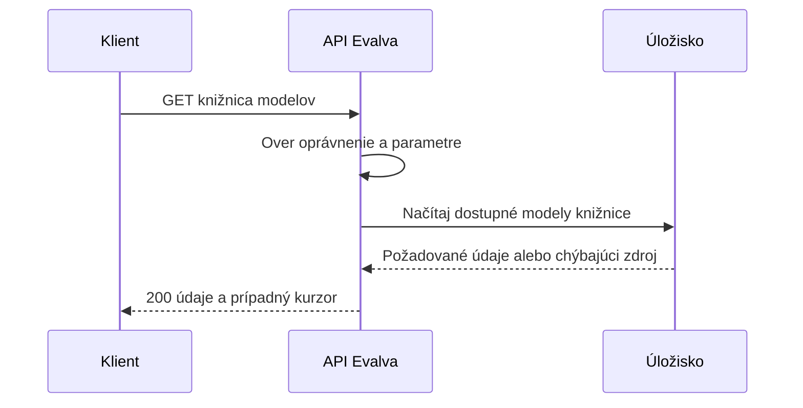

**JSON výstupu — HTTP 200**

```json
{
  "items": [
    {
      "model_id": "mdl_local_01",
      "name": "Evalvo Demo 3B Q4",
      "kind": "local",
      "status": "ready"
    },
    {
      "model_id": "mdl_local_02",
      "name": "Evalvo Demo 7B Q4",
      "kind": "local",
      "status": "ready"
    },
    {
      "model_id": "mdl_local_vision_01",
      "name": "Evalvo Demo Vision",
      "kind": "local",
      "status": "ready"
    }
  ],
  "next_cursor": null
}
```

**Chybové stavy:** `422 INVALID_QUERY`.

### 09 Detail modelu knižnice

**GET `/api/v1/models/{model_id}`**

Načítať detail stiahnutého modelu a jeho podporované vstupy a možnosti.

**Parametre cesty a query — nie HTTP body**

```json
{
  "path": {
    "model_id": "mdl_local_02"
  }
}
```

**Sekvenčný diagram**

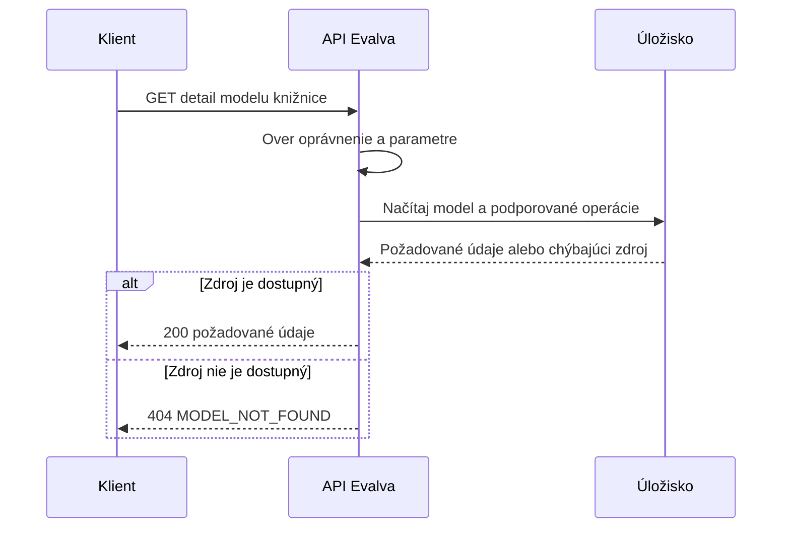

**JSON výstupu — HTTP 200**

```json
{
  "model_id": "mdl_local_02",
  "name": "Evalvo Demo 7B Q4",
  "kind": "local",
  "status": "ready",
  "format": "gguf",
  "device_id": "device_01",
  "capabilities": {
    "text": true,
    "images": false,
    "tools": false,
    "fine_tuning": false
  },
  "fine_tuning": {
    "methods": [],
    "parameters": []
  }
}
```

**Chybové stavy:** `404 MODEL_NOT_FOUND`.

### 10 Odstránenie lokálneho modelu

**DELETE `/api/v1/models/{model_id}`**

Odstrániť stiahnutý model z knižnice a zo zariadenia.

**Parametre cesty a query — nie HTTP body**

```json
{
  "path": {
    "model_id": "mdl_local_01"
  }
}
```

**Sekvenčný diagram**

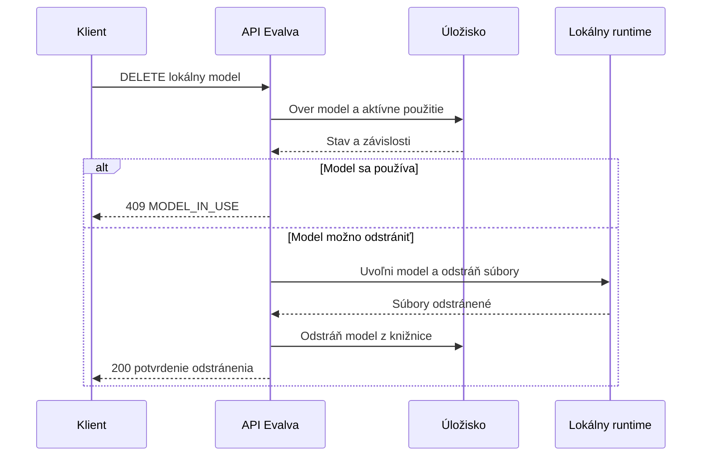

**JSON výstupu — HTTP 200**

```json
{
  "model_id": "mdl_local_01",
  "deleted": true,
  "released_bytes": 2147483648
}
```

**Chybové stavy:** `404 MODEL_NOT_FOUND`; `409 MODEL_IN_USE`; `422 MODEL_NOT_LOCAL`.

Runtime overí, či lokálny model nemá aktívne použitie. Pri používanom modeli vráti `409 MODEL_IN_USE`.

## Súbory

### 11 Nahratie súboru

**POST `/api/v1/files`**

Nahrať obrázok pre konverzáciu alebo porovnávacie kolo a získať `file_id`.

**Vstup — `multipart/form-data`**

| Pole | Typ | Hodnota |
| --- | --- | --- |
| `file` | súbor | Obrázok JPG. |
| `purpose` | text | `image` pre obrázok. |

V následnej generácii alebo porovnávacom kole sa obrázok prenáša odkazom `file_id`.

**Sekvenčný diagram**

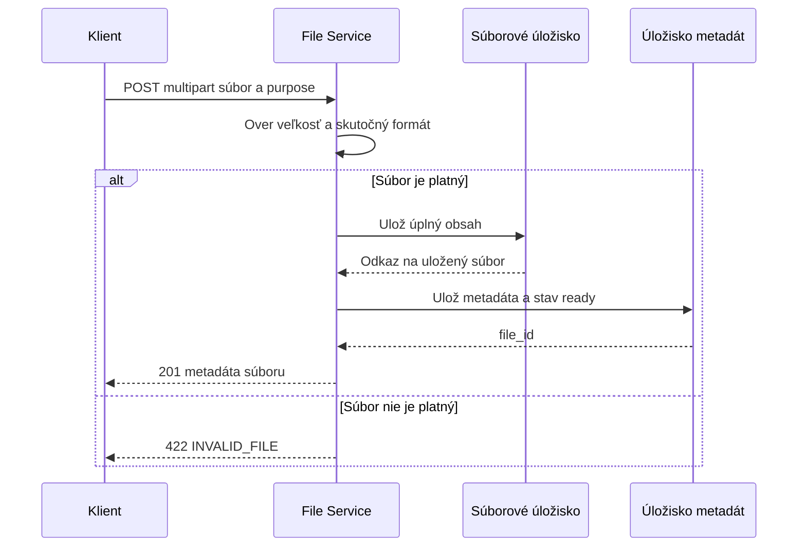

**JSON výstupu — HTTP 201**

```json
{
  "file_id": "file_image_01",
  "filename": "image.jpg",
  "purpose": "image",
  "media_type": "image/jpeg",
  "size_bytes": 24013,
  "status": "ready"
}
```

**Chybové stavy:** `413 FILE_TOO_LARGE`; `415 UNSUPPORTED_MEDIA_TYPE`; `422 INVALID_FILE`.

### 12 Načítanie obsahu súboru

**GET `/api/v1/files/{file_id}/content`**

Načítať obsah nahratého súboru alebo zobraziť uložený obrázok.

**Parametre cesty a query — nie HTTP body**

```json
{
  "path": {
    "file_id": "file_image_01"
  }
}
```

**Sekvenčný diagram**

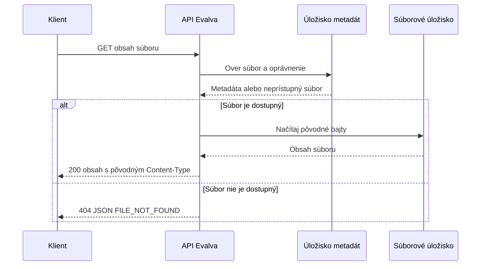

**Úspešný výstup — HTTP 200**

`Content-Type: image/jpeg` a `Content-Disposition: inline; filename="image.jpg"`. Úspešná odpoveď obsahuje pôvodné bajty súboru. Nasledujúca JSON ukážka ukazuje chybovú odpoveď pre neexistujúce `file_id`.

**JSON chyby — HTTP 404**

```json
{
  "error": {
    "code": "FILE_NOT_FOUND",
    "message": "Súbor neexistuje alebo k nemu nie je prístup.",
    "details": {
      "file_id": "file_image_01"
    },
    "request_id": "req_demo_12",
    "retryable": false
  }
}
```

**Chybové stavy:** `404 FILE_NOT_FOUND`.

## Konverzácie a používanie modelov

### 30 Vytvorenie konverzácie

**POST `/api/v1/conversations`**

Vytvoriť konverzáciu so stiahnutým modelom a voliteľným uloženým agentom.

**JSON vstupu — application/json**

```json
{
  "model_id": "mdl_local_01",
  "agent_id": "agent_01",
  "title": "Test matematickej úlohy"
}
```

**Sekvenčný diagram**

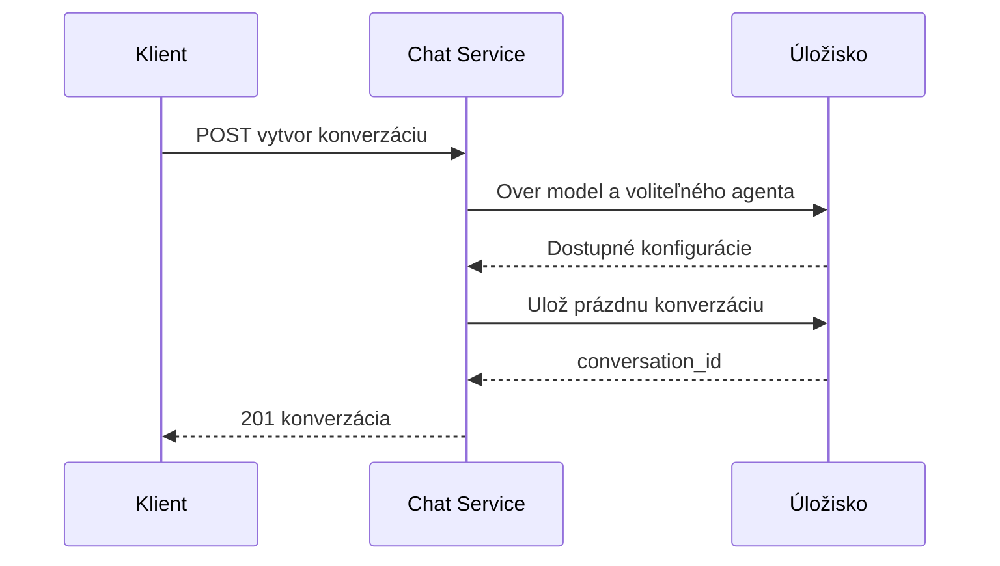

**JSON výstupu — HTTP 201**

```json
{
  "conversation_id": "conv_01",
  "model_id": "mdl_local_01",
  "agent_id": "agent_01",
  "title": "Test matematickej úlohy",
  "message_count": 0,
  "status": "idle",
  "created_at": "2026-11-17T18:00:00Z"
}
```

**Chybové stavy:** `404 MODEL_OR_AGENT_NOT_FOUND`; `422 MODEL_NOT_READY`.

Vytvorenie konverzácie negeneruje odpoveď. Vstup sa odosiela cez POST /api/v1/generations.

### 31 Zoznam konverzácií

**GET `/api/v1/conversations`**

Zobraziť uložené konverzácie.

**Parametre cesty a query — nie HTTP body**

```json
{
  "query": {
    "limit": 20
  }
}
```

**Sekvenčný diagram**


**JSON výstupu — HTTP 200**

```json
{
  "items": [
    {
      "conversation_id": "conv_01",
      "model_id": "mdl_local_01",
      "agent_id": "agent_01",
      "title": "Test matematickej úlohy",
      "message_count": 2,
      "status": "idle",
      "updated_at": "2026-11-17T18:00:05Z"
    }
  ],
  "next_cursor": null
}
```

**Chybové stavy:** `422 INVALID_QUERY`.

### 32 Detail konverzácie

**GET `/api/v1/conversations/{conversation_id}`**

Zobraziť detail konverzácie a jej priradený model a agenta.

**Parametre cesty a query — nie HTTP body**

```json
{
  "path": {
    "conversation_id": "conv_01"
  }
}
```

**Sekvenčný diagram**

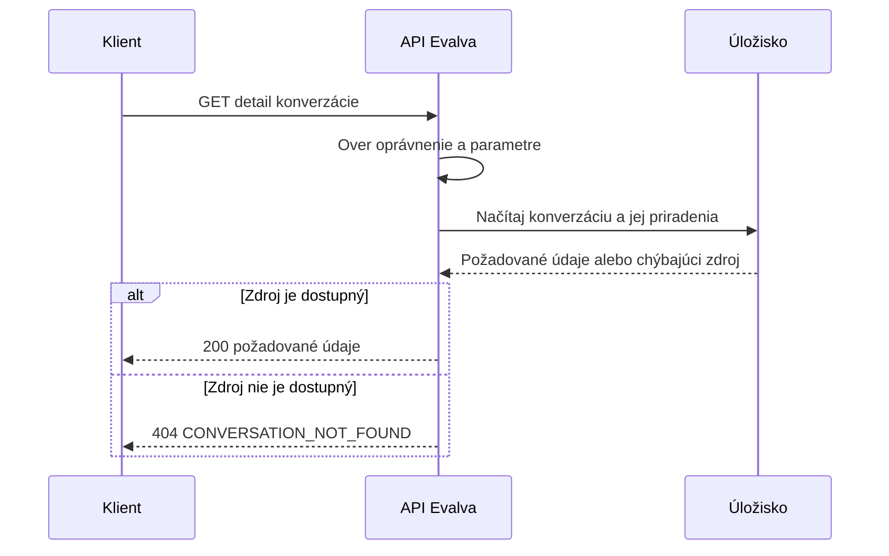

**JSON výstupu — HTTP 200**

```json
{
  "conversation_id": "conv_01",
  "model_id": "mdl_local_01",
  "agent_id": "agent_01",
  "title": "Test matematickej úlohy",
  "message_count": 2,
  "last_message_id": "msg_a01",
  "active_generation_id": null,
  "status": "idle"
}
```

**Chybové stavy:** `404 CONVERSATION_NOT_FOUND`.

### 33 História správ

**GET `/api/v1/conversations/{conversation_id}/messages`**

Načítať celú uloženú históriu správ a odpovedí v správnom poradí.

**Parametre cesty a query — nie HTTP body**

```json
{
  "path": {
    "conversation_id": "conv_01"
  },
  "query": {
    "limit": 50
  }
}
```

**Sekvenčný diagram**

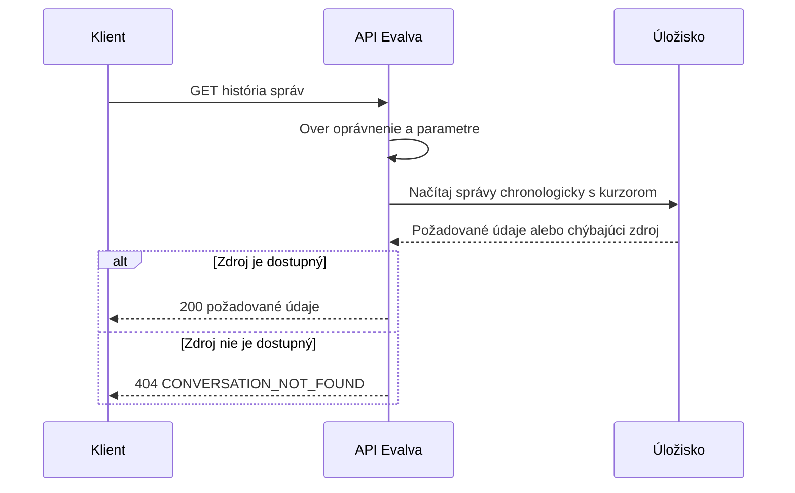

**JSON výstupu — HTTP 200**

```json
{
  "items": [
    {
      "message_id": "msg_u01",
      "role": "user",
      "content": [
        {
          "type": "text",
          "text": "Koľko je dva plus dva?"
        }
      ],
      "generation_id": "gen_01",
      "created_at": "2026-11-17T18:00:00Z"
    },
    {
      "message_id": "msg_a01",
      "role": "assistant",
      "content": [
        {
          "type": "text",
          "text": "4"
        }
      ],
      "generation_id": "gen_01",
      "created_at": "2026-11-17T18:00:05Z"
    }
  ],
  "next_cursor": null
}
```

**Chybové stavy:** `404 CONVERSATION_NOT_FOUND`; `422 INVALID_QUERY`.

Stránkovanie nemení poradie histórie. Odkaz na obrázok sa vracia ako file_id a obsah možno načítať cez GET /api/v1/files/{file_id}/content.

### 34 Spustenie generovania

**POST `/api/v1/generations`**

Spustiť generovanie základného lokálneho modelu. Pri použití agenta zachytiť a vložiť jeho inštrukcie do kontextu. Nové správy sa ukladajú do príslušnej konverzácie.

**JSON vstupu — application/json**

```json
{
  "conversation_id": "conv_01",
  "model_id": "mdl_local_01",
  "agent_id": "agent_01",
  "input": {
    "text": "Koľko je dva plus dva?",
    "image_file_ids": []
  },
  "parameters": {
    "temperature": 0.2,
    "max_output_tokens": 512
  },
  "tools": []
}
```

**Alternatívny vstup s obrázkom**

```json
{
  "conversation_id": "conv_image_01",
  "model_id": "mdl_local_vision_01",
  "input": {
    "text": "Čo je na obrázku?",
    "image_file_ids": [
      "file_image_01"
    ]
  },
  "parameters": {
    "max_output_tokens": 128
  },
  "tools": []
}
```

**Alternatívny vstup s nástrojom vykonávaným klientom**

```json
{
  "conversation_id": "conv_tool_01",
  "model_id": "mdl_local_tools_01",
  "input": {
    "text": "Zisti stav objednávky ORD-42.",
    "image_file_ids": []
  },
  "parameters": {
    "max_output_tokens": 512
  },
  "tools": [
    {
      "type": "function",
      "execution": "client",
      "name": "lookup_order",
      "description": "Načíta stav objednávky.",
      "input_schema": {
        "type": "object",
        "properties": {
          "order_id": {
            "type": "string"
          }
        },
        "required": [
          "order_id"
        ],
        "additionalProperties": false
      }
    }
  ]
}
```

**Sekvenčný diagram**

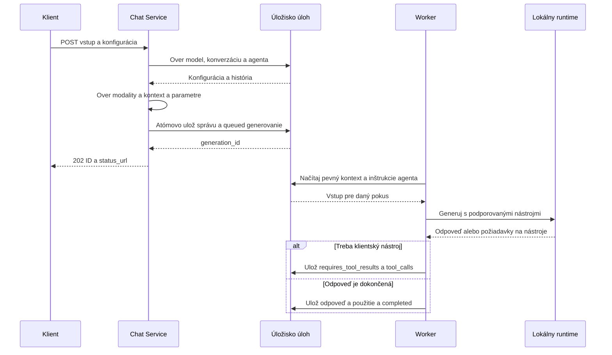

**JSON výstupu — HTTP 202**

```json
{
  "generation_id": "gen_01",
  "conversation_id": "conv_01",
  "status": "queued",
  "user_message_id": "msg_u01",
  "status_url": "/api/v1/generations/gen_01"
}
```

**Chybové stavy:** `404 MODEL_CONVERSATION_OR_AGENT_NOT_FOUND`; `409 CONVERSATION_BUSY`; `409 CONVERSATION_MODEL_MISMATCH`; `422 CONTEXT_LIMIT_EXCEEDED`; `422 UNSUPPORTED_INPUT_OR_PARAMETER`.

Samostatné generovanie môže vynechať `conversation_id`. Pri konverzácii sa explicitný `model_id` musí zhodovať s jej modelom. Konverzácia má najviac jedno aktívne generovanie. Prekročenie kontextu vráti `422 CONTEXT_LIMIT_EXCEEDED`.

Agent uvedený v požiadavke má prednosť pred agentom konverzácie. Jeho inštrukcie sa zachytia pred odoslaním a použijú pri danom pokuse.

Obrazová a nástrojová ukážka predpokladajú, že uvedené modely podporujú príslušnú modalitu alebo nástroje.

### 35 Stav a výsledok generovania

**GET `/api/v1/generations/{generation_id}`**

Načítať stav generovania, požiadavky na nástroje a po ukončení úplnú odpoveď alebo chybu.

**Parametre cesty a query — nie HTTP body**

```json
{
  "path": {
    "generation_id": "gen_01"
  }
}
```

**Sekvenčný diagram**

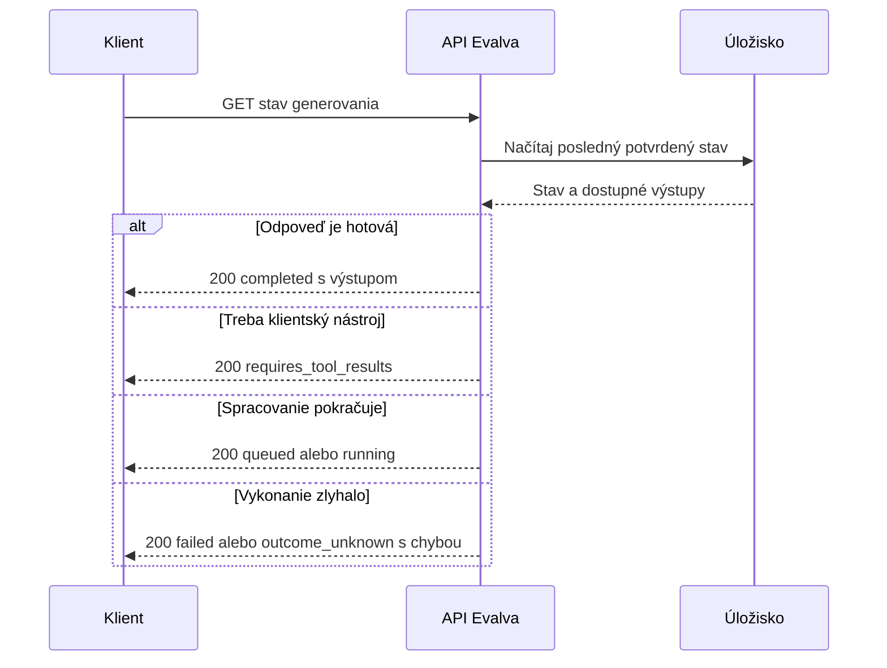

**JSON výstupu — HTTP 200**

```json
{
  "generation_id": "gen_01",
  "conversation_id": "conv_01",
  "model_id": "mdl_local_01",
  "agent_id": "agent_01",
  "status": "completed",
  "output": {
    "message_id": "msg_a01",
    "text": "4",
    "image_file_ids": []
  },
  "tool_calls": [],
  "usage": {
    "input_tokens": 100,
    "output_tokens": 1,
    "total_tokens": 101,
    "cost": {
      "amount": null,
      "currency": null,
      "status": "unknown",
      "reason": "LOCAL_COST_NOT_CONFIGURED"
    }
  },
  "error": null
}
```

**Generovanie čakajúce na klientský nástroj — HTTP 200**

```json
{
  "generation_id": "gen_tool_01",
  "conversation_id": "conv_tool_01",
  "model_id": "mdl_local_tools_01",
  "status": "requires_tool_results",
  "output": null,
  "tool_calls": [
    {
      "tool_call_id": "tc_01",
      "type": "function",
      "name": "lookup_order",
      "arguments": {
        "order_id": "ORD-42"
      }
    }
  ],
  "usage": null,
  "error": null
}
```

**Chybové stavy:** `404 GENERATION_NOT_FOUND`.

Chyba prijatej úlohy je súčasťou zdroja generovania pri HTTP `200`. HTTP `404` označuje nenájdené ID.

### 36 Odovzdanie výsledkov nástrojov

**POST `/api/v1/generations/{generation_id}/tool-results`**

Doplniť výsledky nástrojov vykonaných klientom a umožniť pokračovanie generovania čakajúceho na tieto výsledky.

**Parametre cesty a query — nie HTTP body**

```json
{
  "path": {
    "generation_id": "gen_tool_01"
  }
}
```

**JSON vstupu — application/json**

```json
{
  "tool_results": [
    {
      "tool_call_id": "tc_01",
      "output": {
        "order_id": "ORD-42",
        "status": "shipped"
      }
    }
  ]
}
```

**Sekvenčný diagram**

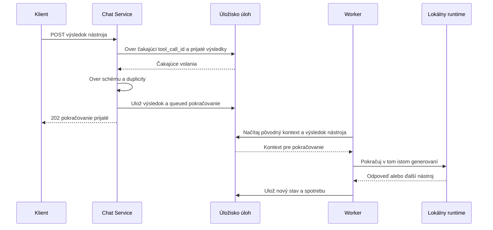

**JSON výstupu — HTTP 202**

```json
{
  "generation_id": "gen_tool_01",
  "status": "queued",
  "accepted_tool_call_ids": [
    "tc_01"
  ],
  "status_url": "/api/v1/generations/gen_tool_01"
}
```

**Chybové stavy:** `404 GENERATION_NOT_FOUND`; `409 GENERATION_NOT_WAITING_FOR_TOOLS`; `409 TOOL_RESULT_CONFLICT`; `422 TOOL_RESULT_INVALID`.

Nevytvára sa nové generation_id. Rovnaký tool_call_id s rovnakým výsledkom sa započíta iba raz; iný výsledok pre už prijaté volanie spôsobí konflikt.

### 37 Spotreba konverzácie

**GET `/api/v1/conversations/{conversation_id}/usage`**

Zobraziť priebežné použitie tokenov, cenu a prepočet na 1 milión tokenov pre danú konverzáciu.

**Parametre cesty a query — nie HTTP body**

```json
{
  "path": {
    "conversation_id": "conv_01"
  }
}
```

**Sekvenčný diagram**

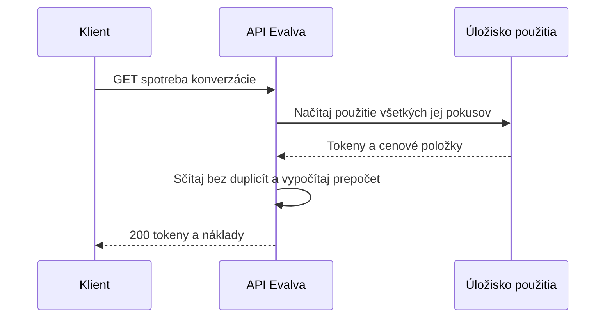

**JSON výstupu — HTTP 200**

```json
{
  "conversation_id": "conv_01",
  "model_id": "mdl_local_01",
  "input_tokens": 100,
  "output_tokens": 1,
  "total_tokens": 101,
  "cost": {
    "amount": null,
    "currency": null,
    "status": "unknown",
    "reason": "LOCAL_COST_NOT_CONFIGURED"
  },
  "effective_price_per_1m_tokens": null,
  "cost_complete": false
}
```

**Chybové stavy:** `404 CONVERSATION_NOT_FOUND`.

Efektívna cena za milión je celkový náklad × 1 000 000 / `total_tokens`. Pri nulovom počte alebo neúplnom cenovom podklade má hodnotu `null`.

## Agentové profily

### 53 Vytvorenie agenta

**POST `/api/v1/agents`**

Vytvoriť a uložiť agenta s inštrukciami a priradeným modelom.

**JSON vstupu — application/json**

```json
{
  "name": "Stručný asistent",
  "model_id": "mdl_local_01",
  "instructions": "Odpovedaj stručne a vecne. Pri matematickej úlohe vráť iba výsledné číslo."
}
```

**Sekvenčný diagram**

```mermaid
sequenceDiagram
    participant C as Klient
    participant A as API Evalva
    participant D as Úložisko
    C->>A: POST agent a inštrukcie
    A->>D: Over predvolený model
    D-->>A: Dostupný model
    A->>A: Over neprázdne inštrukcie
    A->>D: Ulož agenta
    D-->>A: agent_id
    A-->>C: 201 agent
```

**JSON výstupu — HTTP 201**

```json
{
  "agent_id": "agent_01",
  "name": "Stručný asistent",
  "model_id": "mdl_local_01",
  "instructions": "Odpovedaj stručne a vecne. Pri matematickej úlohe vráť iba výsledné číslo."
}
```

**Chybové stavy:** `404 MODEL_NOT_FOUND`; `422 INVALID_AGENT`.

Agent je uložený profil inštrukcií s predvoleným modelom. Explicitne zvolený model konverzácie alebo porovnávacieho kandidáta môže tento predvolený model nahradiť; použité inštrukcie sa zachytia pri spustení.

### 54 Zoznam agentov

**GET `/api/v1/agents`**

Zobraziť uložených agentov dostupných na výber.

**Parametre cesty a query — nie HTTP body**

```json
{
  "query": {
    "limit": 20
  }
}
```

**Sekvenčný diagram**

```mermaid
sequenceDiagram
    participant C as Klient
    participant A as API Evalva
    participant D as Úložisko
    C->>A: GET zoznam agentov
    A->>A: Over oprávnenie a parametre
    A->>D: Načítaj uložené profily agentov
    D-->>A: Požadované údaje alebo chýbajúci zdroj
    A-->>C: 200 údaje a prípadný kurzor
```

**JSON výstupu — HTTP 200**

```json
{
  "items": [
    {
      "agent_id": "agent_01",
      "name": "Stručný asistent",
      "model_id": "mdl_local_01"
    }
  ],
  "next_cursor": null
}
```

**Chybové stavy:** `422 INVALID_QUERY`.

### 55 Detail agenta

**GET `/api/v1/agents/{agent_id}`**

Načítať inštrukcie a priradený model agenta; umožniť jeho použitie cez odkaz v požiadavke.

**Parametre cesty a query — nie HTTP body**

```json
{
  "path": {
    "agent_id": "agent_01"
  }
}
```

**Sekvenčný diagram**

```mermaid
sequenceDiagram
    participant C as Klient
    participant A as API Evalva
    participant D as Úložisko
    C->>A: GET detail agenta
    A->>A: Over oprávnenie a parametre
    A->>D: Načítaj model a úplné inštrukcie agenta
    D-->>A: Požadované údaje alebo chýbajúci zdroj
    alt Zdroj je dostupný
    A-->>C: 200 požadované údaje
    else Zdroj nie je dostupný
    A-->>C: 404 AGENT_NOT_FOUND
    end
```

**JSON výstupu — HTTP 200**

```json
{
  "agent_id": "agent_01",
  "name": "Stručný asistent",
  "model_id": "mdl_local_01",
  "instructions": "Odpovedaj stručne a vecne. Pri matematickej úlohe vráť iba výsledné číslo."
}
```

**Chybové stavy:** `404 AGENT_NOT_FOUND`.

Odkaz na agenta sa v ďalších požiadavkách odovzdáva cez agent_id. Backend nepreberá inštrukcie z ľubovoľnej externej URL.

### 56 Úprava agenta

**PATCH `/api/v1/agents/{agent_id}`**

Upraviť uložené inštrukcie alebo priradený model pre nasledujúce použitia agenta.

**Parametre cesty a query — nie HTTP body**

```json
{
  "path": {
    "agent_id": "agent_01"
  }
}
```

**JSON vstupu — application/json**

```json
{
  "instructions": "Odpovedaj stručne, vecne a po slovensky. Pri matematickej úlohe vráť iba výsledné číslo."
}
```

**Sekvenčný diagram**

```mermaid
sequenceDiagram
    participant C as Klient
    participant A as API Evalva
    participant D as Úložisko
    C->>A: PATCH inštrukcie alebo model agenta
    A->>D: Načítaj agenta a over závislosti
    D-->>A: Aktuálna konfigurácia
    A->>A: Validuj menené polia
    A->>D: Ulož konfiguráciu pre nové použitia
    A-->>C: 200 aktualizovaný agent
```

**JSON výstupu — HTTP 200**

```json
{
  "agent_id": "agent_01",
  "name": "Stručný asistent",
  "model_id": "mdl_local_02",
  "instructions": "Odpovedaj stručne, vecne a po slovensky. Pri matematickej úlohe vráť iba výsledné číslo."
}
```

**Chybové stavy:** `404 AGENT_OR_MODEL_NOT_FOUND`; `422 INVALID_AGENT`.

Zmena agenta neprepíše prompt ani výsledok už prijatého generovania alebo spusteného evaluačného behu.

## Porovnávanie agentových prístupov

### 57 Vytvorenie porovnania

**POST `/api/v1/comparisons`**

Vytvoriť porovnanie stiahnutých modelov s voliteľnými agentmi a so samostatnou konverzáciou pre každého kandidáta.

**JSON vstupu — application/json**

```json
{
  "name": "Porovnanie sčítania",
  "candidates": [
    {
      "candidate_id": "candidate_local_a",
      "model_id": "mdl_local_01",
      "agent_id": "agent_01",
      "parameters": {
        "max_output_tokens": 512
      }
    },
    {
      "candidate_id": "candidate_local_b",
      "model_id": "mdl_local_02",
      "agent_id": "agent_02",
      "parameters": {
        "max_output_tokens": 512
      }
    }
  ]
}
```

**Sekvenčný diagram**

```mermaid
sequenceDiagram
    participant C as Klient
    participant E as Evaluation Service
    participant M as Model Service
    participant A as Agent Service
    participant H as Chat Service
    C->>E: POST kandidáti porovnania
    E->>M: Over zvolené modely
    M-->>E: Schopnosti kandidátov
    E->>A: Načítaj uložené profily cez GET agenta
    A-->>E: Dostupné profily
    E->>E: Ulož pripravované porovnanie
    loop Každý kandidát
    E->>H: Vytvor samostatnú konverzáciu
    H-->>E: conversation_id
    end
    E->>E: Ulož väzby vetiev porovnania
    E-->>C: 201 pripravené porovnanie
```

**JSON výstupu — HTTP 201**

```json
{
  "comparison_id": "comparison_01",
  "name": "Porovnanie sčítania",
  "candidates": [
    {
      "candidate_id": "candidate_local_a",
      "model_id": "mdl_local_01",
      "agent_id": "agent_01",
      "parameters": {
        "max_output_tokens": 512
      },
      "conversation_id": "conv_cmp_local_a"
    },
    {
      "candidate_id": "candidate_local_b",
      "model_id": "mdl_local_02",
      "agent_id": "agent_02",
      "parameters": {
        "max_output_tokens": 512
      },
      "conversation_id": "conv_cmp_local_b"
    }
  ],
  "turn_ids": [],
  "active_turn_id": null
}
```

**Chybové stavy:** `404 MODEL_OR_AGENT_NOT_FOUND`; `422 INSUFFICIENT_CANDIDATES`; `422 INVALID_COMPARISON_CONFIGURATION`.

Porovnanie má najmenej dvoch kandidátov. Príklad predpokladá uložené profily `agent_01` a `agent_02` vytvorené cez `POST /api/v1/agents`. Rovnaký model s odlišným agentom môže byť ďalším kandidátom. Generovanie sa začne po odoslaní kola.

### 58 Zoznam porovnaní

**GET `/api/v1/comparisons`**

Zobraziť uložené porovnania modelov a agentových prístupov.

**Parametre cesty a query — nie HTTP body**

```json
{
  "query": {
    "limit": 20
  }
}
```

**Sekvenčný diagram**

```mermaid
sequenceDiagram
    participant C as Klient
    participant A as API Evalva
    participant D as Úložisko
    C->>A: GET zoznam porovnaní
    A->>A: Over oprávnenie a parametre
    A->>D: Načítaj uložené porovnania
    D-->>A: Požadované údaje alebo chýbajúci zdroj
    A-->>C: 200 údaje a prípadný kurzor
```

**JSON výstupu — HTTP 200**

```json
{
  "items": [
    {
      "comparison_id": "comparison_01",
      "name": "Porovnanie sčítania",
      "candidate_count": 2,
      "latest_turn_id": "turn_01",
      "active_turn_id": null
    }
  ],
  "next_cursor": null
}
```

**Chybové stavy:** `422 INVALID_QUERY`.

### 59 Detail porovnania

**GET `/api/v1/comparisons/{comparison_id}`**

Zobraziť vybrané modely, agentov a jednotlivé konverzácie daného porovnania.

**Parametre cesty a query — nie HTTP body**

```json
{
  "path": {
    "comparison_id": "comparison_01"
  }
}
```

**Sekvenčný diagram**

```mermaid
sequenceDiagram
    participant C as Klient
    participant A as API Evalva
    participant D as Úložisko
    C->>A: GET detail porovnania
    A->>A: Over oprávnenie a parametre
    A->>D: Načítaj porovnanie a nezávislé konverzácie
    D-->>A: Požadované údaje alebo chýbajúci zdroj
    alt Zdroj je dostupný
    A-->>C: 200 požadované údaje
    else Zdroj nie je dostupný
    A-->>C: 404 COMPARISON_NOT_FOUND
    end
```

**JSON výstupu — HTTP 200**

```json
{
  "comparison_id": "comparison_01",
  "name": "Porovnanie sčítania",
  "candidates": [
    {
      "candidate_id": "candidate_local_a",
      "model_id": "mdl_local_01",
      "agent_id": "agent_01",
      "parameters": {
        "max_output_tokens": 512
      },
      "conversation_id": "conv_cmp_local_a"
    },
    {
      "candidate_id": "candidate_local_b",
      "model_id": "mdl_local_02",
      "agent_id": "agent_02",
      "parameters": {
        "max_output_tokens": 512
      },
      "conversation_id": "conv_cmp_local_b"
    }
  ],
  "turn_ids": [
    "turn_01"
  ],
  "active_turn_id": null
}
```

**Chybové stavy:** `404 COMPARISON_NOT_FOUND`.

História každej vetvy je dostupná cez GET /api/v1/conversations/{conversation_id}/messages. Odpovede jednej vetvy sa neposielajú ostatným modelom.

### 60 Spustenie porovnávacieho kola

**POST `/api/v1/comparisons/{comparison_id}/messages`**

Odoslať rovnaký text alebo obrázok vybraným modelom, načítať odkazovaného agenta a zahrnúť jeho inštrukcie do promptu. Vytvoriť porovnávacie kolo.

**Parametre cesty a query — nie HTTP body**

```json
{
  "path": {
    "comparison_id": "comparison_01"
  }
}
```

**JSON vstupu — application/json**

```json
{
  "input": {
    "text": "Koľko je dva plus dva?",
    "image_file_ids": []
  }
}
```

**Alternatívny vstup s obrázkom**

```json
{
  "input": {
    "text": "Opíš obrázok.",
    "image_file_ids": [
      "file_image_01"
    ]
  },
  "agent_id": "agent_vision_01"
}
```

**Sekvenčný diagram**

```mermaid
sequenceDiagram
    participant C as Klient
    participant E as Evaluation Service
    participant A as Agent Service
    participant H as Chat Service
    participant B as Broker správ
    C->>E: POST spoločný vstup a voliteľný agent
    E->>E: Over kolo a ulož plán vetiev
    E->>A: Zachyť použité inštrukcie
    A-->>E: agent_snapshot_id
    E->>H: Prijmi dávku pre samostatné konverzácie
    H-->>E: generation_id pre každú vetvu
    E-->>C: 202 turn_id a status_url
    H->>B: Odošli lokálne inferenčné príkazy
    B-->>H: Výstupy runtime alebo chyby
    H->>H: Ulož výstupy a spotrebu v jednotlivých vetvách
    H->>B: generation.completed alebo generation.failed
    B-->>E: Výsledok pre konkrétnu vetvu
    E->>E: Aktualizuj stav porovnávacieho kola
```

**JSON výstupu — HTTP 202**

```json
{
  "comparison_id": "comparison_01",
  "turn_id": "turn_01",
  "status": "queued",
  "generations": [
    {
      "candidate_id": "candidate_local_a",
      "generation_id": "gen_cmp_local_a_01",
      "conversation_id": "conv_cmp_local_a"
    },
    {
      "candidate_id": "candidate_local_b",
      "generation_id": "gen_cmp_local_b_01",
      "conversation_id": "conv_cmp_local_b"
    }
  ],
  "status_url": "/api/v1/comparisons/comparison_01/turns/turn_01"
}
```

**Chybové stavy:** `404 COMPARISON_AGENT_OR_FILE_NOT_FOUND`; `409 COMPARISON_BUSY`; `422 CANDIDATE_INPUT_UNSUPPORTED`; `422 CONTEXT_LIMIT_EXCEEDED`.

agent_id v požiadavke výslovne nahradí agenta všetkých kandidátov pre toto kolo; bez neho zostávajú agenti z konfigurácie kandidátov. Obrázkový vstup sa prijme iba pri podpore všetkými vybranými modelmi. Alternatívny obrazový príklad predpokladá porovnanie s obrazovo kompatibilnými kandidátmi. Súbežné nové kolo v tom istom porovnaní sa odmietne.

### 61 Výsledky porovnávacieho kola

**GET `/api/v1/comparisons/{comparison_id}/turns/{turn_id}`**

Zobraziť stav a odpovede jednotlivých modelov v kole, aby používateľ mohol po dokončení vybrať lepší chat.

**Parametre cesty a query — nie HTTP body**

```json
{
  "path": {
    "comparison_id": "comparison_01",
    "turn_id": "turn_01"
  }
}
```

**Sekvenčný diagram**

```mermaid
sequenceDiagram
    participant C as Klient
    participant A as API Evalva
    participant D as Úložisko výsledkov
    C->>A: GET výsledky kola
    A->>D: Načítaj kolo a generovania vetiev
    D-->>A: Stav každej vetvy
    A->>A: Urči dokončenie a možnosť hodnotenia
    A-->>C: 200 oddelené odpovede a stavy
```

**JSON výstupu — HTTP 200**

```json
{
  "comparison_id": "comparison_01",
  "turn_id": "turn_01",
  "status": "completed",
  "results": [
    {
      "candidate_id": "candidate_local_a",
      "model_id": "mdl_local_01",
      "agent_id": "agent_01",
      "conversation_id": "conv_cmp_local_a",
      "generation_id": "gen_cmp_local_a_01",
      "status": "completed",
      "response_message_id": "msg_cmp_local_a_01",
      "output": {
        "text": "4",
        "image_file_ids": []
      },
      "usage": {
        "input_tokens": 100,
        "output_tokens": 1,
        "total_tokens": 101,
        "cost": {
          "amount": null,
          "currency": null,
          "status": "unknown",
          "reason": "LOCAL_COST_NOT_CONFIGURED"
        }
      },
      "error": null
    },
    {
      "candidate_id": "candidate_local_b",
      "model_id": "mdl_local_02",
      "agent_id": "agent_02",
      "conversation_id": "conv_cmp_local_b",
      "generation_id": "gen_cmp_local_b_01",
      "status": "completed",
      "response_message_id": "msg_cmp_local_b_01",
      "output": {
        "text": "Výsledok je 4.",
        "image_file_ids": []
      },
      "usage": {
        "input_tokens": 90,
        "output_tokens": 5,
        "total_tokens": 95,
        "cost": {
          "amount": null,
          "currency": null,
          "status": "unknown",
          "reason": "LOCAL_COST_NOT_CONFIGURED"
        }
      },
      "error": null
    }
  ],
  "can_submit_preference": true
}
```

**Chybové stavy:** `404 COMPARISON_TURN_NOT_FOUND`.

Počas spracovania je can_submit_preference=false a nedokončené vetvy majú output=null. Kolo s technickou chybou časti vetiev má completed_with_errors a chyby zostávajú pri konkrétnych kandidátoch.

### 62 Uloženie lepšieho chatu

**PUT `/api/v1/comparisons/{comparison_id}/turns/{turn_id}/preference`**

Uložiť alebo aktualizovať používateľovu voľbu lepšieho chatu a vybranej odpovede pre dané kolo.

**Parametre cesty a query — nie HTTP body**

```json
{
  "path": {
    "comparison_id": "comparison_01",
    "turn_id": "turn_01"
  }
}
```

**JSON vstupu — application/json**

```json
{
  "preferred_candidate_id": "candidate_local_a",
  "selected_message_id": "msg_cmp_local_a_01"
}
```

**Sekvenčný diagram**

```mermaid
sequenceDiagram
    participant C as Klient
    participant A as API Evalva
    participant D as Úložisko
    C->>A: PUT lepší chat a vybraná odpoveď
    A->>D: Načítaj dokončené kolo a odpovede
    D-->>A: Kandidáti a message_id
    A->>A: Over príslušnosť odpovede ku kandidátovi
    alt Voľba je platná
    A->>D: Ulož alebo nahraď voľbu aktuálneho používateľa
    D-->>A: Uložená preferencia
    A-->>C: 201 nová voľba alebo 200 aktualizácia
    else Voľba nie je platná
    A-->>C: 409 nedokončené kolo alebo 422 nesúlad
    end
```

**JSON výstupu — HTTP 201**

```json
{
  "comparison_id": "comparison_01",
  "turn_id": "turn_01",
  "preferred_candidate_id": "candidate_local_a",
  "preferred_conversation_id": "conv_cmp_local_a",
  "selected_message_id": "msg_cmp_local_a_01",
  "updated_at": "2026-11-17T18:04:00Z"
}
```

**Chybové stavy:** `404 COMPARISON_TURN_NOT_FOUND`; `409 COMPARISON_TURN_NOT_FINISHED`; `422 PREFERENCE_TARGET_MISMATCH`.

message_id musí patriť označenému kandidátovi v danom kole. Endpoint vracia 201 pri prvom uložení a 200 pri nahradení. Preferencia patrí prihlásenému používateľovi.

### 63 Načítanie voľby lepšieho chatu

**GET `/api/v1/comparisons/{comparison_id}/turns/{turn_id}/preference`**

Načítať uloženú používateľovu voľbu lepšieho chatu a odpovede.

**Parametre cesty a query — nie HTTP body**

```json
{
  "path": {
    "comparison_id": "comparison_01",
    "turn_id": "turn_01"
  }
}
```

**Sekvenčný diagram**

```mermaid
sequenceDiagram
    participant C as Klient
    participant A as API Evalva
    participant D as Úložisko
    C->>A: GET načítanie voľby lepšieho chatu
    A->>A: Over oprávnenie a parametre
    A->>D: Načítaj preferenciu aktuálneho používateľa v kole
    D-->>A: Požadované údaje alebo chýbajúci zdroj
    alt Zdroj je dostupný
    A-->>C: 200 požadované údaje
    else Zdroj nie je dostupný
    A-->>C: 404 COMPARISON_TURN_NOT_FOUND
    end
```

**JSON výstupu — HTTP 200**

```json
{
  "comparison_id": "comparison_01",
  "turn_id": "turn_01",
  "preferred_candidate_id": "candidate_local_a",
  "preferred_conversation_id": "conv_cmp_local_a",
  "selected_message_id": "msg_cmp_local_a_01",
  "updated_at": "2026-11-17T18:04:00Z"
}
```

**Chybové stavy:** `404 COMPARISON_TURN_NOT_FOUND`; `404 PREFERENCE_NOT_SET`.

Pred prvým uložením voľby sa vráti 404 PREFERENCE_NOT_SET.

### 64 Spotreba porovnávaných konverzácií

**GET `/api/v1/comparisons/{comparison_id}/usage`**

Zobraziť priebežnú spotrebu tokenov a cenu vrátane prepočtu na 1 milión tokenov samostatne pre každý porovnávaný chat.

**Parametre cesty a query — nie HTTP body**

```json
{
  "path": {
    "comparison_id": "comparison_01"
  }
}
```

**Sekvenčný diagram**

```mermaid
sequenceDiagram
    participant C as Klient
    participant A as API Evalva
    participant D as Úložisko použitia
    C->>A: GET spotreba porovnania
    A->>D: Načítaj cenové položky podľa vetiev
    D-->>A: Tokeny a náklady
    A->>A: Spočítaj každú vetvu osobitne
    A-->>C: 200 spotreba a úplnosť cien podľa kandidátov
```

**JSON výstupu — HTTP 200**

```json
{
  "comparison_id": "comparison_01",
  "candidates": [
    {
      "candidate_id": "candidate_local_a",
      "conversation_id": "conv_cmp_local_a",
      "model_id": "mdl_local_01",
      "input_tokens": 100,
      "output_tokens": 1,
      "total_tokens": 101,
      "cost": {
        "amount": null,
        "currency": null,
        "status": "unknown",
        "reason": "LOCAL_COST_NOT_CONFIGURED"
      },
      "effective_price_per_1m_tokens": null,
      "cost_complete": false
    },
    {
      "candidate_id": "candidate_local_b",
      "conversation_id": "conv_cmp_local_b",
      "model_id": "mdl_local_02",
      "input_tokens": 90,
      "output_tokens": 5,
      "total_tokens": 95,
      "cost": {
        "amount": null,
        "currency": null,
        "status": "unknown",
        "reason": "LOCAL_COST_NOT_CONFIGURED"
      },
      "effective_price_per_1m_tokens": null,
      "cost_complete": false
    }
  ],
  "cost_comparison_complete": false
}
```

**Chybové stavy:** `404 COMPARISON_NOT_FOUND`.

Súhrn zahŕňa všetky kolá danej vetvy. Vetvy bez cenového podkladu majú stav `unknown` a `cost_complete=false`.

## Interná komunikácia

Interné HTTP trasy a vlastníkov uvádza [prehľad endpointov](ENDPOINTY.md#navrhnut%C3%A9-intern%C3%A9-endpointy). Výmenné schémy týchto návrhov sa dodefinujú pri implementácii. Interná dávka generovaní nesie ID vetvy a `agent_snapshot_id`. Snapshot zachová presné znenie inštrukcií pre dané kolo.

Význam stavov a metód upravujú [RFC 9110](https://www.rfc-editor.org/rfc/rfc9110.html) a pri stave `507` [RFC 4918](https://www.rfc-editor.org/rfc/rfc4918.html#section-11.5).
