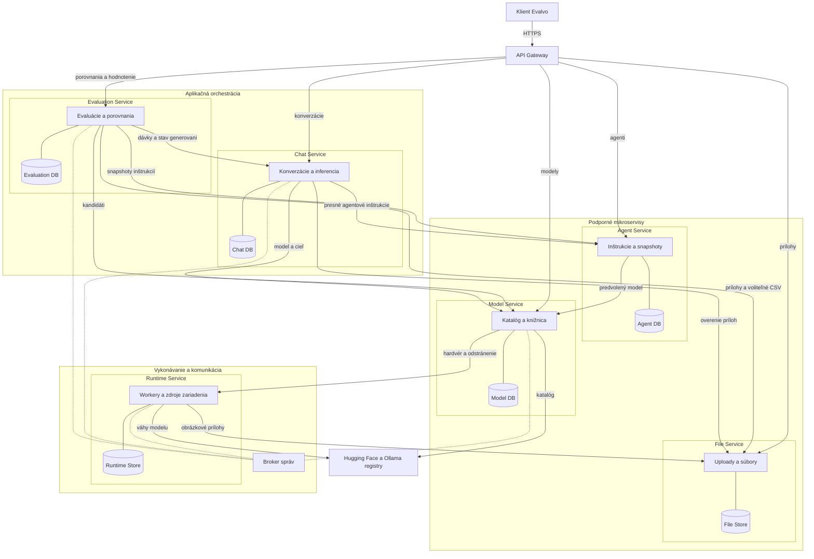

# Mikroservisná architektúra – Zadanie 3

[Späť na zadanie](README.md) · [Endpointy](ENDPOINTY.md)

Používateľ pracuje so stiahnutými modelmi a uloženými agentmi. Kandidát je konkrétna kombinácia modelu, inštrukcií a parametrov. Všetky vetvy dostanú spoločný vstup a zachovajú si vlastnú históriu. Používateľ po porovnaní vyberie lepší chat a uloží odpoveď. Váhy modelov zostávajú v tomto toku základné.

Plná šípka zobrazuje priame volanie a plná čiara k úložisku vlastníctvo dát. Prerušované spojenia zobrazujú komunikáciu cez broker. Presný smer príkazov a udalostí je uvedený v tabuľke nižšie.

## Služby a vlastníctvo dát

| Mikroservis | Čo má robiť v tomto pohľade | Vlastné dáta |
| --- | --- | --- |
| Model Service | Sprístupní základné stiahnuté modely a ich schopnosti; kontroluje kompatibilitu a dostupnosť. | Model DB: metadáta modelov, device_id, runtime_model_id a stav download_id. |
| File Service | Prijíma obrázky k spoločnému promptu a voliteľné CSV pre dávkové agentové testy. | File DB a súkromný File Store: metadáta a používateľské prílohy. |
| Agent Service | Uloží inštrukcie a predvolený model. Pri začatí kola vytvorí nemenný agent_snapshot_id, aby úprava profilu počas vykonávania nezmenila porovnanie. | Agent DB: profily a agent_snapshot_id s presným obsahom inštrukcií. |
| Evaluation Service | Vlastní porovnania, kandidátov, kolá a preferencie. Pripraví izolované konverzácie, zachytí snapshoty agentov, spustí dávku a uloží výber lepšej odpovede. Rovnaká služba podporuje aj automatický agentový beh nad taskovou sadou. | Evaluation DB: prípady, referencie, run_id, comparison_id, výsledkové projekcie a voľby používateľov. |
| Chat Service | Načíta presné agentové inštrukcie a kontext každej vetvy, zostaví prompt a prijme generovania. Jedna odpoveď sa neposiela ostatným kandidátom. | Chat DB: história, generation_id, snapshot vstupu, tool_calls a cenové položky. |
| Runtime Service | Vykoná lokálnu inferenciu kandidátov so zvolenými inštrukciami a vráti skutočné výstupy a meranie spotreby. | Runtime DB a Runtime Store: lokálne váhy a aktívne inferenčné vykonania. |

## Volania medzi službami

| Volajúca služba | Cieľ | Endpointy | Úloha volania |
| --- | --- | --- | --- |
| Agent Service | Model Service | `GET /api/v1/models/{model_id}` | Overiť model zvolený ako predvolený pre profil agenta. |
| Evaluation Service | Agent Service | `GET /api/v1/agents/{agent_id}`, `POST /internal/v1/agent-snapshots` | Overiť dostupnosť profilu pri vytvorení porovnania a zachytiť jeho inštrukcie pri spustení kola. |
| Chat Service | Agent Service | `GET /internal/v1/agent-snapshots/{snapshot_id}` | Použiť presne zachytený obsah pri generovaní, nie neskôr upravený profil. |
| Chat Service | Agent Service | `POST /internal/v1/agent-snapshots` | Zachytiť profil aj pri bežnom generovaní s agent_id mimo evaluácie. |
| Evaluation Service | Chat Service | `POST /api/v1/conversations` | Pri vytvorení porovnania založiť samostatnú konverzáciu pre každého kandidáta. |
| Evaluation Service | Chat Service | `POST /internal/v1/generation-batches` | Prijať jedno porovnávacie kolo so spoločným vstupom, samostatnými kontextmi a agent_snapshot_id. |
| Evaluation Service | Chat Service | `GET /api/v1/generations/{generation_id}`; `GET /api/v1/conversations/{conversation_id}/usage` | Zosúladiť výsledky a zostaviť spotrebu jednotlivých porovnávaných chatov. |
| Evaluation Service | Model Service | `GET /api/v1/models/{model_id}` | Overiť kandidátov a podporu obrázkov alebo parametrov. |
| Evaluation Service | File Service | `POST /internal/v1/files/resolve`; `GET /api/v1/files/{file_id}/content` | Overiť spoločné prílohy a v dávkovom režime načítať CSV. |
| Chat Service | Model Service a File Service | `GET /api/v1/models/{model_id}`; `POST /internal/v1/files/resolve` | Vykonať rovnaké vstupné kontroly ako pri bežnej konverzácii. |
| Model Service | Runtime Service | `GET /internal/v1/devices/{device_id}/hardware`; `DELETE /internal/v1/runtime-models/{runtime_model_id}` | Overiť zariadenie a spravovať lokálne váhy. |
| Runtime Service | File Service | `GET /api/v1/files/{file_id}/content` | Načítať obrazový vstup príslušnej vetvy. |

Verejné trasy `/api/v1` volajú interné služby priamo na vlastníka kontraktu. `GET /api/v1/hardware` vlastní Model Service a načítava skutočné zdroje zariadenia z Runtime Service. Navrhnuté trasy `/internal/v1` a externé adaptéry majú samostatné rozhrania.

## Príkazy a udalosti

| Producent | Konzument | Správa | Úloha |
| --- | --- | --- | --- |
| Model Service | Runtime Service | `model.download.requested` | Stiahnuť presnú revíziu a variant na device_id. |
| Runtime Service | Model Service | `model.download.progress`, `model.download.completed`, `model.download.failed` | Priebeh a výsledok so záznamom runtime_model_id. Knižnicu aktualizuje Model Service. |
| Chat Service | Runtime Service | `runtime.inference.requested` | Vykonať pripravené lokálne generovanie. |
| Runtime Service | Chat Service | `inference.completed`, `inference.requires_tool_results`, `inference.failed` | Vrátiť odpoveď, volania nástrojov, použitie tokenov alebo chybu. Chat Service uloží stav a históriu. |
| Chat Service | Evaluation Service | `generation.completed`, `generation.failed` | Priradiť výsledok ku kandidátovi, testu alebo porovnávaciemu kolu. |

## Hlavný tok

1. Stiahnuť kompatibilné modely, pripraviť agentové profily cez `POST /api/v1/agents` a podľa potreby ich použiť v bežnej konverzácii.
2. Vytvoriť kandidátov cez `POST /api/v1/comparisons`. Každý kandidát dostane samostatnú konverzáciu.
3. Odoslať spoločný text alebo obrázok cez `POST /api/v1/comparisons/{comparison_id}/messages`. Pri prijatí kola sa uloží použitá verzia agentových inštrukcií.
4. Načítať odpovede kola, uložiť preferenciu cez `PUT /api/v1/comparisons/{comparison_id}/turns/{turn_id}/preference` a skontrolovať spotrebu jednotlivých vetiev.

Agent Service zachytí obsah inštrukcií pri spustení kola. Chat Service pracuje s `agent_snapshot_id` a vlastnou históriou každej vetvy. Zmena profilu sa použije pri ďalšom kole.

Voliteľný automatický tok nad CSV využíva [API zadania 2](../Zadanie%202%20-%20Modely%2C%20Pou%C5%BE%C3%ADvanie%2C%20Evalu%C3%A1cia%20%C3%BAlohy/API.md). Kandidát v tomto rozšírení nesie aj `agent_id`. Evaluation Service zmrazí jeho inštrukcie pri štarte behu a na výsledok použije referenčné pravidlo hodnotenia.

## Spoločné pravidlá

Každá doménová služba vlastní svoje údaje a má vlastné prístupové oprávnenia. Brána overí vstupnú identitu a smeruje požiadavku. Pri čítaní a zápise doménové služby overujú prístup k vlastným zdrojom.

Runtime Service reportuje zdroje konkrétneho zariadenia podľa `device_id`. Na prenášanie príkazov a výsledkov sa používa broker. Veľké súbory zostávajú v úložiskách a správy prenášajú ich identifikátory. Producent trvalo zapisuje prácu a udalosť pomocou outboxu. Konzument opakovanú správu rozpozná podľa `message_id` a ID vykonania.
